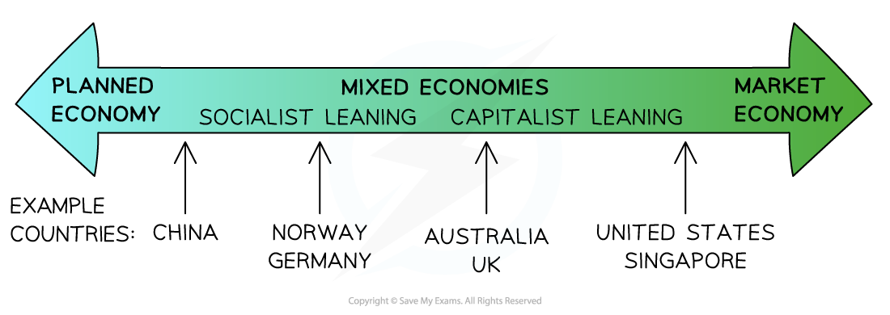

# Types of Economic Systems

## An introduction to economic systems

> **Spec point** — `spcpt_PRBvFGHtQvSvbmSj`

## An introduction to economic systems

- In order to solve the basic economic problem of **scarcity**, economic systems emerge or are created by different economic agents within the economy

  - These agents include **consumers, producers, the government, and special interest groups** (e.g. environmental or trade unions)
  - The economic system aims to allocate the **scarce factors of production**
- Any economic system needs to decide how to answer the **three fundamental economic questions**

  - **What to produce?** More weapons for the military, or more schools to educate the children?
  - **Who to produce for?** Only those who can afford to pay for it? Or for everyone in society?
  - **How to produce it?** Should more labour be used, or should the economy focus on using technology instead?
- An economy can be considered to be a free market, ***mixed*** or ***planned*** economy

  - The type of economy is determined by how the **three economic questions** are answered
  - This ultimately determines the **amount of government intervention** in an economy

*The spectrum of economic systems and where certain economies fall based on the degree of government intervention*

- North Korea is a planned economy
- The United States, Japan and Singapore are mixed economies but have less government intervention than Norway, Germany or China

## Decision making and resource allocation In market economies

> **Spec point** — `spcpt_tBwJpjpkC5SpfWQT`

## Free-market economies

- A **market economy **is an economy that has **no government intervention** in the allocation of resources and distribution of goods or services

  - This is also called a **free market economy**
  - There is no purely free market economy in the world but some countries have **less government intervention** than others

#### Characteristics of a market system

| **Characteristic** | **Explanation** |
|---|---|
| **Property ownership** | - Individuals have the right to **purchase the factors of production** |
| **Freedom of choice** | - **Individuals** are free to start their own business - **Firms** are free to decide what they are going to produce, how, and for whom - **Workers** are free to decide who they are going to work for - **Consumers **decided what goods and services best meet their wants and needs |
| **Self-interest is maximised** | - Entrepreneurs maximise **profits** - Workers maximise **wages** - Consumers maximise their well-being |
| **Limited government intervention** | - A pure market economy has no government intervention - Most free market economies have a **low level of intervention,** usually in the form of ***taxation***, provision of defence, healthcare and education |
| **Price mechanism allocates resources** | - Changes in prices **allocate scarce resources** - Rising prices indicate a **shortage** of resources and falling prices indicate a **surplus** of resources |

### The price mechanism plays a central role in resource allocation

- When firms produce more than consumers demand, a surplus occurs
- This surplus leads to falling prices, encouraging more purchases
- Lower prices may cause firms to reduce production
- As supply drops, prices begin to rise again
- Higher prices attract firms back into the market, increasing supply
- This cycle continues, helping balance supply and demand
- The government’s role is limited to monitoring the system and stepping in only when the market fails to allocate resources efficiently

## Decision making and resource allocation in planned economies

> **Spec point** — `spcpt_Yzd2znSY2nVnftGq`

## Planned economies

- A** planned economy** is an economy in which all of the resources are owned by the state and the **government controls the distribution of goods and services**

  - Karl Marx believed that free markets lead to **capitalism,** in which the owners of the factors of production (Capitalists) **exploited the workers**
  - This creates **inequality,** which will lead to a breakdown between the classes
  - The role of the State is therefore to share the **means of production and ownership** with all of the workers in society
  - This required the abolition of **private property**
  - This required the State to become the **central planner**, deciding how each of the **three economic questions **would be answered

#### Characteristics of a planned economy

| **Characteristic** | **Explanation** |
|---|---|
| **State ownership** | • Most land and capital are owned by the government |
| **Central planning** | • The government sets production targets and allocates resources |
| **Price and wage controls** | • Prices and wages are fixed by the state |
| **Limited market forces** | • Supply and demand play little or no role |
| **Subsidies for essentials** | • Essential goods are kept cheap through subsidies |
| **Risk of shortages** | • Fixed prices can cause excess demand and long queues |
| **Small private sector** | • Private ownership limited to small businesses |

### Decisions about the allocation of resources

- In such economies, **choices **about **what** goods and services to produce, **how **to produce them, and **who** receives them are made by **central authorities**
- Planning boards and government agencies oversee production, and **consumer preferences are managed centrally rather than by market forces**
- Governments in planned economies often pursue rapid development to match the progress of more advanced market economies
- Today, few countries operate under this model, with **Cuba** and **North Korea **being notable examples

  - Socialist-leaning nations like Albania and Vietnam share some features but are not fully planned economies

## Decision making and resource allocation In mixed economies

> **Spec point** — `spcpt_DKpV79yb3MhZn94Y`

## Mixed economies

- A **mixed economic system** is a blend of a ***market ***and ***planned economy***

  - Individuals, firms and the government **own factors of production** and distribute goods or services
  - In reality, almost every country in the world operates as a **mixed economic system**
  - Some countries have more **government intervention** than others
  
    - e.g. China has more intervention than the USA
  - The higher the level of **government intervention**, the more the economy will lean towards operating like a planned economy

| **Key thinker** |
|---|
| - **Friedrich Hayek** believed  that **planned economies** were flawed - He identified **information gaps** between what the economies actually required and what the **central planners** in planned economies were saying it required - These gaps led to **shortages** or **surpluses** of goods and services in planned economies - He felt that the** **threat to efficiency and economic growth is overly heavy **government intervention** |

### Decisions about the allocation of resources

- A mixed economy combines elements of** both private enterprise and government involvement** in managing resources
- Decisions about production and distribution are shaped by **interactions among businesses, workers, and the state, with the market mechanism playing a central role**

#### Examples

- Over the past few decades, many countries, especially those in **Central and Eastern Europe **have shifted toward** *****privatisation***

  - This transition has significantly impacted industries such as manufacturing, particularly in the UK and similar regions
- The restructuring of the **Soviet Union’s economy**, known as perestroika, marked a major shift toward market-oriented reforms
- Countries known as the Asian Tigers including **Singapore, Malaysia, the Philippines, Indonesia, and China** have pursued rapid economic development by** combining state planning with market-driven strategies**

#### Evaluating mixed economies

| **Advantages** | **Disadvantages** |
|---|---|
| - **Efficient resource allocation**    - The private sector responds to consumer demand, encouraging innovation and competition - **Government addresses market failure**    - Public goods (e.g. street lighting) and merit goods (e.g. education) are provided where the market would underprovide - **Reduces inequality**    - Governments can ***redistribute income ***through taxation and ***welfare*** to protect vulnerable groups - **Protects consumers and the environment**    - Laws and ***regulations*** can reduce external costs and ensure product safety | - **Government failure is possible**    - Decisions by the state may be inefficient or influenced by politics rather than economics - **Higher taxes**    - To fund public services and ***welfare***, taxes may be high, which can discourage work and investment - **Bureaucracy and inefficiency**    - Public sector organisations may lack profit incentives and become wasteful or slow to respond to change - **Risk of reduced *****innovation***    - Excessive regulation may limit risk-taking and creativity in the private sector |

> **Exam Hint**
> Make sure you can provide examples for different economic systems
> 
> Mixed economies can be placed along  a wide spectrum from strong government control to greater market reliance
> 
> At one end are countries like Albania, which lean heavily on centralised planning. Toward the middle are nations such as Hungary which balance both approaches. On the market-driven side are the UK and Singapore, with the USA representing the most market-oriented model
