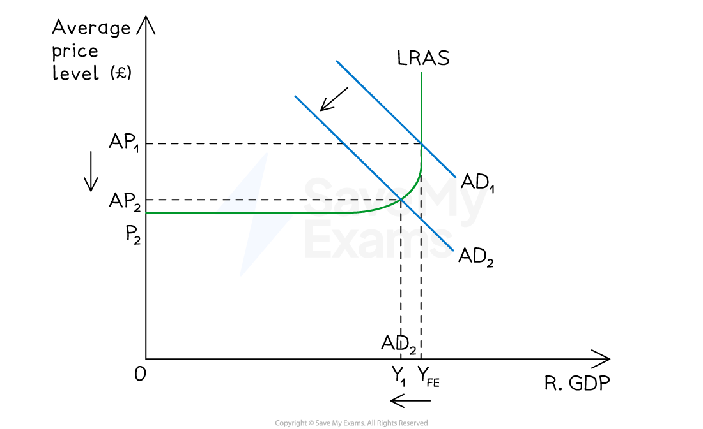
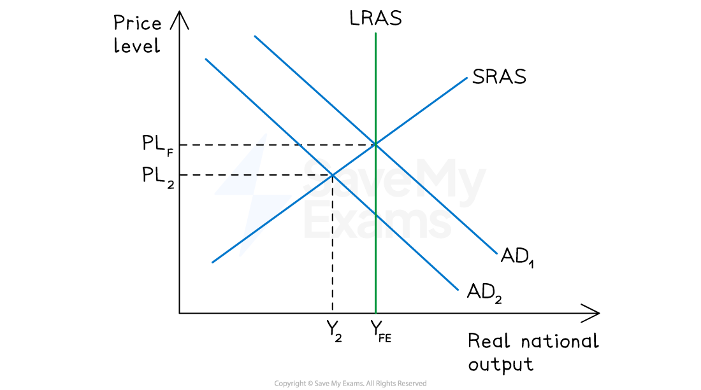

# Expansionary & Contractionary Fiscal Policy

## Expansionary fiscal policy

> **Spec point** — `spcpt_sXtPHnbWMhw5B5ZN`

## Expansionary fiscal policy

- **Expansionary fiscal policies include reducing taxes or increasing government spending with the aim of increasing AD **

  - AD = household consumption (C) + firms investment (I) + government spending (G) + exports (X) - imports (M)
  
    - **AD = C + I + G + (X - M)**
- **Expansionary fiscal policy** aims to shift aggregate demand (AD) to the** right**

*Expansionary fiscal policy which increases real GDP (Y1 →Y2) and average price levels (AP1 → AP2) *

### Diagram analysis

- The economy is initially in macroeconomic equilibrium **AP1Y1:** there is a** *****recessionary gap***
- The Government wants to boost economic growth and lowers the rate of income and corporation taxes
- **Lower taxes **cause i**nvestment and consumption **to increase, which are components of AD
- Aggregate demand increases from **AD→ AD****1**
- The economy reaches a new equilibrium at **AP****2****Y****2** - a higher average price level and a greater level of national output
- As real output rises from Y1 to Y2, firms require more workers to produce the higher level of output - **employment rises and unemployment falls**

#### Examples of the impact of expansionary fiscal policy

| **Example 1: The Government decreases corporation tax** |   |
|---|---|
| **Effect on the economy** | - Firms *net profits* increase → investment by firms increases → AD increases |
| ** Impact on macroeconomic aims** | - Economic growth increases - *Inflation* rises - Employment rises as firms expand output and hire more workers - unemployment falls - Net external demand - unsure - exports may rise due to new investments in the economy, but imports may rise due to higher income generated by the investment |

| **Example 2: The Government increases unemployment benefits** |   |
|---|---|
| **Effect on the economy** | - Household income increases → *consumption* increases → AD increases |
| **Impact on macroeconomic aims** | - Economic growth increases - Inflation rises - Employment rises as output increases and firms demand more labour - though the income effect of higher benefits may reduce labour supply at the margin, partially offsetting this - Net external demand is unlikely to change as this policy helps the poorest and imports are unlikely to increase - Redistribution of income has increased and there is more *equity* in society |

## Contractionary fiscal policy

> **Spec point** — `spcpt_5yXCxT73rYSF2FMD`

## Contractionary fiscal policy

- **Contractionary fiscal policies include increasing taxes or decreasing government spending with the aim of decreasing AD  **

  - AD= household consumption (C) + firms investment (I) + government spending (G) + exports (X) - imports (M)
  
    - **AD = C + I + G + (X - M)**
- Changes to fiscal policy can influence government spending or consumption or investment

  - Changing taxation can influence household consumption and the investment by firms
- Contractionary fiscal policies aims to shift aggregate demand (AD) to the **left**

*Contractionary fiscal policy on a Keynesian supply curve*

*Contractionary fiscal policy on a classical diagram*

### Diagram analysis

- The economy is initially in macroeconomic equilibrium **AP****1****Y****FE** - an *inflationary output gap* is developing
- The economy is booming and the Government wants to lower inflation towards its target of 2%
- The Government increases the **rate of income tax**
- Higher tax rates cause households to have less *discretionary income*, causing consumption to decrease
- Aggregate demand decreases from **AD1→ AD2**
- The economy reaches a new equilibrium at **AP****2****Y****1**** **- a lower average price level and a smaller level of national output
- As real output falls from YFE to Y1, firms require fewer workers - **employment falls and unemployment rises**

#### Examples of the impact of contractionary fiscal policy

| **Example 1: The Government increases the rate of income tax** |   |
|---|---|
| **Effect on the economy** | - Households pay **more tax** → discretionary income reduces → consumption reduces → AD reduces |
| **Impact on macroeconomic aims** | - Economic growth slows down - Inflation eases - Employment falls as firms reduce output and demand less labour - unemployment rises - Net external demand Improves (with less income, imports may fall) |

| **Example 2: The Government freezes/reduces public sector workers pay** |   |
|---|---|
| **Effect on the economy** | - Wages *stagnate* or fall → real household purchasing power falls → consumption decreases → AD decreases |
| **Impact on macroeconomic aims** | - Economic growth slows down - Inflation eases - Employment falls as output contracts and firms reduce their demand for labour - unemployment rises - Net external demand improves (with less income, imports may fall) |

| **Example 3: The Government cuts Government Spending in their Budget** |   |
|---|---|
| **Effect on the economy** | - Less demand for goods/services → less income for firms → output and profits decrease → AD decreases |
| **Impact on macroeconomic aims** | - Economic growth slows down - Inflation eases - Employment falls as output contracts and firms reduce their demand for labour - unemployment rises - Net external demand may Improve (with less income, imports may fall) - Less *corporation tax* available for redistribution |

> **Worked Example**
> The government of a country plans to raise income tax rates. The initial equilibrium for the country is represented by point X on the diagram.
> 
> 
> 
> **Which new equilibrium point would an economist predict as the result?**
> 
> A    B    C    D
> 
> **Final answer:** **Answer: D**
> 
> **Step 1: Work out which curve shifts, and which way**
> 
> - Raising income tax is **contractionary fiscal policy**. It reduces households' disposable income, so consumption (C), a component of AD, falls.
> - AD shifts left, from AD₁ to AD₂.
> - The AS curve does not shift, because income tax does not directly affect firms' costs of production.
> 
> **Step 2: Find the new equilibrium**
> 
> - The new equilibrium is where the new AD curve (AD₂) crosses the original AS curve (AS₁).
> - It must be to the left of X, because real national income is lower.
> - The price level must also be lower, because AD has fallen along the same AS curve.
> - Point D is the only point where AD₂ meets AS₁, so **D is the correct answer**.
> 
> **Ruling out the wrong answers**
> 
> - **A:** This is where AS₁ meets AD₃. It would need AD to *rise*, which comes from expansionary policy such as an income tax cut, not an income tax rise.
> - **B:** This is where AD₁ meets AS₂. AD hasn't moved here and AS has shifted right, which is the opposite of what an income tax rise does.
> - **C:** This is where AD₂ meets AS₂. AD falls correctly, but C also needs AS to shift right, and income tax does not shift AS.
> 
> **The effect on all three variables**
> 
> - **Real output falls:** national income is lower.
> - **The price level falls:** inflationary pressure eases.
> - **Employment falls:** firms produce less and need less labour, so unemployment rises.
> 
> **The trap is option C.** Students who correctly shift AD left may also shift AS without a reason. C sits on the right AD curve (AD₂) but the wrong AS curve (AS₂). At AS Level, the main effect of income tax is on households' disposable income, and therefore on AD, not on productive capacity. Only one curve should move here.

> **Exam Hint**
> Always identify which curve shifts and why before locating the new equilibrium. Fiscal policy operates primarily through AD: tax cuts and spending increases shift AD right; tax rises and spending cuts shift AD left. The AS curve only shifts if the policy directly affects costs of production or productive capacity. Higher income tax can reduce the incentive to work, but unless the question points you towards this, treat a change in income tax as an AD shift only.
> 
> For the impact on all three variables, use the following framework when the AS curve slopes upwards: a rightward AD shift raises real output, raises the price level and raises employment; a leftward AD shift does the opposite.
> 
> The slope of the AS curve affects the size of each change. The flatter the AS curve, the larger the effect of an AD shift on output and the smaller the effect on the price level. The steeper the AS curve (as the economy nears full capacity), the smaller the output effect and the larger the price effect. If a question uses the Keynesian LRAS, remember the extremes: on the horizontal section, the price level barely changes; on the vertical section, only the price level changes.

## Fiscal policy and aggregate supply

> **Spec point** — `spcpt_4Qc5Vsd5s36Y9KR9`

## Fiscal policy and aggregate supply

- Many **fiscal policies** have the ability to improve the **productive potential (supply-side) **of an economy

  - E.g. Education *subsidies* to help the poorest households constitute an annual expenditure for the government
  - However, in the long term, they help to **improve human capital,** which boosts productivity and output
  - The fiscal policy is short-term (annually); however, the supply-side impact occurs in the long term
