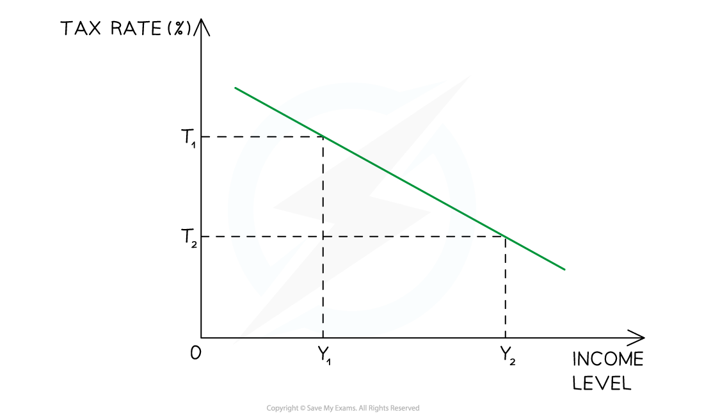
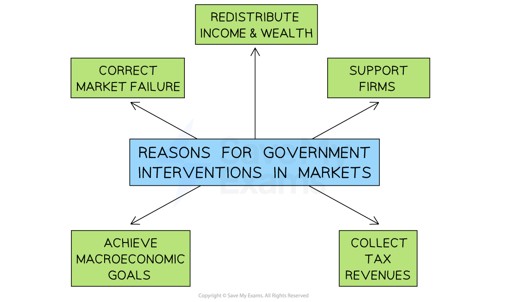

# Taxation

## Types of taxes

> **Spec point** — `spcpt_jCmCVY92QT4XDntj`

## Types of taxes

- The main source of government revenue is **taxation**
- **Direct taxes are taxes imposed on income and profits**

  - They are **paid directly** to the government by the individual or firm
  
    - E.g., income tax, corporation tax, ***capital gains tax***, national insurance contributions and inheritance tax
- **Indirect taxes are imposed on spending**

  - The **less **a consumer spends, the** less indirect tax** they pay
  - Examples of indirect tax include **Value Added Tax **(19% VAT rate in the European Union in 2022), taxes on ***demerit goods*** and excise duties on fuel

### Progressive, regressive and proportional tax systems

- Tax systems can be classified as **progressive**, **regressive **or **proportional**
- Most countries have a **mix** of progressive **(direct taxation)** and regressive **(indirect taxation)** taxes in place

#### Progressive tax system

- As income rises, **a larger percentage** of income is paid in tax
- In the diagram, when personal **income rises** from Y1 to Y2, the **tax rate rises** from T1 to T2

#### Regressive tax system

*Regressive taxation*

- **Indirect taxes are regressive in terms of proportion of income**

  - A high earner and a low earner pay the same absolute amount of *VAT* on a good, but it represents a larger share of the low earner's income.
  
    - As income rises, **a smaller percentage** of income is paid in tax
- In the diagram, when personal **income rises** from Y1 to Y2, the **tax rate falls** from T1 to T2
- All indirect taxes are regressive
- In the USA, **Federal income tax** is progressive but almost all **State taxes** are regressive (the bottom 20% of income earners pay as much as 6x the % of their income than the top 20%)

#### Proportional tax system

*A proportional tax system*

- As income rises, **the same percentage **of income is paid in tax
- In the diagram, when personal **income rises **from Y1 to Y2, the tax rate remains constant at 20%
- In 2022, Bolivia was using this system with a **proportional tax** rate of 13%

> **Exam Hint**
> Never confuse **direct and indirect** taxes with **progressive and regressive** - these are separate classifications. Income tax is both direct and progressive. VAT is both indirect and regressive.
> 
> A tax can be direct and proportional (like Bolivia's flat income tax) or indirect and regressive (like *fuel duty*). Always state both classifications when describing a tax.
> 
> For marginal and average rate calculations, always work through the tax bands in order and calculate each band separately before summing. The most common error is applying the highest marginal rate to total income rather than only to the income within that band. The average rate will always be lower than the highest marginal rate in a progressive system.

## Marginal and average rates of taxation (mrt, art)

> **Spec point** — `spcpt_Hy7w8DrycdYfbQBT`

## Marginal and average rates of taxation (mrt, art)

- **Marginal rate of tax (MRT) is the proportion of each additional dollar of income taken in tax - the rate paid on the last unit of income earned**

  - In a progressive tax system, marginal tax rates increase as income increases
- **Average rate of tax (ART) is the proportion of total income taken in tax - total tax paid divided by total income**
- **Direct tax rate calculations** usually focus on the calculation of **marginal and average tax rates **from a set of data provided
- Average tax rates are calculated using the following formula

$\mathrm{Average} \mathrm{tax} \mathrm{rate}=\frac{\mathrm{total} \mathrm{taxes} \mathrm{paid}}{\mathrm{total} \mathrm{income}}x100$

> **Worked Example**
> Using information from the table below, calculate the average tax rate paid by an employee who earns \$25,000 a year.
> 
> **[4 marks]**
> 
> | **Income (\$ per year)** | **Rate of Income Tax** |
> |---|---|
> | 1 - 10,000 | 5% |
> | 10,001 - 18,000 | 10% |
> | 18,001 - 35,000 | 20% |
> | 35,001 and over | 30% |
> 
> **Answer:**
> 
> **Step 1: Calculate the tax paid on the first \$10,000**
> 
> 5% x 10,000 = \$500
> 
> **Step 2:** **Calculate the tax paid on income between \$10,001 - \$18,000**
> 
> 10% x \$7,999 = \$799.90
> 
> **Step 3: Calculate the tax paid on income between \$18,001 and \$25,000 (the employees income)**
> 
> 20% x 6,999 = \$1,399.80 **[1 mark]**
> 
> **Step 4: Add the marginal tax paid together to obtain the total tax bill for the employee**
> 
> \$500 + \$799.90 + \$1,399.80 = \$2,699.70** [1 mark]**
> 
> **Step 5: Calculate the average rate of tax for the employee**
> 
> `Error converting from MathML to accessible text.`**[1 mark]**
> 
> **Step 6: Present your answer rounded to two decimal places**
> 
> Average tax rate = 10.80%** [1 mark]**

## Reasons for taxation

> **Spec point** — `spcpt_8Nxb47MSc8vcWxTZ`

## Reasons for taxation

- Nearly every economy in the world is a ***mixed economy*** and has varying degrees of **government intervention**
- One of the **main reasons** that governments tax  is to **correct **various **market failures**

*Government intervention in mixed economic systems*

- **To raise revenue**

  - The primary purpose of most taxes is to fund government expenditure on *public goods*, *merit goods* and *transfer payments*
  - Without tax revenue, governments could not provide national defence, education, healthcare or social security
- **To redistribute income and wealth**

  - Progressive taxes take a higher proportion of income from higher earners, reducing inequality and improving *equity*
  - Income tax and *inheritance tax* are used explicitly for this purpose in most economies
- **To correct market failure**

  - Indirect taxes on *demerit goods* and goods generating negative externalities aim to internalise external costs and reduce consumption towards the socially optimal level
  - Examples include taxes on tobacco, alcohol and *carbon emissions*
- **To discourage certain behaviours**

  - Closely related to market failure correction, governments use taxation to reduce consumption of harmful goods where the social cost exceeds the private cost
- **To manage aggregate demand and achieve macroeconomic objectives**

  - Taxation is a tool of fiscal policy; raising taxes reduces household *disposable income* and firm profits, contracting aggregate demand during periods of high inflation

> **Case Study**
> ** Reasons for taxation - carbon taxes in Sweden**
> 
> **The context**
> 
> Sweden introduced one of the world's first carbon taxes in 1991, initially set at approximately \$30 per tonne of CO₂. By 2023 it had risen to approximately \$130 per tonne - the highest carbon tax rate in the world.
> 
> 
> 
> **Actions taken**
> 
> - The tax raised the private cost of burning *fossil fuels*, bringing it closer to the social cost by internalising the negative externality of carbon emissions
> - Revenue was used to reduce income taxes and fund *renewable energy* investment - simultaneously correcting market failure and redistributing fiscal resources
> 
> **Outcomes**
> 
> - Sweden's carbon emissions fell by approximately 27% between 1991 and 2020, while real GDP grew by over 75% - demonstrating that environmental taxation need not harm growth
> - The tax illustrates three reasons for taxation simultaneously - correcting market failure, raising revenue for public investment, and managing aggregate demand
> - However the tax is regressive in impact - lower-income households spend a higher proportion of income on heating and transport, bearing a disproportionate burden - illustrating the equity-efficiency trade-off in environmental taxation
