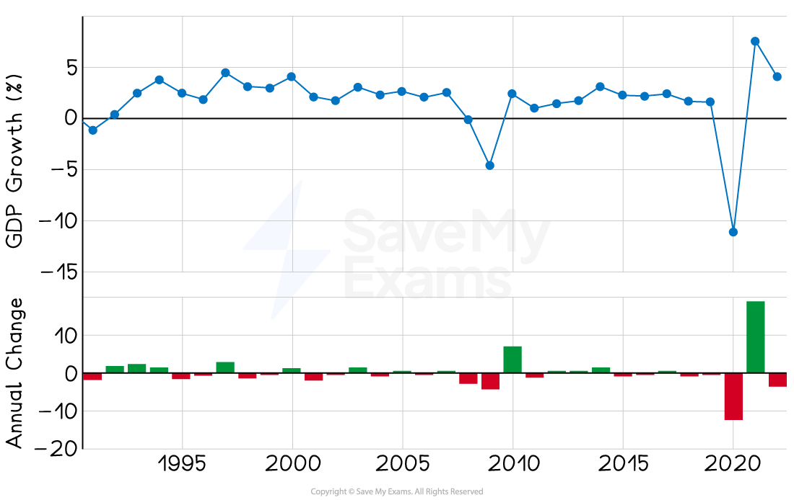
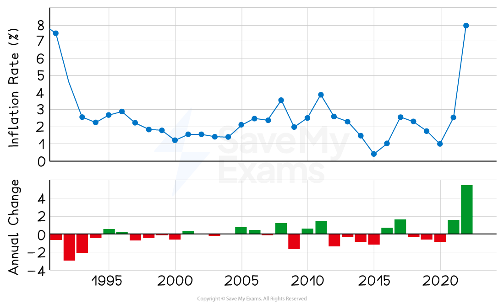
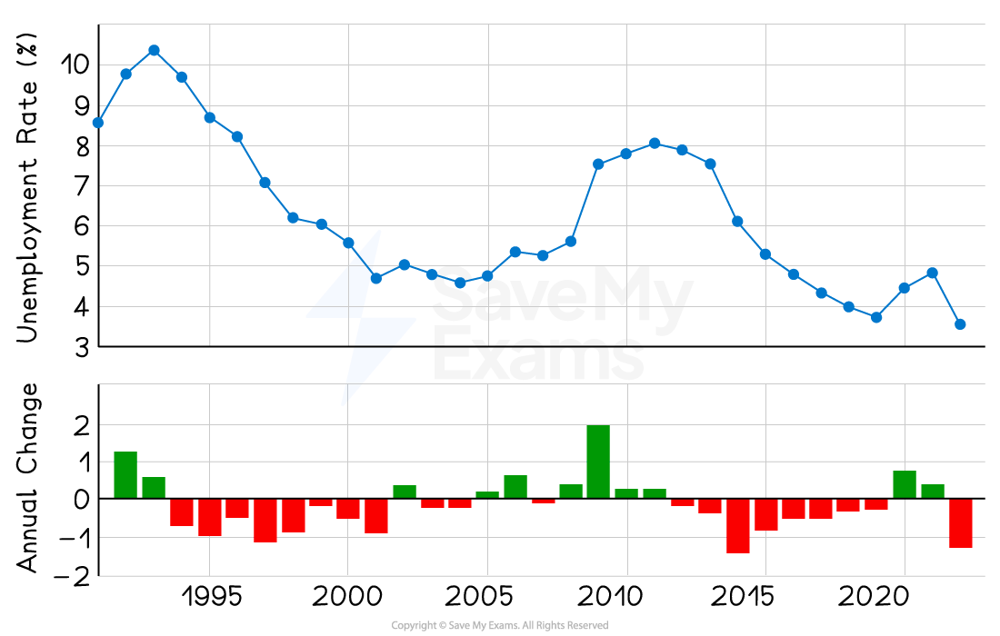
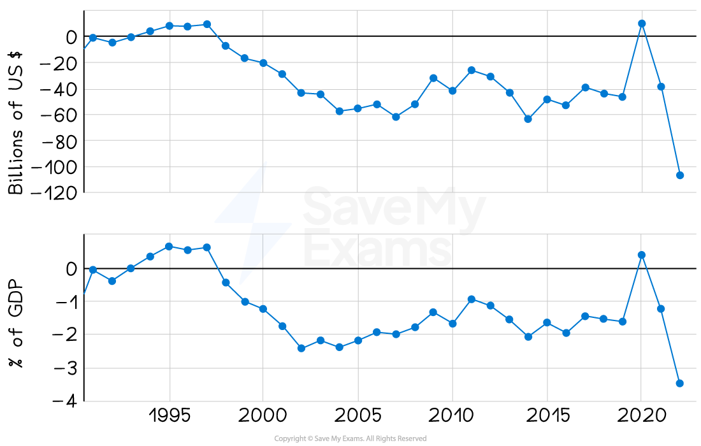

# Common Policy Objectives

## Introduction to macroeconomic objectives

> **Spec point** — `spcpt_mGXMHFzHHqSMVCTb`

## Introduction to macroeconomic objectives

- **Macroeconomic objectives are goals set by the government aimed at improving the overall economic performance of a country as well as the quality of life of its citizens**

  - The government aims to achieve these objectives through** **the use of ***macroeconomic policies***

- It can be difficult to achieve some **outcomes simultaneously**

  - E.g. high economic growth and stable price levels can be in conflict with one another

## Economic growth

> **Spec point** — `spcpt_3GxgqBvJJfDGVG3C`

## Economic growth

- **Economic growth is an increase in national output as measured by real GDP**

  - **Economic growth **is a central macroeconomic aim of most governments
- Many developed nations (UK included) have an annual target rate of 2–3%

  - This is considered to be **sustainable growth**
  - Growth at this rate is **less likely** to cause excessive ***demand pull inflation***
- **Politicians** often use it as a metric of the effectiveness of their **policies** and leadership
- Economic growth has **positive impacts** on confidence, consumption, investment, employment, incomes, living standards and government budgets
- **Strong** economic growth means higher incomes, lower unemployment rates and better government budgets
- ***Sustainable*** economic growth will have less demand-pull inflationary pressures or excessive **environmental** pressure

*UK economic growth rates up to 2023 (Source: Macrotrends)*

### Growth trends

- An increase in real GDP is a sign that the economy is expanding and employment is increasing
- A fall in real GDP (-11% in 2020) caused by Covid restrictions is a sign economy is contracting
- In 2021 and 2022, real GDP growth rate shows signs of recovery post-Covid restrictions

  - High inflation *r*ates also occurred during this period

#### UK Economic Growth Trends 2019–2022

| **Year** | **GDP Growth (%)** | **Economic Trends** |
|---|---|---|
| 2019 | 1.6% | Stable economic growth rate |
| 2020 | -11% | Fall in GDP growth rate ***Recession*** |
| 2021 | 7.6% | Rapid economic growth post-covid recovery |
| 2022 | 4.1% | Continued economic growth, but at a decreasing rate |

## Price stability

> **Spec point** — `spcpt_GVKNRDmKTdbY5RDT`

## Price stability

- **Inflation is a sustained increase in the average price level of goods/services in an economy**

  - The UK has a **target** **inflation** rate of 2% using the ***Consumer Price Index (CPI)***
  - A low rate of inflation is desirable, as it is a **symptom of economic growth**
- The different causes of inflation (***cost push*** or ***demand pull***) require different policy responses from the Government

  - ***Demand-side policies*** ease demand pull inflation
  - ***Supply-side policies*** ease cost push inflation

*The inflation rate in the UK from 1991 to 2024 measured using the CPI (Source: Macrotrends)*

### Inflation trends for 2015–2023

- In the period following the pandemic, inflation rates have exceeded the target rate of 2%
- The CPI peaked at around 8% in 2023
- This is due to supply chain disruptions causing ***cost-push inflation***
- Increased spending following the pandemic caused ***demand-pull inflation***
- The **Bank of England (BoE) **uses ***monetary policy*** to observe and regulate inflation rate

## Minimising unemployment levels

> **Spec point** — `spcpt_bN4C9Y98FJQFZkfr`

## Minimising unemployment levels

- The target unemployment rate for the UK is 4–5%
- This is close to the ***full employment***** level **of labour (YFE)

  - There will always be a level of ***frictional unemployment***
  - This makes it impossible to achieve 100% employment
- Within the broader** unemployment rate**, there is an **increased emphasis** on the unemployment rate within different **sections of the population**

  - E.g. **youth unemployment**, ethnic/racial unemployment by group
  
    - In 2021, black unemployment in the UK was 11% and white unemployment was 4.1%
- Low levels of unemployment are a sign of a strongly performing economy and are inversely linked to **real GDP growth **

  - When real GDP increases, unemployment falls
  - When real GDP decreases, unemployment rises

*The actual and projected unemployment rate in the UK from 1991 - 2024 (Source: Macrotrends)*

### Unemployment trends

- In the six years following the 2007 financial crisis, unemployment in the UK remained relatively high
- It declined during economic recovery in 2012, reaching lowest levels just before Covid pandemic
- However, with restrictions, unemployment rose again
- Unemployment increased from 2021 to 2022 but decreased by just over 1% in 2023

## Stable balance of payments on current account

> **Spec point** — `spcpt_SZ9zJjKWkgZqqFGx`

## Stable balance of payments on current account

- **The Balance of Payments (BoP) for a country is a record of all the financial transactions that occur between it and the rest of the world**

  - The current account focuses mainly on the financial transactions related to *exports *and *imports *of goods and services
- Governments aim for Balance of Payments equilibrium on the **Current Account**

  - If exports > imports, it will create a current account **surplus**
  - If imports > exports, it will create a current account** deficit**
  
    - Each one of these conditions has advantages and disadvantages associated with it
    - However, a current account deficit is more problematic in the long run
- The **UK **has traditionally run a small **deficit**

  - As a percentage of GDP, the UK current account deficit is insignificant and has not been problematic

*The bottom graph illustrates the trade deficit as a percentage of GDP and the top one illustrates the absolute value expressed in US$ (Source: Macrotrends)*

### Graph analysis

- The U.K. trade balance for 2019 was \$-46.14B, a 4.78% increase from 2018
- The U.K. trade balance for 2020 was \$9.69B, a 121% decline from 2019
- The U.K. trade balance for 2021 was \$-38.56B, a 498.05% decline from 2020.
- The U.K. trade balance for 2022 was \$-106.79B, a 176.91% increase from 2021
- The UK offsets its negative trade in goods with a very positive trade in services

## Sustainability

> **Spec point** — `spcpt_vx2GzRKDdBFX9dyS`

## Sustainability

- The UK government aims to ensure ***sustainable *****economic development** and reduce adverse impacts on the environment
- In April 2021, the UK Government stated that their environmental aim was to reduce emissions by **78% by 2035**

  - This reduction is based on the **emission levels of 1990**
  - It is one of the most ambitious climate change targets globally
  - It includes the UK’s share of international aviation and shipping emissions
- Broader environmental aims include

  - A focus on **sustainability**
  - The reduction of **negative externalities **of production
  - 100% energy from **renewable** sources by 2035

## Redistribution of income and wealth

> **Spec point** — `spcpt_mCHCxGzcCtqqvv6S`

## Redistribution of income and wealth

- **Equitable distribution of income and wealth ensures fairness and allows the same opportunities for everyone**
- The aim is not equality of distribution, as it removes the incentive to work and study
- High levels of income inequality can create **social unrest**
- Income inequality is measured using the ***Gini Coefficient***

#### Income Inequality for 2020 using Gini Coefficient

| **Country** | **Gini Index** |
|---|---|
| Belgium | 0.248 |
| Uk | 0.357 |
| Mexico | 0.420 |

- The higher the Gini coefficient, the more unequal the distribution of income

  - 0 = complete equality; 1 = complete inequality
  - Most developed economies have a Gini target of 0.3–0.4

- There is a need for the UK government to **intervene** to maintain acceptable levels of income inequality. Governments can redistribute income

  - Through a ***progressive tax*** system
  - Providing essential *merit goods* such as healthcare and education
