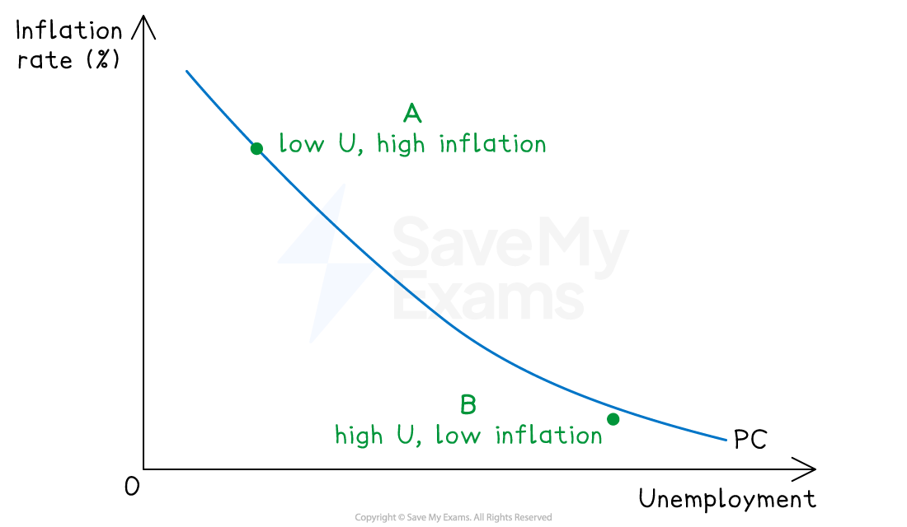
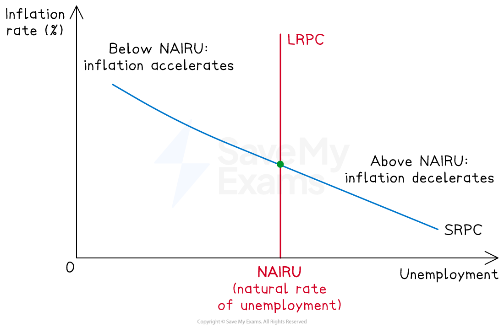
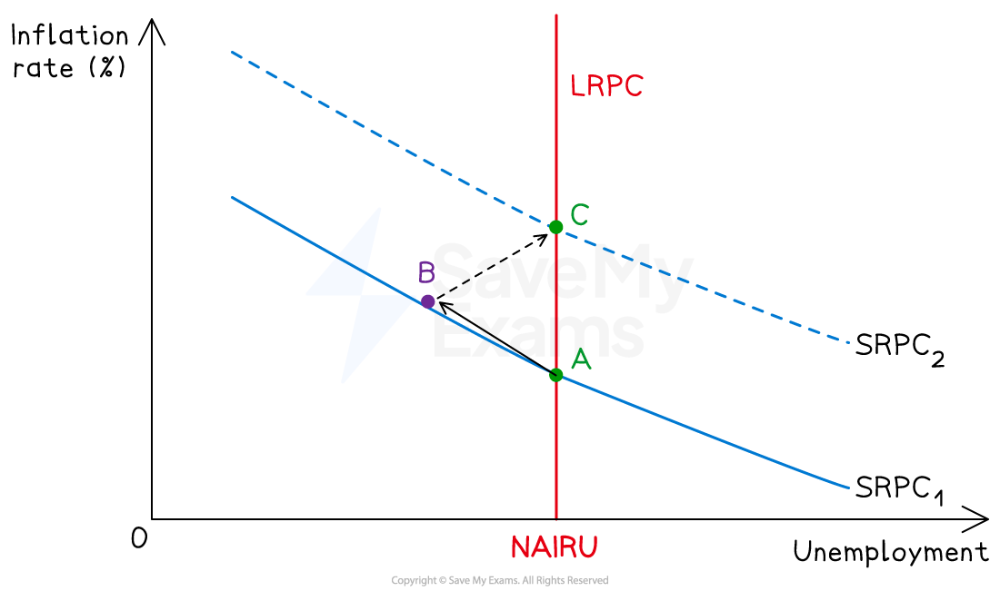

# The Phillips Curve

## The Phillips curve and the inflation-unemployment relationship

> **Spec point** — `spcpt_89VzppXQ3yxrybcd`

## The Phillips curve and the inflation-unemployment relationship

- **The Phillips curve describes the observed relationship between unemployment and inflation**
- The traditional version showed a **stable inverse trade-off**

  - The expectations-augmented version, developed after the 1970s, distinguishes a short-run trade-off from a vertical long-run curve at the natural rate of unemployment (NAIRU)

## The traditional Phillips curve

> **Spec point** — `spcpt_mfHjSnfhKByJF8sY`

## The traditional Phillips curve

- **The traditional Phillips curve, based on A.W. Phillips's 1958 study of UK data from 1861 to 1957, describes a stable inverse relationship between the rate of unemployment and the rate of wage inflation, later extended to price inflation**

### How does it work?

*Tighter labour markets push wages and prices up; looser markets bring them down*

- When unemployment is **low**, labour markets are tight - employers compete for scarce workers, bidding up wages
- Higher wages feed into higher prices as firms pass on cost increases - inflation rises
- When unemployment is **high**, the opposite occurs - workers compete for scarce jobs, wages *stagnate*, and inflation falls
- The result is a downward-sloping curve relating inflation to unemployment

#### Implications for policy

- Policymakers face a stable **trade-off** between inflation and unemployment
- Choosing a point on the curve becomes a political decision — accept higher inflation to reduce unemployment, or accept higher unemployment to reduce inflation
- The 1960s consensus (Samuelson and Solow, 1960) treated this trade-off as exploitable through monetary and fiscal policy

### Why the traditional Phillips curve broke down

- The 1970s produced **stagflation** - simultaneously high inflation and high unemployment - which the traditional Phillips curve could not explain

  - The 1973 oil shock raised production costs sharply, pushing inflation up
  - At the same time, the *recession *that followed pushed unemployment up
  - Both variables rose together, contradicting the stable inverse relationship the original curve predicted
  - This empirical failure prompted the development of the expectations-augmented Phillips curve

## The expectations-augmented Phillips curve

> **Spec point** — `spcpt_b5b7FFnRGRJpNpb8`

## The expectations-augmented Phillips curve

- **The expectations-augmented Phillips curve, developed by Milton Friedman (1968) and Edmund Phelps (1967), modifies the traditional model by incorporating inflationary expectations**

  - It distinguishes a short-run trade-off from a vertical long-run curve at the natural rate of unemployment

### The short-run Phillips curve (SRPC)

*Short-run and long-run Phillips curves. The LRPC is vertical at NAIRU - there is no long-run trade-off between inflation and unemployment*

- For any given level of inflationary expectations, there is a downward-sloping short-run Phillips curve - the standard inverse trade-off
- Workers and firms set wages and prices based on **expected** inflation

  - If actual inflation differs from expected, real wages and unemployment are temporarily affected
- A rise in actual inflation that exceeds expectations reduces real wages, prompting firms to hire more workers - unemployment falls below the natural rate
- This explains why the SRPC slopes downwards in the short run

#### The long-run Phillips curve (LRPC)

- **The long-run Phillips curve is vertical at the natural rate of unemployment (NAIRU) - the rate at which inflation neither accelerates nor decelerates**

  - Over time, workers and firms adjust their expectations to actual inflation
  - Once expectations have fully adjusted, the temporary effect on real wages disappears - unemployment returns to its natural rate
- This means there is **no long-run trade-off** between inflation and unemployment - only the short-run one
- The LRPC is therefore vertical at the NAIRU, regardless of the inflation rate

## How attempts to exploit the trade-off fail

> **Spec point** — `spcpt_DtBJTt2BxQZf6W5N`

## How attempts to exploit the trade-off fail

- The expectations-augmented theory predicts that **any attempt by policymakers to push unemployment below the NAIRU through expansionary policy will fail in the long run**

*Expectations augmented Phillips Curve*

- Initially, expansionary monetary policy raises AD, and inflation rises, real wages fall, unemployment falls below NAIRU
- The economy moves up the SRPC from point A to point B
- Workers observe the higher inflation and revise their expectations upwards
- The SRPC shifts upwards as inflation expectations rise
- Real wages return to their original level, firms reduce hiring, and unemployment returns to the NAIRU - but at a higher rate of inflation (point C)
- Any further attempt to reduce unemployment below NAIRU repeats this process - the SRPC shifts up again, locking in higher inflation without lasting employment gains

#### The natural rate of unemployment (NAIRU)

- **NAIRU stands for the Non-Accelerating Inflation Rate of Unemployment**

  - **This is the level of unemployment consistent with stable inflation**
  
    - Below NAIRU, inflation accelerates as expectations rise
    - Above NAIRU, inflation decelerates as expectations fall
    - The NAIRU is determined by **structural factors** such as *labour market flexibility*, skills mismatch, *frictional unemployment*, regulation
    - Reducing the NAIRU itself requires **supply-side policies** (training, *deregulation*, improved job matching) rather than demand-side stimulus

### Comparing the two theories

| Feature | Traditional Phillips curve | Expectations-augmented Phillips curve |
|---|---|---|
| Shape | - Single downward-sloping curve | - Downward-sloping SRPC + vertical LRPC at NAIRU |
| Trade-off in long run | - Stable and exploitable | - None - No long-run trade-off |
| Role of expectations | - Implicit, not modelled | - Central - Drives shifts in SRPC |
| Implication for monetary policy | - Can permanently reduce unemployment by accepting higher inflation | - Can only temporarily reduce unemployment; long-run effect is higher inflation only |
| How to reduce unemployment permanently | - Expansionary demand-side policy | - Supply-side policies that lower NAIRU |
| Explained by 1970s stagflation? | - No - Predicted inflation and unemployment to move inversely | - Yes - Supply shocks and expectations explain simultaneous high inflation and unemployment |

#### Why the disagreement matters for policy

- Under the **traditional view**, monetary policy is a powerful tool, as *central banks* can fine-tune the inflation-unemployment mix
- Under the **expectations-augmented view**, monetary policy can only manage **inflation expectations** in the long run; unemployment is determined by supply-side conditions
- Modern central banks largely **operate under the expectations-augmented **framework

  - They target inflation explicitly (e.g. the Bank of England's 2% target) and treat unemployment as primarily a supply-side issue

> **Exam Hint**
> Use the **expectations-augmented version as the default**, not the traditional one. Strong essay answers introduce the original Phillips curve briefly, explain why it broke down in the 1970s, and then build the analysis around SRPC, LRPC, and NAIRU. Candidates who treat the traditional curve as the main framework miss the modern theoretical understanding.
> 
> Diagrams are **essential** for this topic. Mark schemes expect candidates to draw at least the SRPC and LRPC, with NAIRU labelled and the vertical LRPC at the NAIRU. A more sophisticated diagram showing SRPC shifting upwards as expectations adjust earns higher analysis marks. Show the path A → B → C clearly when discussing how attempts to exploit the trade-off fail.
> 
> Use the post-2021 global inflation episode as an evaluative anchor. Central banks raised rates aggressively in 2022–2023 to prevent inflation expectations from un-anchoring - exactly the concern the expectations-augmented framework predicts. The episode shows the framework remains influential in real-world policy, even if the precise NAIRU is uncertain.
