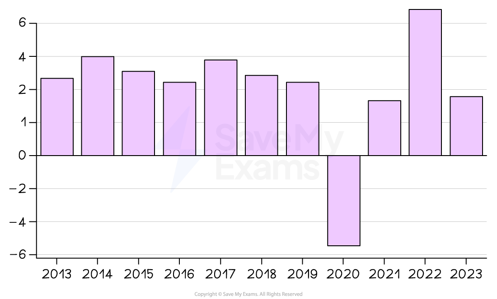
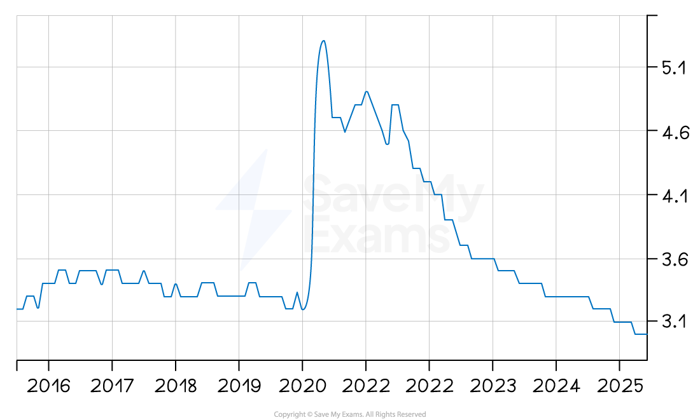
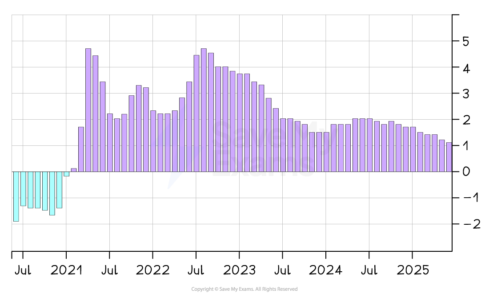

# Typical Macroeconomic Objectives

## An introduction to macroeconomic objectives

> **Spec point** — `spcpt_xzkn477XQvR2JTj7`

## An introduction to macroeconomic objectives

- **The macroeconomic objectives of government are the main long-term targets they strive to achieve to promote a healthy and sustainable economy**
- They include:

  - **Economic growth**
  
    - Increasing the total output of goods and services over time
  - **Low unemployment**
  
    - Ensuring that as many people as possible who are willing and able to work have jobs
  - **Price stability**
  
    - Keeping the general level of prices steady to protect *purchasing power*

## Economic growth

> **Spec point** — `spcpt_zWdHm6CsQsRjF6CW`

## Economic growth

- **Economic growth is an increase in national output as measured by real GDP**

  - It is a central macroeconomic aim of most governments
- Many developed nations have an annual target **growth rate of 2-3%**

  - This is considered to be **sustainable growth**
  - Growth at this rate is **less likely** to cause excessive ***demand pull inflation***
- **Politicians** often use it as a metric of the effectiveness of their **policies** and leadership
- Economic growth has **positive impacts** on the economy:

  - Rising employment and household incomes as firms expand output
  - Higher government tax revenues, allowing increased spending on *public services*
  - Improved business and consumer confidence, encouraging further investment

*Malaysia's GDP growth rate 2013 - 2023*

Source: [Macrotrends](https://www.macrotrends.net/global-metrics/countries/mys/malaysia/gdp-growth-rate) (opens in a new tab)

#### Explaining Malaysia's chart 2013 - 2023

| **2014 - 2016** | **2017 - 2019** | **2020** | **2022** |
|---|---|---|---|
| - Economic growth was increasing each year, but at a decreasing rate | - Growth increased significantly in 2017, but the following two years saw the rate of growth falling again | - As with all economies during the Covid-19 *lockdowns*, Malaysia experienced significant *recession *and a fall from +4.2% growth to - 5.8% growth | - As with most economies, Malaysia saw a significant rebound in economic growth (over 8%) during 2022 |

## Low unemployment

> **Spec point** — `spcpt_RVmHJkmR8NCQftzv`

## Low unemployment

- Someone is considered to be unemployed if they do not have a job and are **actively seeking** one
- The target unemployment rate depends on the **structure** of the economy - its degree of *labour market flexibility*, industrial composition and level of development

  - E.g. India finds a rate of 6.5% good, whereas Singapore aims for it to be under 2%
- The closer an economy is to the **full employment level **of labour, the better (more efficiently) it is using its human resources
- Within the broader** unemployment rate**, there is an **increased emphasis** on the unemployment rate within different **sections of the population**

  - For example,** youth unemployment**, ethnic/racial unemployment by group
  
    - In 2021, black unemployment in the USA was 8.7% and white unemployment was 4.7%

- Unemployment tends to be **inversely proportional to real GDP** growth

  - When ***real GDP*** increases, unemployment falls
  - When real GDP decreases, unemployment rises

*Malaysia's unemployment rate from 2015 - 2025*

Source: [Trading Economics](https://tradingeconomics.com/malaysia/inflation-cpi) (opens in a new tab)

### Chart analysis

- **2016–2019:**

  - The unemployment rate remained stable at around **3.3–3.5%**, indicating a steady labour market
- **Early 2020:**

  - Slight dip before a sharp **spike to over 5%** — most likely due to the economic disruption caused by the **Covid-19 pandemic** and lockdown measures
- **2021–2022:**

  - Gradual but uneven decline in unemployment, with small fluctuations suggesting partial recovery and intermittent economic disruptions
- **2022–2025:**

  - Continuous and steady decline, reaching around **3.1%** in 2025, indicating strong post-pandemic recovery and possible job creation from economic reopening
- **Overall trend:**

  - Long-term stability before pandemic → sharp short-term shock → gradual recovery → return to pre-pandemic unemployment levels

## Price stability ( low inflation)

> **Spec point** — `spcpt_hrJsqyQbn5HXW6tN`

## Price stability ( low inflation)

- Most economies have a **target** ***inflation*** rate of 2% using the ***Consumer Price Index (CPI)***

  - A low and stable rate of inflation is desirable as it supports economic growth by providing certainty for firms and households to plan, invest and spend with confidence
- The different causes of inflation (***cost-push*** or ***demand-pull***) require different policy responses from the government

  - ***Demand-side policies*** ease demand-pull inflation
  - ***Supply-side policies*** ease cost-push inflation

*Malaysia's rate of inflation 2020 - 2025*

Source: [Trading Economics](https://tradingeconomics.com/malaysia/inflation-cpi)(opens in a new tab)

- Malaysia experienced a **continual deviation** from the target of 2% between July 2021 and July 2023

  - An inflation rate in July 2022 of 4-5% was considered to be unstable, eroding household ***purchasing power***
- A **low and stable rate of inflation** is important, as it

  - Allows firms to **confidently plan** for future investment
  - Offers **price stability** to consumers

> **Worked Example**
> The table shows the nominal GDP growth and inflation rate in four countries.
> 
> | Country | Nominal GDP growth rate (%) | Annual inflation rate (%) |
> |---|---|---|
> | W | 2.1 | 1.9 |
> | X | -1.6 | 8.9 |
> | Y | 4.1 | 5.8 |
> | Z | -2.0 | 16.4 |
> 
> **What can be concluded from the table?**
> 
> A. W experienced the highest rate of real economic growth
> 
> B. X and Z experienced *deflation*
> 
> C. Y experienced the greatest rise in the standard of living
> 
> D. Z experienced the greatest growth in *public debt*
> 
> **Final answer:** **Answer: A - W experienced the highest rate of real economic growth**
> 
> **Worked solution**
> 
> Calculate real GDP growth for each country using:
> 
> - Real GDP growth = Nominal GDP growth - Inflation rate
> 
> | Country | Nominal GDP growth | Inflation | Real GDP growth |
> |---|---|---|---|
> | W | 2.1% | 1.9% | **+0.2%** |
> | X | -1.6% | 8.9% | **-10.5%** |
> | Y | 4.1% | 5.8% | **-1.7%** |
> | Z | -2.0% | 16.4% | **-18.4%** |
> 
> W has the highest real GDP growth rate at +0.2% - the only country where real output is actually rising.
> 
> - **Option B** is incorrect - deflation means a negative inflation rate. X and Z both have positive inflation rates (8.9% and 16.4%) - they are experiencing high inflation, not deflation
> - **Option C** is incorrect - Y's real GDP is falling (-1.7%), so living standards are declining despite nominal growth appearing positive
> - **Option D** cannot be concluded from the data given - public debt figures are not provided

> **Exam Hint**
> Always be precise about the three objectives - **price stability** does not mean zero inflation, it means a low and stable rate, typically around 2%. **Low unemployment** does not mean zero unemployment - frictional unemployment always exists in a healthy economy.
> 
> **Economic growth** must be measured in **real** terms - nominal GDP growth is meaningless as a measure of the objective if inflation is not stripped out first.
> 
> When data questions present nominal GDP and inflation figures together, always calculate real GDP growth before drawing conclusions about any of the three objectives. A country with rising nominal GDP and high inflation may be failing on all three objectives simultaneously - as countries X, Y and Z illustrate above.
