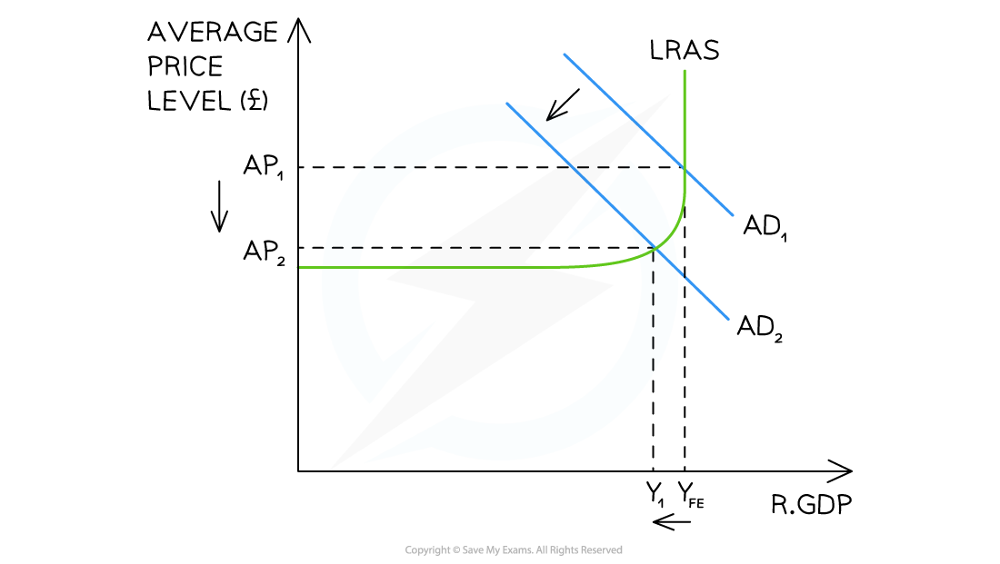

# Expansionary & Contractionary Monetary Policy

## Expansionary monetary policy

> **Spec point** — `spcpt_7mDC6Ws7Dw85XTcz`

## Expansionary monetary policy

- **Expansionary monetary policy involves reducing interest rates, increasing the money supply (including through *****quantitative easing*****), or loosening credit regulations - with the aim of increasing aggregate demand in the economy**
- To understand the **effects of monetary policy** on an economy, it is useful to know how aggregate demand ***(AD)*** is calculated

  - AD= household consumption (C) + firms investment (I) + government spending (G) + exports (X) - imports (M)
  - AD = C + I + G + (X - M)
- From this, it is logical that **changes to monetary policy** can influence any of these components - and often several of them at once

*AD/AS diagram illustrating expansionary monetary policy*

### Diagram analysis

- The economy is initially in **macroeconomic equilibrium** AP1Y1
- The Central Bank wants to **boost economic growth** and lower interest rates
- Lower interest rates cause investment and consumption to increase, which are components of AD
- Aggregate demand increases from AD1→ AD2
- The economy reaches a new equilibrium at AP2Y2 - a higher average price level and a greater level of national output
- As real output rises from Y1 to Y2, firms require more workers - **employment rises and unemployment falls**

#### An example of how expansionary monetary policy works

| **The USA Federal Reserve Bank commits to an extra \$60bn a month of QE** |   |
|---|---|
| **Effect on the economy** | - *Commercial banks* receive cash for their bonds → liquidity in the market increases → commercial banks lower lending rates → consumers and firms borrow more → **consumption and investment** increase → AD increases |
| **Impact on macroeconomic aims** | - **Economic growth** increases - ***Inflation**** *rises - Employment rises as firms expand output and demand more labour - unemployment falls - **Net external demand** worsens (with higher price levels *exports *may decrease and with rising incomes,* imports *may increase) |

> **Worked Example**
> **Which combination would represent the most expansionary set of monetary policies?**
> 
> |   | Credit availability | Interest rates | Money supply |
> |---|---|---|---|
> | A | increased | up | reduced |
> | B | increased | down | increased |
> | C | reduced | up | increased |
> | D | reduced | down | reduced |
> 
> **Final answer:** **Answer: B**
> 
> **Worked solution:**
> 
> Assess each tool against its expansionary direction:
> 
> - **Credit availability** - increasing availability makes borrowing easier, stimulating consumption and investment - **expansionary**. Options C and D reduce credit - contractionary. Eliminates C and D
> - **Interest rates** - cutting rates reduces the cost of borrowing and the return on saving, raising consumption and investment - **expansionary**. Option A raises rates - contractionary. Eliminates A
> - **Money supply** - increasing money supply puts more money into circulation, reducing interest rates and stimulating spending - **expansionary**. Option B increases money supply - confirms B
> 
> All three tools in option B point in the same expansionary direction. **The trap** is option A - two tools are expansionary but raising interest rates is contractionary, making it a mixed rather than the most expansionary combination.

## Contractionary monetary policy

> **Spec point** — `spcpt_JVyTWpcKqQWMRF9x`

## Contractionary monetary policy

- **Contractionary monetary policy involves raising interest rates, stopping/reducing quantitative easing or reducing the amount of credit, with the aim of decreasing aggregate demand in the economy**

*Keynesian diagram illustrating contractionary monetary policy*

### Diagram analysis

- The economy is initially in **macroeconomic equilibrium** AP1YFE
- The central bank is wanting to lower inflation towards its target rate
- Higher interest rates cause **investment** and **consumption** to decrease
- Aggregate demand decreases from AD1→ AD2
- As real output falls from YFE to Y1, firms require fewer workers - **employment falls and unemployment rises**
- The economy reaches a new equilibrium at AP2Y1 - a lower average price level and a smaller level of national output

#### An example of how contractionary monetary policy works

| **The Central Bank increases interest rates** |   |
|---|---|
| **Effect on the economy** | - Existing loan repayments for households become more expensive → *discretionary income* reduces → **consumption** decreases → total demand falls - Firms are less likely to borrow  → less **investment** in capital takes place → AD falls - ***Hot money flows*** increase → the *exchange rate* appreciates → exports more expensive and imports cheaper → net exports reduce → AD decreases |
| **Impact on macroeconomic aims** | - **Economic growth** slows down - **Inflation** eases - Employment falls as firms reduce output and demand less labour - unemployment rises - **Net external demand** is likely to worsen as both exports and imports reduce (exports more expensive due to higher exchange rate and imports cheaper - but households have less income for imports) |

> **Case Study**
> **Contractionary monetary policy - United States 2022-2023**
> 
> **The context**
> 
> US inflation rose to 9.1% in June 2022 - its highest level since 1981 - driven by post-pandemic demand surges, *supply chain* disruptions and rising energy prices. The Federal Reserve responded with its fastest tightening cycle in decades.
> 
> 
> 
> **Actions taken**
> 
> - The Federal Reserve raised the federal funds rate from near zero in March 2022 to 5.25-5.50% by July 2023 - eleven consecutive increases over sixteen months
> - Higher rates increased *mortgage* costs, *credit card* rates and business borrowing costs, reducing consumption and investment
> - The Fed also began reducing the quantitative easing of the pandemic period by selling bonds and withdrawing money from circulation
> 
> **Outcomes**
> 
> - Inflation fell from 9.1% in June 2022 to approximately 3.2% by October 2023 - a significant reduction achieved without triggering a *recession*
> - GDP growth slowed but remained positive throughout, and unemployment stayed below 4% - leading economists to describe it as a rare "soft landing"
> - The case illustrates that contractionary monetary policy can reduce inflation without necessarily causing large falls in output and employment - though the Fed itself acknowledged the outcome was better than most models predicted
> - It also shows all three monetary policy tools working together - higher interest rates, tighter credit conditions and reduced money supply reinforcing each other to shift AD left

> **Exam Hint**
> Always state the **full transmission mechanism** when analysing monetary policy - do not simply say "cutting interest rates increases AD." The chain must include: rates fall - cost of borrowing falls and return on saving falls - consumption and investment rise - AD shifts right - real output, price level and employment rise.
> 
> The key distinction between the three tools is that **interest rates affect the cost of borrowing, money supply affects the volume of money in circulation, and credit regulations affect the availability of borrowing**. All three shift AD but through different channels.
> 
> In an exam question asking which tool is most appropriate, consider which channel is most relevant to the economic problem described.
