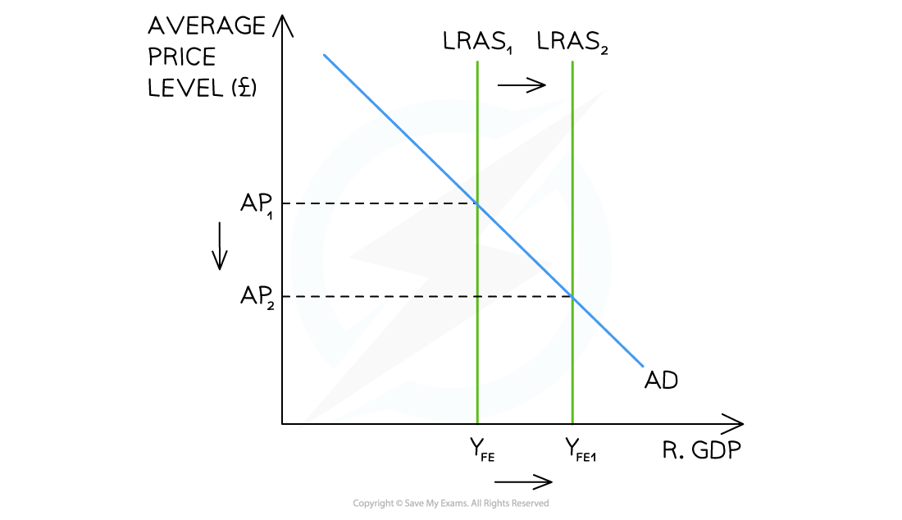

# Understanding Supply Side Policy

## What is supply-side policy?

> **Spec point** — `spcpt_ztF9mh947rDKZ9hq`

## What is supply-side policy?

- **Supply-side policy is government policy that aims to increase the productive capacity of the economy by shifting the Long Run Aggregate Supply (LRAS) curve to the right**
- Unlike fiscal and monetary policy which operate primarily through AD, supply-side policy works directly on the supply side of the economy - increasing the quantity and quality of *factors of production*

*Supply side policy aims to shift LRAS*

- A rightward shift of LRAS means the economy can produce more output at every price level

  - The potential output increases

## The objectives of supply-side policy

> **Spec point** — `spcpt_fGnF25kVjPKKQnKc`

## The objectives of supply-side policy

### 1. Increasing productivity

- **Productivity is the output produced per unit of input - most commonly measured as output per worker (labour productivity)**

  - Higher productivity means the same number of workers can produce more output - *unit costs* of production fall and the economy becomes more competitive internationally
- Productivity can be raised by improving the **quality of labour** (through education and training), improving **technology** (through *R&D* investment) or improving **management practices**

### 2. Increasing productive capacity

- **Productive capacity is the maximum output the economy can produce when all resources are fully employed - represented by the position of the LRAS curve**

  - Increasing productive capacity shifts LRAS rightward - the economy's potential output rises and the full employment level of national income increases
- This is distinct from a movement along LRAS - supply-side policy shifts the curve itself

## Tools of supply-side policy

> **Spec point** — `spcpt_SkCSSbbrtgGMjcNj`

## Tools of supply-side policy

### Education and training

- Investment in education and training raises the **human capital** of the workforce - the skills, knowledge and productivity of workers

  - Examples include government spending on schools and universities, *apprenticeship *programmes and subsidised retraining for unemployed workers
- Higher human capital raises labour productivity, reducing unit costs of production and shifting LRAS right

### Infrastructure development

- Investment in physical infrastructure - roads, railways, ports, energy networks and digital broadband - reduces the costs of doing business and improves the efficiency of the economy

  - Better transport links reduce delivery times and costs
  - A reliable energy supply reduces production disruptions
  - Fast broadband enables more efficient communication
- Infrastructure investment shifts LRAS right by raising the productive capacity available to all firms in the economy

### Support for technological improvement

- Government support for research and development (R&D) - through *subsidies*, *tax incentives* or direct public investment - encourages *innovation *and the adoption of new production technologies

  - New technology raises total factor productivity - more output from the same inputs - shifting LRAS right
  - Examples include government R&D tax credits, university-industry research partnerships and public investment in emerging technologies such as renewable energy and *artificial intelligence*

### Deregulation and competition policy

- Reducing unnecessary *regulation *lowers costs for firms and encourages new entrants to markets

  - Greater competition incentivises firms to innovate, cut costs and improve efficiency - raising economy-wide productivity
  - Examples include *deregulating *labour markets to improve flexibility, and removing barriers to entry in key industries

### Tax incentives

- Cutting *corporation tax *raises post-tax profits, increasing the incentive for firms to invest in new capital - shifting LRAS right over time
- Cutting *income tax *or reducing benefits may increase labour supply by making work more financially rewarding relative to inactivity
