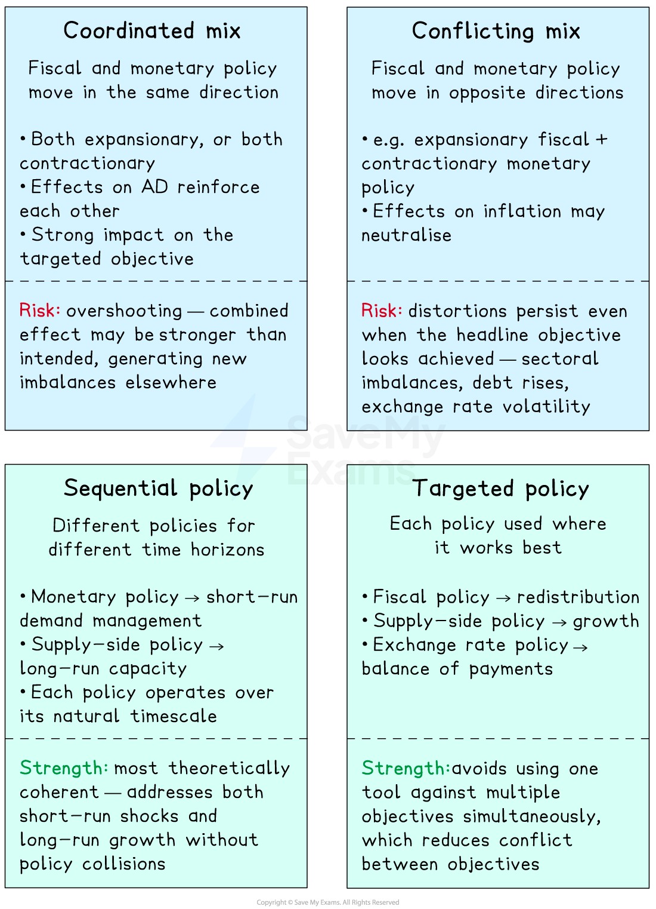

# Conflicts Between Policy Objectives & Government Failure

## The link between policy objectives and government failure

> **Spec point** — `spcpt_v8yq6fKkfKzdbd9N`

## The link between policy objectives and government failure

- **Government macroeconomic policy faces two persistent challenges**

  - First, the main objectives - growth, low inflation, low unemployment, *balance of payments* stability, and equitable income distribution - frequently **conflict** with each other, so achieving one objective often worsens another
  - Second, even well-designed policies can **fail to deliver **their intended outcomes due to information gaps, political constraints, time lags, and unintended consequences
  
    - This is known as **government failure**
  - This page synthesises the policy analysis from [earlier sections](https://www.savemyexams.com/a-level/economics/cie/23/revision-notes/government-macroeconomic-intervention/the-effectiveness-of-macroeconomic-policies-a-level/fiscal-policy-and-the-laffer-curve/) and applies the relationships framework identified in [Links Between Macroeconomic Problems](https://www.savemyexams.com/a-level/economics/cie/23/revision-notes/government-macroeconomic-intervention/government-macroeconomic-policy-objectives-a-level/links-between-macroeconomic-problems/)

## Why policy objectives conflict

> **Spec point** — `spcpt_VFWQvrshrsKvQFVD`

## Why policy objectives conflict

- The main macroeconomic objectives are interconnected - covered in detail in [Links Between Macroeconomic Problems](https://www.savemyexams.com/a-level/economics/cie/23/revision-notes/government-macroeconomic-intervention/government-macroeconomic-policy-objectives-a-level/links-between-macroeconomic-problems/)
- The four key conflicts are

  - **Growth vs inflation**  - demand-led growth raises AD against fixed AS, generating inflationary pressure
  - **Growth vs balance of payments** - rising income raises import demand, worsening the current account
  - **Inflation vs unemployment** - contractionary policy to reduce inflation raises unemployment in the short run (the SRPC trade-off)
  - **Internal vs external value of money** - high inflation reduces the currency's external value, generating imported inflation that further raises domestic prices
- **Policy aimed at one objective transmits through the same channels that affect the others**

  - There is no policy that improves all five objectives simultaneously

## How specific policies conflict in practice

> **Spec point** — `spcpt_BbRmqrzdBRx9z4w9`

## How specific policies conflict in practice

- Each policy generates specific conflicts

| Policy | Achieves | Worsens |
|---|---|---|
| **Expansionary fiscal** (information [here](https://www.savemyexams.com/a-level/economics/cie/23/revision-notes/government-macroeconomic-intervention/fiscal-policy/expansionary-and-contractionary-fiscal-policy/)) | - Higher growth, lower unemployment | - Higher inflation, worse BoP - Rising debt |
| **Contractionary monetary** (information [here](https://www.savemyexams.com/a-level/economics/cie/23/revision-notes/government-macroeconomic-intervention/fiscal-policy/expansionary-and-contractionary-fiscal-policy/)) | - Lower inflation | - Higher unemployment, slower growth, stronger currency worsens BoP |
| **Currency devaluation** (information [here](https://www.savemyexams.com/a-level/economics/cie/23/revision-notes/government-macroeconomic-intervention/the-effectiveness-of-macroeconomic-policies-a-level/monetary-policy-and-exchange-rate-policy/)) | - Better BoP, higher export-led growth | - Higher *imported inflation*, surrenders monetary policy independence |
| **Market-based supply-side** (information [here](https://www.savemyexams.com/a-level/economics/cie/23/revision-notes/government-macroeconomic-intervention/the-effectiveness-of-macroeconomic-policies-a-level/supply-side-policy-and-international-trade-policy/)) | - Long-run growth, lower inflation | - Wider income inequality, weakened worker protections |
| **Interventionist supply-side** (information [here](https://www.savemyexams.com/a-level/economics/cie/23/revision-notes/government-macroeconomic-intervention/the-effectiveness-of-macroeconomic-policies-a-level/supply-side-policy-and-international-trade-policy/)) | - Long-run growth, lower inequality | - Higher government debt, slow to materialise |
| **Protectionism** (information [here](https://www.savemyexams.com/a-level/economics/cie/23/revision-notes/government-macroeconomic-intervention/the-effectiveness-of-macroeconomic-policies-a-level/supply-side-policy-and-international-trade-policy/)) | - Better BoP, employment in protected sectors | - Higher inflation, retaliation, lost efficiency |

> **Exam Hint**
> **Every policy creates winners and losers across objectives**. Strong evaluation in Paper 4 essays traces these trade-offs explicitly

## The role of policy mix

> **Spec point** — `spcpt_c4bVgb8wqHhpjKNj`

## The role of policy mix

- Because no single policy achieves all objectives, governments combine policies - but combinations themselves create new conflicts

*The top two combinations risk creating new conflicts; the bottom two aim to reduce conflict by design*

> **Exam Hint**
> In essays, a key evaluative insight to communicate is that **policy effectiveness depends on coordination and sequencing, **not just the choice of individual policies.

## Government failure in macroeconomic policies

> **Spec point** — `spcpt_vY69rSv86X5r7hPj`

## Government failure in macroeconomic policies

- **Government failure occurs when government intervention in the economy produces an outcome that is worse than would have occurred without intervention, or worse than was intended**
- Government failure in macro policy arises from five main sources

#### 1. Information failure

- Governments do not have perfect information about the current state of the economy
- Key data (GDP, inflation, unemployment) is **reported with delays** of weeks or months and is later revised
- Acting on incomplete or wrong data leads to badly timed or wrongly sized interventions

  - For example, central banks raising rates based on backward-looking inflation data may tighten just as inflation is naturally falling, deepening a *recession*

#### 2. Time lags

- **Recognition lag** - time taken to identify that a problem exists
- **Decision lag** - time taken to agree on a policy response (especially fiscal policy with budget cycles)
- **Implementation lag **- time taken to enact the policy
- **Effect lag** - time taken for the policy to work through the transmission mechanism
- Combined lags can mean policy effects materialise after the problem has changed or resolved itself

#### 3.Political constraints

- *Election cycles* encourage short-term policy choices over long-term optimal policy
- Politically powerful groups (industries, *unions*, regional voters) lobby for protection, *subsidies *or tax breaks that benefit them at general cost
- Policy reversals between governments undermine credibility and long-run effectiveness

  - For example, supply-side investment in education and infrastructure benefits the economy over decades but rarely shows results within an electoral cycle

#### 4. Unintended consequences

- Policies designed to achieve one outcome can produce unexpected effects elsewhere
- For example, *quantitative easing* was intended to stimulate lending, but instead inflated asset prices (housing, equities), widening inequality without raising real activity in proportion
- For example, protectionist *tariffs *designed to support domestic industry can trigger retaliation from trading partners that harms exporters

#### 5. Regulatory capture and rent-seeking

- Industries subject to regulation may influence regulators to set rules that benefit existing firms over consumers and new entrants
- Subsidies and tax breaks become entrenched even when no longer economically justified, because beneficiaries *lobby* to preserve them

  - This contributes to chronic inefficiency in protected sectors

## When government failure is most likely

> **Spec point** — `spcpt_h6XVgTDQ6X8SpgkD`

## When government failure is most likely

- Government failure tends to be more severe when

  - The problem is **complex** and information is **uncertain** (e.g. *supply shocks*, novel crises like COVID-19)
  - **Time pressures** force quick decisions without adequate analysis
  - **Political incentives** favour short-term over long-term outcomes
  - **Multiple objectives** must be balanced, so policy cannot be optimised on any single criterion
  - **Distributional effects** are large, generating powerful political resistance to optimal policy

### The implications (useful for evaluation)

- Government failure does not mean **no intervention is the answer**
- It means that

  - Policy must be designed with awareness of its own limitations
  - Independent institutions (e.g. *central banks* with inflation-targeting mandates) reduce political distortion
  - Rules-based policy (e.g. fiscal rules, automatic stabilisers) reduces *discretionary error*
  - Time-limited interventions with clear exit conditions reduce regulatory capture
  - The choice is rarely between perfect government and perfect markets
  
    - It is between **imperfect government** and** imperfect markets**, with each option having different costs

> **Worked Example**
> Discuss whether a government can achieve all its key macroeconomic aims simultaneously.
> 
> [13 marks]
> 
> **Indicative answer structure**
> 
> **AO1 Knowledge**
> 
> - Identify the five main macroeconomic aims (growth, low inflation, low unemployment, BoP stability, equitable income distribution); identify the main policy categories (fiscal, monetary, supply-side, exchange rate, trade)
> 
> **AO2 Analysis**
> 
> - Explain the four key conflicts (growth vs inflation, growth vs BoP, inflation vs unemployment, internal vs external value of money)
> - Show that each policy
> 
>   - Targets specific objectives through specific transmission channels
>   - Generates side effects on other objectives via the same channels
>   - For example, contractionary monetary policy reduces inflation but raises unemployment and strengthens the currency, worsening BoP
> 
> **AO3 Evaluation**
> 
> - A government **cannot** achieve all aims simultaneously through any single policy, but can come close through
> 
>   - **Coordinated policy mix** — using each policy where it works best
>   - **Sequential policy** — short-run demand management plus long-run supply-side expansion
>   - **Independent institutions** — central banks, *fiscal councils* that reduce political distortion
>   - The limitation is **government failure** — information gaps, time lags, political constraints, and unintended consequences mean even well-designed policy mixes underperform their theoretical potential
>   - Conclude that simultaneous achievement of all aims is **unattainable** — but partial success across all aims is achievable through coordinated, evidence-based, institution-anchored policy

> **Exam Hint**
> In essays, be sure to name the specific conflict (e.g., "growth vs BoP"), explain the mechanism (rising income raises import demand), and apply it to the policy in question. Vague claims about trade-offs lose evaluation marks.
> 
> For government failure questions, show that government failure does not imply non-intervention is better - markets also fail. Use specific examples of policy design that mitigates failure: central bank independence, fiscal rules, automatic stabilisers.
> 
> Use the post-2021 inflation episode as an evaluative anchor. Supply shocks, central banks acting on imperfect data with long time lags, and political pressure around cost-of-living support combined to show conflicting objectives and government failure operating together.
