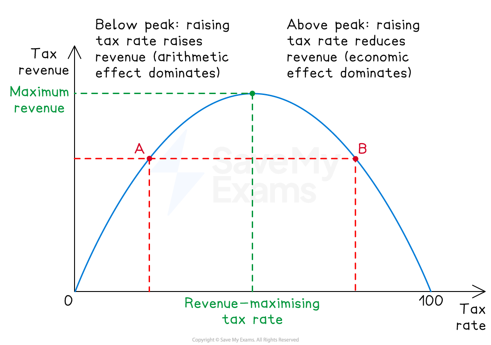

# Fiscal Policy & the Laffer Curve

## Fiscal policy recap

> **Spec point** — `spcpt_VyPN6nsFZWbnGbWV`

## Fiscal policy recap

- **Fiscal policy is the use of government spending and taxation to influence the level and composition of aggregate demand and to achieve macroeconomic objectives**
- At A Level, evaluation focuses on its effectiveness across multiple objectives simultaneously and the relationship between tax rates and revenue described by the Laffer curve

### Recap from AS

- The AS syllabus (4.5) covers the main fiscal policy tools and their basic effects

  - **Expansionary fiscal policy** - higher government spending and/or lower taxation, raising AD
  - **Contractionary fiscal policy** - lower government spending and/or higher taxation, reducing AD
  - **The government budget** - deficit when spending exceeds tax revenue, surplus when tax revenue exceeds spending
  - **The multiplier** - initial fiscal injections have amplified effects on national income
- This content builds on that foundation and adds **effectiveness analysis across multiple objectives** and **Laffer curve analysis**

## Effectiveness across macroeconomic objectives

> **Spec point** — `spcpt_VSW8jXTxgwwz54rD`

## Effectiveness across macroeconomic objectives

- Fiscal policy is rarely effective at achieving all macroeconomic objectives simultaneously - it works through different mechanisms for each, with conflicts and side effects

| Objective | Mechanism | Effectiveness |
|---|---|---|
| **Economic growth** | - Higher G or lower T raises AD, output rises (in the short run); investment in infrastructure raises LRAS (long run) | - Effective in recession; risks crowding out in boom |
| **Low unemployment** | - Higher AD raises labour demand, reducing cyclical unemployment; targeted spending on training reduces structural unemployment | - Effective for *cyclical unemployment*; supply-side measures needed for structural |
| **Low inflation** | - Contractionary fiscal policy reduces AD and demand-pull inflation | - *Limited against cost-push inflation* - Politically difficult |
| **Balance of payments stability** | - Contractionary fiscal policy reduces import demand by reducing income; expansionary fiscal policy worsens current account | - Indirect as it works through income effect on imports |
| **Equitable income distribution** | - *Progressive taxation* and *transfer payments* redistribute from higher to lower earners | - Direct and effective, but trade-off with work incentives |

> **Exam Hint**
> **Policies that achieve one objective often work against another**. Expansionary fiscal policy boosts growth and employment but risks inflation and BoP deterioration. Contractionary fiscal policy reduces inflation but raises unemployment

## The Laffer curve

> **Spec point** — `spcpt_bf6zXMFvcR8v94m6`

## The Laffer curve

- **The Laffer curve, popularised by economist Arthur Laffer in 1974, illustrates the relationship between the tax rate and total tax revenue**

  - It shows that tax revenue is zero at both 0% and 100% tax rates, with a revenue-maximising rate somewhere between

#### The logic

*The Laffer Curve*

- At a **0% tax rate**, the government collects no revenue, no matter how large the tax base
- At a **100% tax rate**, the government also collects no revenue — no one would work, save or invest if all income were taken in tax
- Between these extremes, there exists a **revenue-maximising tax rate** at which government revenue peaks
- Above this rate, further tax rate increases **reduce** total revenue because the disincentive effect on work, investment and tax compliance outweighs the higher rate applied to a shrinking *tax base*

#### Two effects of changing tax rates

- The Laffer curve combines two opposing effects of tax rate changes

  - **The arithmetic effect** - at a higher tax rate, each pound of taxable income generates more revenue (revenue rises mechanically with the rate)
  - **The economic effect** - at a higher tax rate, work, investment and reported income fall (the tax base shrinks)
- Below the revenue-maximising rate, the arithmetic effect dominates - raising rates raises revenue
- Above the revenue-maximising rate, the economic effect dominates - raising rates **reduces** revenue

#### Policy implications

- If a country is operating **above** the revenue-maximising rate, cutting tax rates will increase revenue
- If a country is operating **below** the revenue-maximising rate, cutting tax rates will decrease revenue
- The location of the peak is **empirically uncertain** - estimates of the revenue-maximising income tax rate range widely (often cited around 70%, but disputed)
- The Laffer curve is therefore **conceptually important but empirically contested** as a guide to policy

### Strengths and limitations

| Strengths | Limitations |
|---|---|
| - Directly affects AD without depending on the interest rate transmission mechanism | - Implementation lags — fiscal changes require budget cycles and *legislative approval* |
| - Can be targeted (e.g. infrastructure spending in deprived regions, progressive tax cuts for low earners) | - Politically constrained — tax rises and spending cuts face electoral resistance |
| - Automatic stabilisers operate without delay (explained [here](https://www.savemyexams.com/a-level/economics/cie/23/revision-notes/the-macroeconomy/economic-growth-and-sustainability-a-level/the-business-trade-cycle/)) | - Crowding out — government borrowing may raise interest rates, reducing private investment |
| - Capable of long-run impact through capital spending (infrastructure, education) | - Risk of unsustainable debt if deficits persist; *debt servicing* crowds out other spending |
| - Combined with Laffer curve insight, can identify revenue-raising tax structures | - Above the revenue-maximising rate, tax rises reduce revenue and harm growth |

> **Worked Example**
> *In 2022, many countries experienced a high rate of inflation caused by disruptions to the supply of goods and services. In one country, the government cut taxes and the central bank raised interest rates.*
> 
> *Evaluate the likely impact of these policies on that government's ability to control inflation.*
> 
> [20 marks]
> 
> **Indicative answer structure**
> 
> - **AO1 Knowledge**: Define inflation, fiscal policy, monetary policy; identify tax cuts as expansionary fiscal policy and rate rises as contractionary monetary policy
> - **AO2 Analysis**: Tax cuts raise disposable income → higher consumption → higher AD → demand-pull inflation pressure; rate rises reduce borrowing and consumption → lower AD → reduced inflation pressure. **The two policies work against each other** — fiscal policy is expansionary while monetary policy is contractionary
> - **AO3 Evaluation**: Effectiveness depends on the **type of inflation**. The question describes supply-side disruption (cost-push inflation) — contractionary monetary policy may raise unemployment without addressing the supply-side cause. Tax cuts may help by reducing cost pressures (e.g. fuel duty cuts) but could worsen *demand-pull inflation* if poorly targeted. The **policy combination is internally contradictory** unless tax cuts are tightly targeted at supply-side relief. Conclude that the government's ability to control inflation is undermined by the policy mix unless coordination is strong; supply-side policy is the more theoretically appropriate response to cost-push inflation

> **Exam Hint**
> The highest-value framing for fiscal policy questions is to **trace the policy through to multiple macroeconomic objectives**, not just one. Strong answers show that expansionary fiscal policy that raises growth simultaneously risks higher inflation, worse BoP, and rising debt — and weigh these effects against each other. Treating fiscal policy as a single-objective tool misses the evaluation marks the A Level rewards.
> 
> For Laffer curve questions, the key analytical insight are the **two effects** (arithmetic and economic). Strong answers explain how the relative size of these effects changes along the curve - the arithmetic effect dominates below the peak, the economic effect dominates above it. Mark schemes reward answers that connect the Laffer curve to **policy advice** - that revenue can sometimes rise from cutting tax rates, but only if the country is operating above the revenue-maximising rate.
