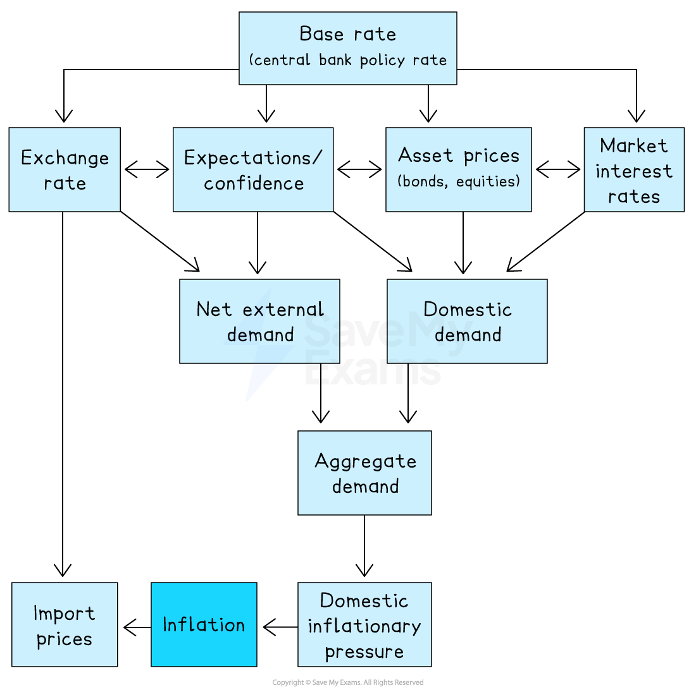

# Monetary Policy & Exchange Rate Policy

## The link between monetary policy and exchange rate policy

> **Spec point** — `spcpt_ZXt6sXK2cHwKgjJG`

## The link between monetary policy and exchange rate policy

- **Monetary policy uses interest rates and money supply controls to influence aggregate demand and inflation**
- **Exchange rate policy manages the value of a currency to influence trade balance, inflation, and competitiveness**
- The two are causally linked - interest rate changes drive capital flows that affect the exchange rate, and exchange rate management often relies on monetary policy tools

### Recap from AS

- The AS syllabus covers the basic tools and effects of both policies

  - Interest rates as the central bank's main tool
  - Expansionary vs contractionary monetary policy
  - Fixed, managed and floating exchange rate regimes
  - Simple effects of currency appreciation and depreciation
- This page builds on that foundation and adds the **transmission mechanism** in detail, **quantitative easing**, and the **integrated effectiveness analysis** of both policies across multiple macroeconomic objectives

## The monetary policy transmission mechanism

> **Spec point** — `spcpt_b5Hgww4XmJpwQ8fT`

## The monetary policy transmission mechanism

- **The transmission mechanism is the chain of cause-and-effect through which a change in the central bank's policy interest rate affects aggregate demand, output, employment and the price level**
- The diagram below maps the full mechanism

  - *Base rate* changes flow through four transmission channels
  - Channels feed into demand components, which converge into aggregate demand
  - Aggregate demand drives domestic inflationary pressure, which feeds inflation
  - The exchange rate channel also affects inflation directly via import prices, separate from the AD route

*The monetary policy transmission mechanism*

### A rise in the base rate transmits through the four channels as follows

| Channel | Mechanism |
|---|---|
| **Market interest rates** | - Lending and savings rates rise    - Consumption and investment fall, saving rises |
| **Asset prices** | - *Bond *and *equity *prices fall    - Wealth effect reduces consumption |
| **Expectations / confidence** | - Anchors inflation expectations    - Influences spending and investment decisions |
| **Exchange rate** | - Capital inflows strengthen the currency    - *Exports *become more expensive, *imports *cheaper (and import prices fall, reducing inflation directly) |

- The bidirectional arrows in the diagram show the channels also interact

  - For example, expectations of higher rates can themselves drive asset prices and the exchange rate before official rate changes occur
- The combined effect of a rate rise is a fall in aggregate demand

  - The reverse applies for a rate cut

#### Time lags and limitations

- The full effect of a rate change typically takes **12 to 24 months** to materialise
- Channels work at different speeds

  - Exchange rate effects appear within weeks
  - Market interest rate effects on consumption build over months as *fixed-rate* deals expire
- The mechanism may break down at the **zero lower bound** (the liquidity trap, covered in 9.4.7)
- Channels can be **disrupted** when *commercial banks* are repairing damaged balance sheets and fail to pass on rate changes (a key issue post-2008)

### Quantitative easing

- **Quantitative easing is a monetary policy tool in which the central bank creates new reserves electronically and uses them to buy financial assets (typically government bonds), expanding the money supply and reducing long-term interest rates**

  - QE works through the same transmission mechanism but operates on **long-term** rates rather than the short-term base rate
  - Bond purchases push prices up and *yields *down, feeding into the asset prices channel and indirectly into market interest rates
  - QE is used when conventional monetary policy reaches its limits - typically at the zero lower bound
  - It was used extensively after the 2008 financial crisis and during the COVID-19 pandemic by major central banks

#### Limitation

- QE may inflate asset prices (housing, equities) more than it stimulates real activity creating distributional concerns and *asset bubble* risk

## Exchange rate policy

> **Spec point** — `spcpt_cyW6M5nGdzGxh49G`

## Exchange rate policy

- **Exchange rate policy is the use of central bank intervention, interest rate adjustments, or capital controls to influence the external value of a currency in pursuit of macroeconomic objectives**

  - It operates on the exchange rate channel of the transmission diagram directly

#### Three regime types

| Regime | Description | Implication |
|---|---|---|
| **Floating** | - Set by market supply and demand | - No direct exchange rate policy    - Monetary policy independent |
| **Fixed** | - Government commits to a specific rate    - Central bank intervenes to maintain it | - Monetary policy subordinated to maintaining the peg |
| **Managed (dirty float)** | - Currency floats but central bank intervenes to smooth fluctuations or guide the rate | - Combines flexibility with some control |

#### The link with monetary policy: the impossible trinity

- **Monetary policy and exchange rate policy are not independent tools**
- They both operate through the exchange rate channel shown in the transmission diagram

  - A central bank cannot simultaneously control the interest rate **and** the exchange rate under free capital mobility - this is the **impossible trinity** (or trilemma)
  
    - Choosing a fixed exchange rate means giving up monetary policy independence
    - Choosing monetary policy independence means accepting exchange rate volatility
  - Most major economies operate **floating exchange rates** to preserve monetary policy independence

## Effectiveness across macroeconomic objectives

> **Spec point** — `spcpt_GWCzvWYvSfY93ZBr`

## Effectiveness across macroeconomic objectives

- Monetary policy and exchange rate policy work through different (but overlapping) channels and produce different effects across each objective

| Objective | Monetary policy | Exchange rate policy |
|---|---|---|
| **Low inflation** | - Effective for demand-pull via all four channels - Limited against cost-push | - Appreciation reduces import prices (effective in import-dependent economies) |
| **Economic growth** | - Effective unless rates near zero - Works with time lags | - Depreciation can stimulate export-led growth but risks imported inflation |
| **Low unemployment** | - Effective for *cyclical unemployment* via raised AD | - Depreciation raises employment in tradable sectors only |
| **Balance of payments** | - Counterproductive as rate rises strengthen currency, worsening BoP | - Depreciation can address BoP deficits, conditional on *Marshall-Lerner* |
| **Equitable income distribution** | - Indirect as savers gain when rates rise, borrowers when rates fall | - Not a tool of redistribution |

- The key insight is that **the same policy serves different objectives through different transmission paths, and these paths often conflict**

  - For example, raising rates to control inflation worsens the BoP through the same exchange rate channel that anchors expectations

#### Strengths and limitations

|   | Strengths | Limitations |
|---|---|---|
| **Monetary policy** | - Independent central banks act without political constraint - Decisions made monthly (faster than fiscal) - QE provides additional capacity at the zero lower bound | - Time lags of 12–24 months; ineffective at the liquidity trap - Cannot be sectorally targeted - Cannot address *cost-push inflation* |
| **Exchange rate policy** | - Direct effect on competitiveness - Useful for small open economies - Depreciation stimulates growth without raising domestic AD | - Surrenders monetary policy independence under fixed regimes - Speculative attacks; imported inflation; Marshall-Lerner condition required |

> **Worked Example**
> Discuss the transmission mechanism of monetary policy and consider why it might not always be effective in achieving the central bank's objectives.
> 
> [13 marks]
> 
> **Indicative answer structure**
> 
> - **AO1 Knowledge**: Define monetary policy and the transmission mechanism; identify the central bank's main objectives (typically price stability, often growth and employment as secondary)
> - **AO2 Analysis**: Walk through the four channels - market interest rates, asset prices, expectations, exchange rate. Show how a rate rise reduces AD through each. Note that the exchange rate channel also affects inflation directly through import prices
> - **AO3 Evaluation**: The mechanism may not work effectively because of
> 
>   - **Time lags** of 12–24 months
>   - The **liquidity trap** at the zero lower bound
>   - **Cost-push inflation** that monetary policy cannot address
>   - **Broken transmission channels** (e.g. impaired banking systems)
>   - **Conflicting policy objectives** (fighting inflation may worsen unemployment)
>   - **Exchange rate effects** that conflict with BoP objectives
> - Conclude that the transmission mechanism is theoretically clear but empirically conditional

> **Exam Hint**
> For monetary policy questions, **trace the full transmission mechanism** rather than just stating that "higher rates reduce AD." The strongest answers walk through all four channels and note that the exchange rate channel feeds into inflation by two routes (via net external demand and directly via import prices). Drawing or describing the diagram structure earns higher analysis marks.
> 
> For exchange rate policy questions, the key insight is the **impossible trinity**
> 
> - a country cannot simultaneously have a fixed exchange rate, free capital mobility, and independent monetary policy
> 
> The strongest answers use this framework to evaluate exchange rate policy choices, showing why countries that fix their currency must sacrifice monetary policy independence.
> 
> Use the post-2021 global inflation episode as an evaluative anchor. Major central banks raised rates aggressively from 2022 onwards. The episode showed monetary policy can transmit through the expected channels but with significant time lags and uneven effects across sectors.
