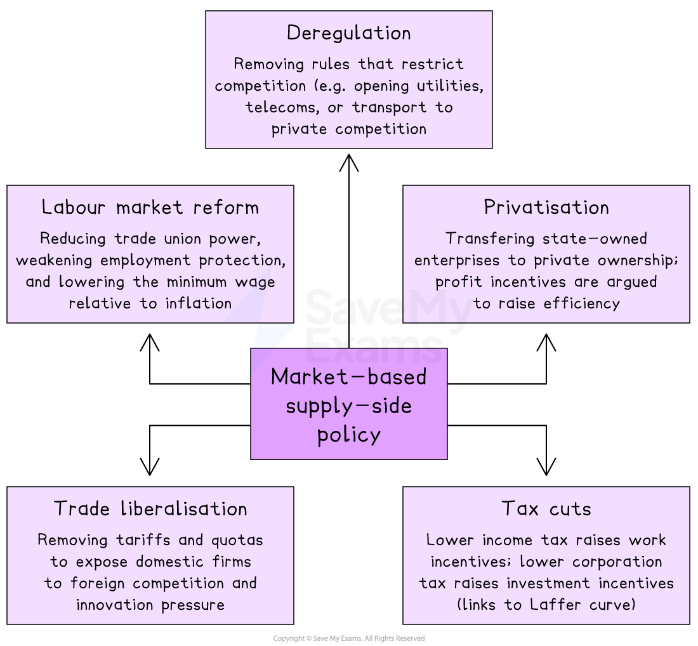

# Supply-Side Policy & International Trade Policy

## The link between supply-side and international trade

> **Spec point** — `spcpt_q7JKk2mYRhH4QTFF`

## The link between supply-side policy and international trade

- **Supply-side policy raises the productive capacity of the economy by improving efficiency, productivity, and the quantity and quality of factors of production**
- **International trade policy uses *****tariffs*****, *****quotas*****, *****subsidies*****, and *****trade agreements***** to shape an economy's external environment in pursuit of macroeconomic objectives**
- Both work primarily through the supply side

  - Supply-side policy expands LRAS directly
  - Trade policy alters the supply environment by changing the cost and availability of imports, exports and inputs

### Recap from AS

- The AS syllabus covers the basic tools and effects of both policies

  - Supply-side tools (training, infrastructure, *R&D*, *deregulation*, *privatisation*, tax cuts) and their basic effects on LRAS
  - Trade policy tools (tariffs, quotas, subsidies, *embargoes*) plus the arguments for free trade and *protectionism*
- This page builds on that foundation and adds the classification of supply-side tools into **market-based** and **interventionist** approaches, and the **integrated effectiveness analysis** of both policies across multiple macroeconomic objectives

## Supply-side policy

> **Spec point** — `spcpt_JgsxY3gt5VXPk8Cp`

## Supply-side policy

- **Supply-side policy is government action that raises the productive capacity of the economy, shifting LRAS rightwards and allowing higher output without inflationary pressure**
- Policies can be separated into market-based and interventionist

### Market-based supply-side policy

- **Market-based supply-side policy reduces government intervention in markets, allowing market forces to determine prices, employment and resource allocation more freely**
- The main tools are

*The main tools of market based supply-side policy*

#### Interventionist supply-side policy

- **Interventionist supply-side policy involves direct government investment in the productive capacity of the economy, addressing market failures that prevent the private sector from achieving efficient outcomes alone**
- The main tools are

  - **Education and training** — government-funded schools, universities, vocational training, *apprenticeships*
  - **Infrastructure investment** — transport networks, broadband, energy grids, ports
  - **R&D subsidies** — direct funding or tax credits for private research and *innovation*
  - **Industrial policy** — strategic support for sectors deemed critical for long-run growth (e.g. green technology, semiconductors)
  - **Healthcare investment** — improving the productivity of the labour force through better health outcomes

#### Effectiveness across objectives

| Objective | Mechanism | Effectiveness |
|---|---|---|
| **Economic growth** | - Both approaches raise LRAS - Long-run growth becomes non-inflationary | - Highly effective in the long run    - Slow to materialise |
| **Low inflation** | - LRAS shift rightwards reduces price pressure at any output level; addresses *cost-push inflation* by reducing input costs | - The only category of policy that addresses cost-push inflation without raising unemployment |
| **Low unemployment** | - Reduces *structural unemployment* (training, mobility) - Reduces NAIRU | - Effective for structural and *frictional unemployment*    - Not for cyclical |
| **Balance of payments** | - Productivity gains improve export competitiveness - Lower costs reduce import prices indirectly | - Effective in the long run    - Depends on the export structure of the economy |
| **Equitable income distribution** | - Market-based widens inequality    - Interventionist (education, training) reduces it | - Mixed, as it depends entirely on which approach is chosen |

> **Exam Hint**
> When evaluating in essays, choose the **approach** based on the objective:
> 
> - Interventionist policies (education, training, infrastructure) **for inequality and structural unemployment**
> - Market-based policies (tax cuts, deregulation) **for raising business investment and short-term efficiency.**

## International trade policy

> **Spec point** — `spcpt_5MHKxYsVfsxGSmNj`

## International trade policy

- **International trade policy is the use of tariffs, quotas, subsidies and trade agreements to shape an economy's external trade environment in pursuit of macroeconomic objectives**
- The arguments for *free trade* (comparative advantage, lower consumer prices, productivity through competition) and for protectionism (*infant industries*, anti-*dumping*, strategic protection) are covered earlier at AS Level starting [here ](https://www.savemyexams.com/a-level/economics/cie/23/revision-notes/international-economic-issues/the-reasons-for-international-trade/absolute-and-comparative-advantage/)
- The focus now is on **how trade policy serves macroeconomic objectives**

### Three policy stances that can be taken

- **Protectionist**

  - Tariffs and quotas to protect domestic industries
  - Subsidies to support exporters
  - *Capital controls* to manage currency flows
- **Free trade**

  - Minimal restrictions on imports and exports
  - Participation in trade agreements (FTAs, *customs unions*)
  - Commitment to *WTO* rules
- **Strategic**

  - Selective protection of strategic industries (semiconductors, food security, defence) combined with free trade in other sectors

#### Effectiveness across objectives

| Objective | Mechanism | Effectiveness |
|---|---|---|
| **Economic growth** | - Free trade raises efficiency through comparative advantage - Protectionism can support infant industries to grow into competitive sectors | - Free trade more effective in the long run - Protectionism only effective for industries with genuine *comparative advantage* and time-limited support |
| **Low inflation** | - Free trade lowers import prices and reduces cost-push pressure - Protectionism raises import prices | - Free trade reduces inflation - Protectionism risks raising it |
| **Low unemployment** | - Protectionism preserves jobs in protected industries - Free trade may cost jobs in some sectors but creates them in others | - Politically powerful argument for protectionism - Economically uncertain |
| **Balance of payments** | - Tariffs and quotas reduce imports - Subsidies raise exports - Both improve trade balance | - Effective in the short run, but risks retaliation - Long-run effects depend on *income elasticities* |
| **Equitable income distribution** | - Free trade benefits consumers but harms workers in import-competing industries - Protectionism does the reverse | - Distributional effects are central to the political economy of trade policy |

### Strengths and limitations

|   | Strengths | Limitations |
|---|---|---|
| **Supply-side policy** | - The only category of policy that addresses cost-push inflation - Can reduce inflation **and** unemployment simultaneously - Permanently improves performance - Complements demand-side policies - Reduces *NAIRU* | - Long time horizons (years) - Uncertain outcomes - Interventionist policies are expensive - Market-based policies can widen inequality - Cannot respond to short-term shocks |
| **Trade policy** | - Direct effect on competitiveness and trade balance - Supports *strategic industries* - Useful for developing economies pursuing *industrialisation* - FTAs lock in market access | - Retaliation from partner countries - Raises consumer prices through higher import costs - Reduces incentives for domestic innovation - WTO commitments constrain flexibility |

> **Worked Example**
> With the help of a diagram, assess the effectiveness of government policies which might be used to reduce cost-push inflation.
> 
> [20 marks]
> 
> **Indicative answer structure**
> 
> - **AO1 Knowledge**: Define cost-push inflation; identify possible policy responses (supply-side policy, exchange rate appreciation, *trade liberalisation*)
> - **AO2 Analysis**: Use AD/AS diagram to show how supply-side policy shifts LRAS rightwards, reducing the price level. Explain that
> 
>   - Market-based supply-side policy (*deregulation*, tax cuts, trade liberalisation) reduces costs by raising efficiency
>   - Interventionist supply-side policy (training, infrastructure, R&D) reduces costs over time by raising productivity
>   - Free trade reduces import prices directly, easing cost-push pressure
>   - Demand-side policy (contractionary monetary or fiscal) is largely ineffective because it raises unemployment without addressing the supply-side cause
> - **AO3 Evaluation**: Supply-side policy is the **theoretically appropriate response** to cost-push inflation, but it has limitations
> 
>   - **Time lags** — effects take years; cost-push shocks may persist in the short run
>   - **Uncertain outcomes** — productivity gains are not guaranteed
>   - **Cost** — interventionist policies raise government debt
>   - **Distributional effects** — market-based policies may widen inequality
> - Conclude that supply-side and trade policy are the most effective long-run responses to cost-push inflation, while demand-side policy may need to manage short-run pressures despite its limitations

> **Exam Hint**
> In essays, **distinguish market-based from interventionist policies explicitly** and evaluate them separately.
> 
> The strongest answers identify which approach is more appropriate for the specific objective in the question:
> 
> - Interventionist for reducing inequality and structural unemployment
> - Market-based for raising business investment and short-term efficiency
> 
> Treating supply-side policy as a single category limits evaluation marks.
> 
> For trade policy questions, the key insight is that **free trade vs protectionism is rarely a binary choice** - most countries use a strategic mix. The strongest answers evaluate both stances against the country's stage of development, industrial structure, and external position.
> 
> Use the post-2021 inflation episode as an evaluative anchor for supply-side questions. The episode was driven by *supply-side shocks* (energy, supply chains) - supply-side policy is the theoretically appropriate response, yet most central banks responded with contractionary monetary policy because it acts faster. This contrast illustrates the time-lag limitation of supply-side policy in real-world settings.
