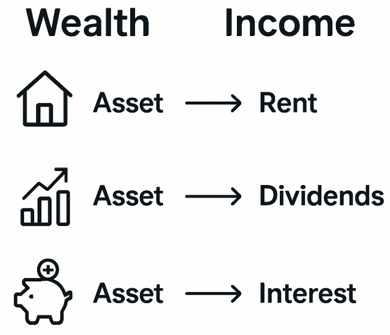
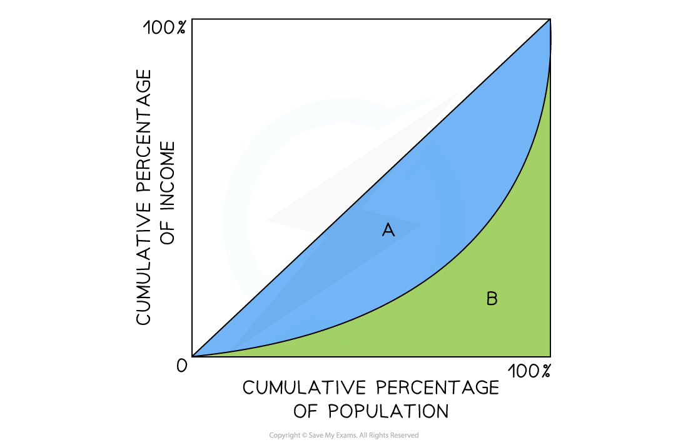

# Measuring Income & Wealth Inequality

## Income as a flow concept

> **Spec point** — `spcpt_DZMRpFSZhGfNBFTC`

## Income

- **Income is the flow of earnings received over a period of time from the** ***factors of production***

  - Rent, wages, interest and profit
- Income inequality refers to differences in the distribution of income between individuals or households
- High inequality may lead to:

  - Poverty
  - Social instability
  - Lower economic growth

## Wealth as a stock concept

> **Spec point** — `spcpt_YHqgnq4J8ZQhWX8R`

## Wealth

- **Wealth is the stock of *****assets*****  owned at a point in time**

  - E.g. Property, ***shares***, antiques, pension schemes
  - Assets can be used to generate a flow of income
- **Wealth inequality refers to differences in the distribution of assets between individuals or households**

  - Wealth can generate income, which can increase inequality over time

## The Gini coefficient

> **Spec point** — `spcpt_NRqhnWk3hmTT4msn`

## The Gini coefficient

- The Lorenz curve can be used to calculate the ***Gini Coefficient***

*The Gini Coefficient is calculated using the area beneath the line of equality   *

### Diagram analysis

- **Gini coefficient = A / (A + B)**
- Where:

  - **A = area between the line of equality and the Lorenz curve**
  - **B = area under the Lorenz curve**

- A value of 0 represents **absolute equality** and 1 represents **perfect inequality**

  - In 2017,  Estonia had a lower Gini coefficient (0.3) than South Africa (0.62), indicating a more equal distribution of income

- Governments use ***progressive taxation*** and ***transfer payments*** to shift the Gini coefficient closer to zero, the line of perfect equality

> **Worked Example**
> Explain what happened to income inequality in Bolivia between 2008 and 2016
> 
> **Income Gini Coefficient Data for Bolivia**
> 
> | Income Gini Coefficient 2008 | 0.51 |
> |---|---|
> | Income Gini Coefficient 2016 | 0.43 |
> 
> **Step 1: Determine if inequality has improved or worsened  **
> 
> - The closer to zero, the closer the country is to perfect equality
> - Bolivia's inequality has improved as the Gini coefficient has fallen
> - The closer the Gini coefficient is to zero, the more equal the distribution of income is in a country
> 
> **Step 2: Provide final comment**
> 
> - Bolivia's Gini coefficient has moved closer to zero, indicating that there is less income inequality in 2016 than there was in 2008

## Economic reasons for inequality

> **Spec point** — `spcpt_gmCTXWW8JwZ7V58j`

## Causes of income and wealth Inequality

- There are many causes of income and wealth inequality

| **Education, training and Skills** | **Trade unions** | **Welfare system** | **Pension payments** |
|---|---|---|---|
| - The **higher** the skill level the higher the level of income. - A country with a **poor education** system will see greater inequality than one with a good education system | - Countries with strong ***trade union*** membership tend to have higher levels of income. - With low trade union membership, the **exploitation** of workers through low wages is easier | - Countries that provide a range of benefits (such as **unemployment**, disability, child support, **housing support **etc**) **raise the income of the lowest 20% of the population resulting in more equal distribution | - **State pension payments** ensure a minimum standard of living for retirees resulting in a more **equal distribution** of income. - Countries without it have a much higher percentage of pensioners living in poverty |
| **Wage rates** | **Employment legislation** | **Tax structure** | **Asset ownership** |
| - The purpose of a ***national minimum wage*** is to improve the equity in the distribution of income. - Without a minimum wage → lower incomes for low-skilled workers → greater income inequality | - Generally, the more workers are **protected by law**, the better the income distribution in an economy e.g. **maternity benefits** ensure that new mothers have a higher level of income during the first months of leave after a birth | - ***Progressive tax systems*** allow all income earners to contribute to **public revenue** according to their ability. - **Decreasing taxes** on the lower end and increasing it on the upper end would mean that the system is **more progressive** and there would be a more equal distribution of income | - ***Assets***** generate income**. - The more equal the asset ownership in an economy the less the inequality in income distribution - Wealth passed across generations → increases wealth inequality |
