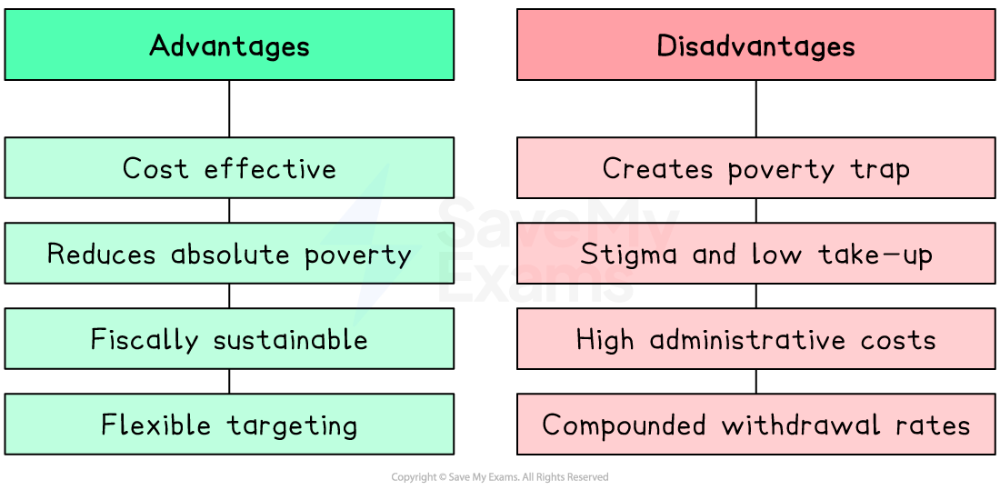
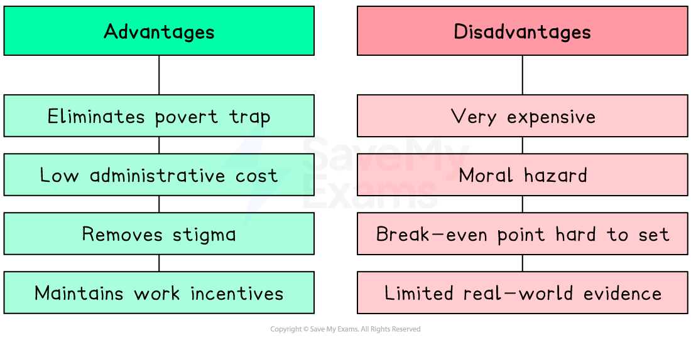

# Redistributive Policies

## Redistribution policies

> **Spec point** — `spcpt_jtqPQx9Q89rDg53T`

## Redistribution policies

- **Governments use redistribution policies to reduce inequality and improve equity by transferring income or resources from higher-income to lower-income groups**
- The central evaluative tension for every policy is the **equity-efficiency trade-off**: does the policy improve fairness, and at what cost to productive and dynamic efficiency?
- There are four key policies to consider: **means-tested benefits**, **universal benefits**, **negative income tax** and **universal basic income**

## 1. Means-tested benefits

> **Spec point** — `spcpt_K6NRNtxZf8kPKZpq`

## 1. Means-tested benefits

- **These are  benefits paid only to individuals whose income and/or wealth falls below a specified threshold - recipients must demonstrate financial need to qualify**

  - The government targets support at those who need it most, making this approach **cost-effective** relative to universal provision
  - Examples include housing benefit, food assistance, unemployment support and healthcare *subsidies* for low-income households

### Evaluating means-tested benefits

*The advantages and disadvantages of means tested benefits*

| Advantages | Disadvantages |
|---|---|
| - **Cost-effective**    - targets spending at those genuinely in need, avoiding payments to higher-income groups | - **Creates the poverty trap**    - benefit withdrawal as income rises produces high effective marginal tax rates, reducing the incentive to work |
| - **Reduces absolute poverty**    - ensures a *minimum income floor* for the most vulnerable | - **Stigma and low take-up**    - means-testing requires individuals to prove need, which can deter eligible claimants due to shame or *bureaucratic complexity* |
| - **Fiscally sustainable**    - lower cost than universal provision, leaving resources for other public spending | - **High administrative costs**    - assessing and monitoring eligibility is expensive and resource-intensive |
| - **Flexible**    - can be targeted at specific groups such as families with children, elderly or disabled | - **Poverty trap worsens with multiple benefits**    - individuals receiving several means-tested benefits simultaneously face compounded withdrawal rates |

> **Case Study**
> **Universal Credit in the United Kingdom**
> 
> **The context**
> 
> The UK's legacy benefit system consisted of six separate means-tested benefits including housing benefit, *tax credits* and income support
> 
> Each had different withdrawal rates and eligibility rules, creating a complex system where some low-income workers faced effective marginal tax rates **(EMTR) **above 90% - a severe *poverty trap* discouraging progression into work
> 
> **Actions taken**
> 
> - **Universal Credit (UC)** was introduced from 2013, merging six benefits into a single payment with a unified taper rate of 55p withdrawn per £1 of earned income
> - The policy aimed to make work always pay by ensuring the EMTR never exceeded 55% - significantly below the rates in the legacy system
> - By 2023, approximately 6 million households were receiving Universal Credit
> 
> **Outcomes**
> 
> - Evidence suggests UC improved work incentives at the margin compared to the legacy system
> - The unified taper rate reduced the most extreme poverty trap cases
> - However critics argue a 55% taper rate remains high, and that the interaction with childcare costs pushes effective marginal tax rates above 70% for many families
> - The five-week wait for first payment also pushed many new claimants into debt, illustrating that poorly designed implementation can undermine a well-intentioned policy - a form of government failure

## 2. Universal benefits

> **Spec point** — `spcpt_VpZ9dQtn9y43bmvF`

## 2. Universal benefits

- **These are benefits paid to all individuals in a category regardless of income or wealth - no means test is applied**

  - Examples include universal *child benefit*, *state pensions* paid to all retirees, and universal healthcare
- The defining feature is that **entitlement is based on status** (being a child, being retired, being a citizen) rather than financial need

### Evaluating universal benefits

| Advantages | Disadvantages |
|---|---|
| - **No poverty trap**    - benefits are not withdrawn as income rises, so there is no disincentive to work | - **Poor targeting**    - payments go to higher-income individuals who do not need them, reducing cost-effectiveness |
| - **No stigma**    - universal entitlement removes the shame associated with means-testing, improving take-up | - **Very expensive**    - universal provision is significantly more costly than means-tested alternatives |
| - **Low administrative cost**    - no eligibility assessment required | - **Regressive in relative terms**    - if a flat-rate universal benefit represents a larger share of a low-income household's budget, this partially addresses inequality, but the absolute payment is the same for all |
| - **Social cohesion**    - universal benefits foster a sense of shared entitlement across income groups | - **Opportunity cost**    - fiscal resources used for universal payments cannot be used for targeted poverty reduction or other public goods |

## 3. Negative income tax

> **Spec point** — `spcpt_3MvVQrMDzKpwCf8p`

## 3. Negative income tax

- **This is a system in which the tax and benefit systems are merged**

  - **Individuals above a specified *****income threshold***** pay tax in the normal way, while those below it receive a government payment (the negative tax) rather than paying tax**
- Proposed by economist **Milton Friedman** as a way to eliminate the poverty trap while maintaining work incentives
- The mechanism:

  - A **break-even income** is set - above this level individuals pay tax; below it they receive payments
  - As earned income rises towards the break-even point, the negative tax payment falls at a **constant taper rate**
  - Because the taper rate is consistent and moderate, the EMTR never becomes prohibitively high - **work always pays at the margin**
- This replaces the complex array of means-tested benefits with a **single, streamlined system**

### Evaluating negative income tax

*The advantages and disadvantages of negative income tax*

| Advantages | Disadvantages |
|---|---|
| - **Eliminates the poverty trap**    - consistent taper rate ensures work always pays at the margin | - **Very expensive**    - providing a guaranteed income to all below the threshold has significant fiscal cost |
| - **Low administrative cost**    - operated through the existing tax system, replacing multiple benefit bureaucracies | - **Moral hazard**    - guaranteed income may reduce labour supply as some individuals choose not to work |
| - **Removes stigma**    - payments are made through the tax system with no means-testing | - **Setting the correct break-even point is difficult**    - too low and poverty persists; too high and fiscal costs become unsustainable |
| - **Maintains incentives**    - individuals always gain from earning more, unlike means-tested systems | - **No country has fully implemented it**    - evidence on real-world effectiveness is limited to small-scale *pilots* |

## 4. Universal basic income

> **Spec point** — `spcpt_PQ9mPTRBJ8d7GpK9`

## 4. Universal basic income

- **Universal basic income (UBI) a regular, unconditional cash payment made to every citizen regardless of income, employment status or need**

  - Unlike negative income tax, UBI is paid to everyone, not just those below a threshold
  - Unlike means-tested benefits, it is never withdrawn as income rises, eliminating the poverty trap entirely
- UBI has gained significant policy attention as a potential response to *technological unemployment* and the *gig economy*

### Evaluating universal basic income

| Advantages | Disadvantages |
|---|---|
| - **Completely eliminates the poverty trap**    - no withdrawal means no disincentive to work | - **Extremely expensive**    - paying every citizen an unconditional income requires very high government expenditure or tax rates |
| - **Provides income security**    - guarantees a floor below which no one can fall, reducing *absolute poverty* | - **Moral hazard**    - unconditional payment may significantly reduce *labour supply*, reducing productive capacity |
| - **Adapts to changing labour markets**    - supports workers in the gig economy and those displaced by *automation* | - **Poor targeting**    - paying wealthy citizens the same as poor ones is highly inefficient use of fiscal resources |
| - **Low administrative cost**    - no *means-testing* or eligibility assessment | - **Inflationary risk**    - large unconditional cash injections may increase *aggregate demand* and push up prices |
| - **Removes stigma**    - universal entitlement with no conditions attached | - **Limited real-world evidence**    - pilots have been small-scale and short-term, making it difficult to assess long-run behavioural effects |

> **Case Study**
> **Universal basic income pilot in Kenya**
> 
> **The context**
> 
> Kenya has high levels of both absolute and relative poverty, with significant rural populations engaged in *subsistence agriculture* and *informal work*
> 
> GiveDirectly, an NGO working with the Kenyan government, launched the world's largest and longest-running UBI experiment in 2017, providing unconditional cash transfers to over 20,000 recipients in rural villages in Siaya County
> 
> **Actions taken**
> 
> - Long-term recipients received approximately **\$0.75 per day** - roughly 75% of the average consumption level in recipient villages - for a guaranteed period of **12 years**
> - Short-term recipients received the same total amount as a lump sum over two years
> - A *control group* of villages received no payments, allowing rigorous comparison of outcomes
> 
> **Outcomes**
> 
> 
> 
> - Early results published by researchers from Princeton and UC San Diego found significant positive effects
> 
>   - Recipient households increased assets, *food security* and psychological wellbeing
>   - There was evidence of positive spillover effects to non-recipient households in the same villages through increased local economic activity
>   - Crucially, there was no significant reduction in labour supply - recipients worked as much as control group households, challenging the *moral hazard* concern
> - However critics note that a donor-funded pilot with a guaranteed end date cannot replicate the fiscal and behavioural dynamics of a permanent government-funded UBI at national scale

## Comparing the four policies

> **Spec point** — `spcpt_kznzsPq7RbBrP3PR`

## Comparing the four policies

| Policy | Poverty trap? | Targets the poorest? | Administrative cost | Fiscal cost |
|---|---|---|---|---|
| Means-tested benefits | - Yes — benefit withdrawal | - Yes | - High | - Medium |
| Universal benefits | - No | - No — paid to all | - Low | - High |
| Negative income tax | - No — consistent taper | - Partially | - Low | - High |
| Universal basic income | - No — never withdrawn | - No — paid to all | - Very low | - Very high |

> **Exam Hint**
> The poverty trap is the central weakness of means-tested benefits - benefit withdrawal combined with income tax creates a high EMTR, so work does not pay at the margin.
> 
> NIT and UBI both solve the poverty trap but at significant fiscal cost - the key distinction is that NIT targets those below a threshold; UBI is paid to everyone.
> 
> Structure evaluation using the **equity-efficiency trade-off**: means-tested benefits are fiscally efficient but damage work incentives; UBI preserves incentives but is poorly targeted and very expensive.
> 
> The Kenya pilot challenges the **moral hazard** assumption - but pilot evidence may not generalise to permanent national-scale implementation.
