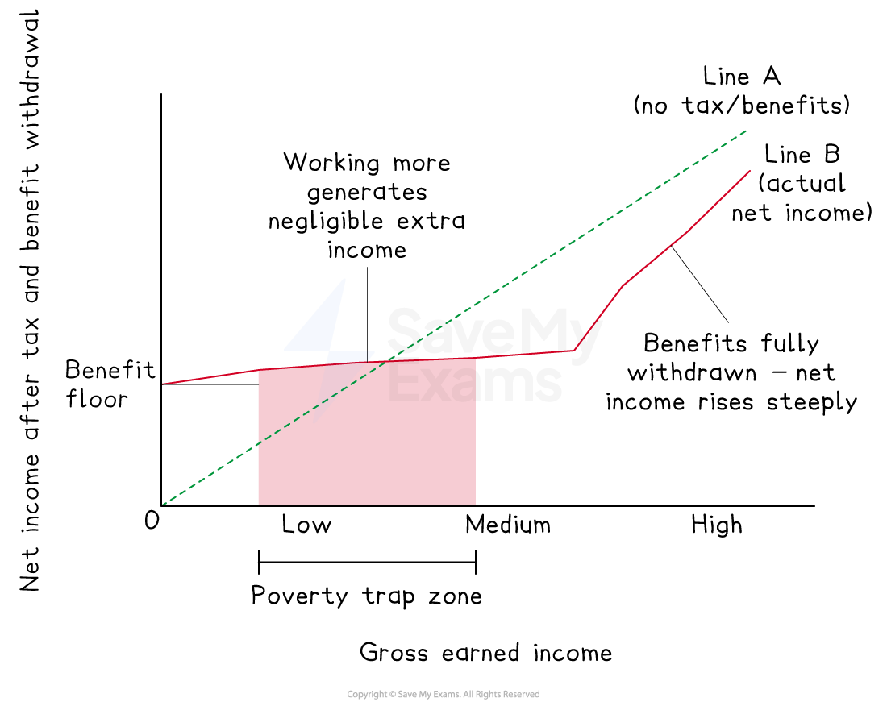

# Understanding Poverty

## Absolute and relative poverty

> **Spec point** — `spcpt_tCjVCHYm2byfkzzk`

## Absolute and relative poverty

- **Absolute poverty is a condition in which an individual lacks the minimum resources necessary for basic survival**

  - They have insufficient income to meet basic needs such as food, shelter, clean water and healthcare
  - It is defined against a **fixed standard** that does not change as average living standards rise
  
    - The World Bank defines the international absolute poverty line as living on less than **\$3.00 per person per day** (2025, purchasing power parity)
- **Relative poverty is a condition in which an individual's income falls significantly below the average standard of living in their society**

  - This is typically defined as below 50% or 60% of *median household income*
  - It is determined by comparing against a **moving standard** that rises as average incomes rise — meaning relative poverty can persist or worsen even as absolute poverty falls
  
    - Relative poverty is therefore a measure of **inequality** as much as deprivation
    - Relative poverty exists in all economies, including high-income ones

### Key distinction

| Feature | Absolute poverty | Relative poverty |
|---|---|---|
| Standard | Fixed minimum threshold | Relative to average living standards |
| Changes as incomes rise? | No — threshold is fixed | Yes — threshold rises with median income |
| Measure of | Deprivation | Inequality |
| Most relevant to | Low-income economies | All economies, including high-income |
| Example threshold | World Bank \$2.15/day | Below 60% of median income |

> **Case Study**
> **Absolute vs relative poverty in India**
> 
> **The context**
> 
> India's rapid economic growth since the *liberalisation* reforms of the 1990s provides a striking illustration of the distinction between absolute and relative poverty - dramatic progress on one measure alongside deterioration on the other.
> 
> **Actions taken**
> 
> - Market liberalisation drove technology-led growth, particularly in services and manufacturing
> - **MGNREGA** guaranteed rural employment, directly targeting absolute poverty
> - **Direct benefit transfers** channelled food, fuel and fertiliser *subsidies* to low-income households
> 
> **Outcomes**
> 
> 
> 
> - The share of Indians living in absolute poverty fell from over 40% in 2011 to under 12% by 2022 - hundreds of millions lifted out of extreme deprivation
> - Under the updated **\$3.00 per day line (2025 PPP)**, progress remains significant
> - However India's Gini coefficient rose during the same period, with the wealthiest 1% capturing a disproportionate share of national income
> 
> This illustrates that rapid growth can simultaneously reduce absolute poverty while worsening relative poverty

## The poverty trap

> **Spec point** — `spcpt_kykRb5x6FFT52QWq`

## The poverty trap

- **The poverty trap occurs when individuals receiving means-tested benefits face such a high effective marginal tax rate as they move into work that the financial gain from working is negligible or negative - creating a disincentive to work**
- It arises from the interaction of two simultaneous effects as earned income rises:

  - **Benefit withdrawal**
  
    - *means-tested benefits* are reduced or removed as income rises
  - **Income tax and social contributions**
  
    - earned income becomes subject to taxation
- Together these can create an **effective marginal tax rate**

  - the combined rate at which additional earned income is lost to tax and benefit withdrawal can exceed 80% or even 100% in some systems

- The individual then faces a rational calculation at the margin

  - If the financial gain from working is negligible, and work involves additional costs such as transport and childcare, **remaining on benefits may be the rational choice**
  - This is a direct application of **the margin and decision-making** key concept — **work does not pay** at the margin

*Graphing the poverty trap*

### Diagram analysis

- **Line A** (45°) shows net income with no tax or benefit withdrawal - every unit earned is kept
- **Line B** starts above zero, reflecting the **benefit floor** received by those not working
- As earned income rises, Line B is nearly **flat** - benefit withdrawal and taxation offset additional earnings, creating the **poverty trap zone**
- Once benefits are **fully withdrawn**, Line B rises steeply - work finally pays at the margin
- Throughout the trap zone, **Line B lies well below Line A** - illustrating how little individuals actually keep from additional earnings

#### Evaluating the poverty trap

| Point | Explanation |
|---|---|
| **Disincentive to work** | - High effective marginal tax rates reduce labour supply at the margin    - This is a productive inefficiency with macroeconomic costs |
| **Rational behaviour** | - Individuals staying on benefits are not irrational    - They are responding correctly to the incentives the system creates. the problem is with the system design, not the individual |
| **Equity concern** | - The poverty trap disproportionately affects the lowest-income groups, *entrenching* inequality rather than reducing it    - The opposite of the redistribution system's stated goal |
| **Policy trade-off** | - Reducing benefit withdrawal rates to eliminate the poverty trap requires either lower benefit levels (worsening equity) or higher government spending (fiscal cost) -  there is no costless solution |
| **Measurement difficulty** | - The effective marginal tax rate varies significantly across individuals depending on their specific combination of benefits, family circumstances and local costs, making the poverty trap hard to quantify and target |

> **Exam Hint**
> The poverty trap is fundamentally about the **margin and decision-making**: individuals compare the marginal financial gain from working against its costs. When the effective marginal tax rate is very high, work does not pay at the margin - this** is rational behaviour**, not laziness.
> 
> The strongest evaluative point is the **policy trade-off**: eliminating the poverty trap requires either reducing benefit levels (worsening equity) or increasing government spending (fiscal cost). There is no costless solution
