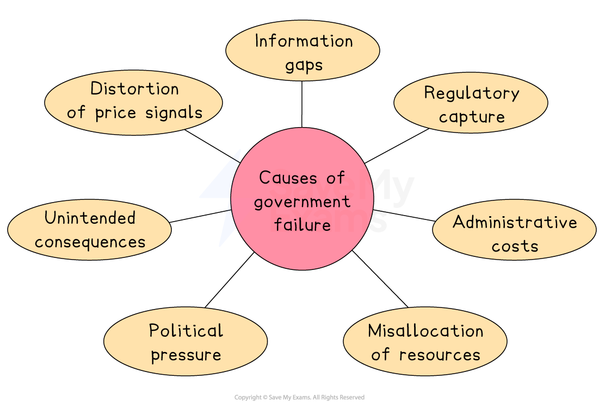
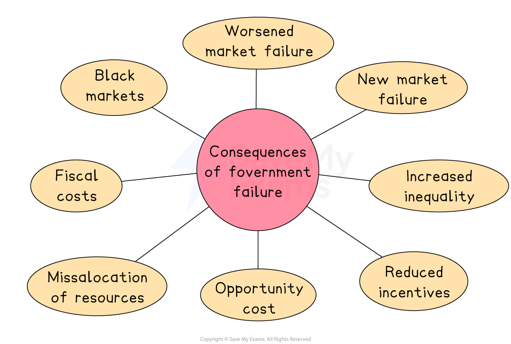

# Causes & Effects of Government Failure

## Why intervention fails

> **Spec point** — `spcpt_q4Tz2M64RVxX6Q8Z`

## Government failure

- **Government failure** **occurs when government intervention in a market creates a net welfare loss** - moving output further from the socially optimal level rather than closer to it
- It does not mean the intervention has no effect

  - It means the **costs of intervention exceed its benefits**, leaving society worse off than without intervention
- Government failure is a critical evaluative concept: **every policy used to correct market failure carries the risk of creating government failure** if poorly designed or implemented

### Causes of government failure

*Causes of government failure*

| Cause | Explanation | International example |
|---|---|---|
| **Information gaps** | - Governments lack the perfect information needed to set taxes, *subsidies*, *price controls* or regulations at the correct level — they cannot accurately observe MSC, MSB or Qopt | - *Carbon taxes* vary enormously across countries - from Sweden's high rate to zero in many major emitting economies - reflecting genuine uncertainty about the correct rate |
| **Distortion of price signals** | - Government intervention artificially alters the *signalling function* of the price mechanism, sending incorrect signals to producers and consumers | - Agricultural *price floors* in the EU have historically signalled to farmers to overproduce, generating large surplus stocks that required costly government purchase and storage |
| **Unintended consequences** | - Producers and consumers respond to interventions by seeking legal or illegal ways to avoid them, creating outcomes the government did not anticipate | - Tobacco taxation in **Australia** and **Singapore** has been linked to growth in illicit tobacco markets - **shifting consumption **from taxed legal products to untaxed illegal ones |
| **Regulatory capture** | - The *regulating body* comes to act in the interests of the industry it regulates rather than the public interest, turning regulation into a tool that protects incumbents | - Financial regulators in several countries were criticised for being too close to the banks they oversaw, contributing to the risk-taking that caused the 2008 global financial crisis |
| **Administrative and compliance costs** | - The costs of designing, implementing, monitoring and enforcing government interventions may exceed the *welfare gains* they generate | - Complex tax systems in many lower-income economies impose significant *compliance costs* on small firms, reducing productive efficiency without generating equivalent welfare gains |
| **Political pressures** | - Government decisions are influenced by *electoral cycles*, *lobbying *and short-term political considerations rather than long-term economic efficiency | - Fuel subsidies in **Nigeria**, **Iran** and **Venezuela** have been maintained long after they ceased to be economically justified, due to political difficulty of removal |

## Consequences of government failure

> **Spec point** — `spcpt_zmFJNyWQYvMj5pBq`

## Consequences of government failure

- There are many possible consequences of government failure

*The consequences of government failure*

### Worsening of the original market failure

- Intervention set at the wrong level **may increase rather than decrease** the *deadweight welfare loss*

  - For example, a subsidy set too high leads to over-consumption beyond Qopt, creating a new welfare loss on the other side of the social optimum

### Creation of a new market failure

- Intervention in one market **generates distortions** in related markets

  - For example, agricultural price floors create *excess supply* that depresses prices in related markets and distorts international trade flows, as seen with EU agricultural policy

### Black markets

- Price controls and *prohibitions *push activity into illegal markets where consumer protections, quality standards and tax collection are absent

  - For example, rent controls in **New York**, **Stockholm** and **Mumbai** have generated significant informal rental markets operating outside the legal framework

### Misallocation of resources

- Government intervention keeps resources in declining or inefficient sectors rather than allowing them to shift to higher-value uses

  - For example, long-term coal subsidies in **Poland** and **India** have slowed the transition to *renewable energy* by** artificially sustaining uncompetitive production**

### Fiscal costs and opportunity cost

- Poorly designed interventions impose ongoing costs on government budgets, crowding out spending on other public goods

  - For example, fuel subsidies consumed over 20% of government spending in **Nigeria** at their peak, representing a massive *opportunity cost* relative to investment in healthcare, education and infrastructure

### Increased inequality

- Some interventions disproportionately benefit wealthier groups despite being designed to improve equity

  - For example, university education subsidies in many countries disproportionately **benefit higher-income students** who are more likely to access higher education, worsening rather than improving income distribution

> **Case Study**
> **Fuel subsidies in Nigeria**
> 
> **The context**
> 
> Nigeria introduced fuel subsidies to make petrol affordable for its population, the majority of whom live on low incomes.
> 
> At their peak the subsidies consumed a vast share of government revenue, making them one of the most significant examples of government failure through fiscal cost and *misallocation *in any developing economy.
> 
> **Actions taken**
> 
> - The Nigerian government subsidised petrol prices for decades, keeping pump prices well below market rates
> - Multiple attempts to remove subsidies were reversed following public protests - illustrating how political pressure perpetuates economically inefficient intervention
> - In **May 2023**, newly elected President Bola Tinubu abruptly ended the subsidy, causing fuel prices to triple overnight
> 
> **Outcomes**
> 
> Removal of the subsidy caused significant short-term *inflation *and hardship for low-income households - the very group the subsidy was meant to protect
> 
> This illustrates a central *paradox *of government failure: poorly designed interventions can become so embedded that their removal also causes harm
> 
> Critics note that wealthier Nigerians, who own more vehicles, captured a disproportionate share of the subsidy benefit, making the policy both fiscally costly and* regressive*

> **Exam Hint**
> Government failure is not a reason to avoid intervention — it is a reason to **design intervention carefully**. Strong answers acknowledge that both market failure and government failure exist and evaluate which is likely to be greater in context.
> 
> The most examinable causes are ***information gaps*** and **unintended consequences** - always support each with a specific international example.
> 
> Connect government failure to **allocative efficiency**: it occurs when intervention moves output away from Qopt, increasing rather than reducing the deadweight welfare loss.
> 
> For higher-mark responses, show that **every policy carries its own specific risk of government failure**, demonstrating sophisticated understanding of the intervention trade-offs.
