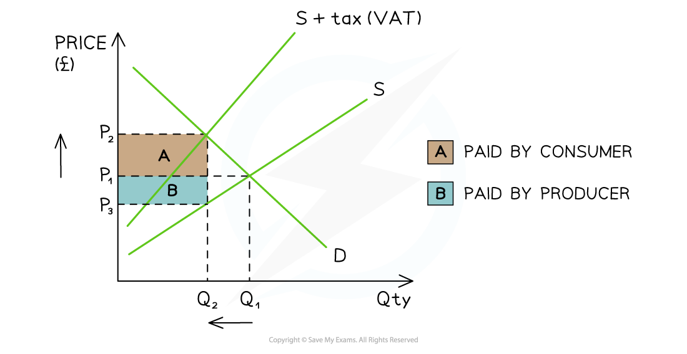

# Indirect Taxes (Specific & Ad Valorem)

## Indirect taxation

> **Spec point** — `spcpt_8CxWtYYGwyqNdhFw`

## Indirect taxation

- An indirect tax can be either **specific** or **ad valorem**
- Both shift the supply curve to the left, raising the price paid by consumers and reducing the quantity traded
- The key difference is in how the tax is calculated:

  - A **specific tax** is a fixed amount per unit, e.g. £0.50 per unit - the supply curve shifts left by the same vertical distance at all output levels, so the two supply curves are **parallel**
  - An ***ad valorem*** **tax** is a percentage of the price, e.g. 20% VAT - the tax per unit rises as price rises, so the shifted supply curve **diverges** from the original

## Specific tax on a negative externality of production

> **Spec point** — `spcpt_YKYsRw78RdN9MqV9`

## Specific tax on a negative externality of production

- Governments impose specific taxes on goods whose production generates *negative externalities* — where **MSC > MPC** at the *free-market equilibrium*
- The aim is to **internalise the externality** by making producers face the full social cost of production
- This moves output closer to the **socially optimal level** where **MSB = MSC**

*A diagram that shows the impact of a tax on a product that is over-provided in society. The tax reduces the welfare loss and moves production closer to the optimum level of production*

### Diagram analysis

- The free-market equilibrium is at **PeQe**, where **MPB = MPC**

  - As **MSC > MPC**, there is a **negative externality of production** and output is above the socially optimal level (**Qopt**)
  - There is a **pre-tax welfare loss** (deadweight loss) shown by the shaded triangle
- A specific tax shifts supply left from **S → S₁**, where S₁ = MPC + tax

  - The new equilibrium is at **P₁Q₁** — a **higher price** and **lower output**
  - Output moves **closer to Qopt**, reducing (but not necessarily eliminating) the welfare loss
  - The **post-tax welfare loss** is smaller than the pre-tax welfare loss

## Ad valorem tax

> **Spec point** — `spcpt_gbtmJyZg2ft8YPMm`

## Ad valorem tax

- **An ad valorem tax is a percentage of the purchase price**
- Because the tax is proportional to price, the vertical distance between the original and shifted supply curve **increases at higher prices** - the two curves diverge
- *Ad valorem* taxes are widely used internationally:

  - **Brazil** operates one of the most complex *ad valorem* tax systems in the world, with multiple layers of *federal taxes* and *state taxes* on goods and services
  - **India's** Goods and Services Tax (GST) applies *ad valorem* rates of 5%, 12%, 18% or 28% depending on the good, with luxury and *demerit goods* attracting the highest rates
  - Most OECD countries apply a standard *ad valorem* consumption tax — for example, Japan's consumption tax is 10%, while many EU member states apply rates of 20–25%

*A diagram showing an ad valorem tax (VAT) and the tax incidence for producers and consumers*

### Diagram analysis

- Initial equilibrium is at **P₁Q₁**
- The *ad valorem* tax shifts supply left from **S → S + tax**; the curves diverge because the tax per unit is larger at higher prices
- New equilibrium is at **P₂Q₂** — price is **higher** and output is **lower**
- The tax burden is shared between consumers and producers:

  - **Consumer incidence** = (P₂ − P₁) × Q₂ — Area A
  - **Producer incidence** = (P₁ − P₃) × Q₂ — Area B

#### Specific vs ad valorem: key comparison

| Feature | Specific tax | *Ad valorem* tax |
|---|---|---|
| Amount | - Fixed per unit | - Percentage of price |
| Supply curve shift | - Parallel | - Diverging |
| Effect on expensive goods | - Same tax regardless of price | - Higher tax on higher-priced goods |
| Common use | - Fuel and tobacco *excise duties* | - *GST*, *VAT*, consumption taxes |

## Evaluating the effectiveness of indirect taxation

> **Spec point** — `spcpt_y5trWbxGMFtzWCnp`

## Evaluating the effectiveness of indirect taxation

### Tax incidence and PED

- The division of the *tax burden* between consumers and producers depends on **price elasticity of demand (PED)** and **price elasticity of supply (PES)**

  - If demand is **price inelastic**, consumers bear most of the tax burden - price rises significantly but quantity demanded falls only slightly, limiting the reduction in output
  
    - Example: specific taxes on tobacco in **Indonesia** and **China** raise significant government revenue but have had limited success in reducing consumption because demand is highly *inelastic*
  - If demand is **price *****elastic***, producers bear more of the burden and output falls more significantly, which is more effective at correcting the *market failure*

### Setting the correct tax rate

- To fully correct a negative externality, the tax must equal the **marginal external cost (MEC) at the *****socially optimal***** output level**
- In practice this is extremely difficult

  - External costs are hard to measure accurately
  - The socially optimal output level is unknown with certainty
  - Setting the tax too low leaves residual market failure; setting it too high creates a new *welfare loss*
  - Example: ***carbon taxes*** vary enormously across countries — Sweden's carbon tax is among the highest in the world, while many major emitting economies have no carbon tax at all, reflecting the difficulty of agreeing on the correct rate

### Government failure

- If the tax is set incorrectly, it may **worsen *****allocative efficiency*** rather than improve it - this is a form of **government failure**
- Higher taxes on demerit goods can encourage **illegal markets**:

  - Heavy tobacco taxation in **Australia** and **Singapore** has been linked to growth in illicit tobacco trade, partially undermining the policy's effectiveness

### Equity

- Indirect taxes are often **regressive** - lower-income households spend a higher proportion of their income on taxed goods, so the tax burden falls disproportionately on them
- This is particularly significant in **lower-income countries**, where a larger share of household expenditure goes on basic goods that attract consumption taxes
- This creates a **trade-off between efficiency and *****equity**** *that governments must consider when setting tax rates
- Some governments attempt to address this by ***zero-rating*** essential goods such as food and medicine - common in many African and South Asian tax systems

> **Exam Hint**
> The most common error is stating that a specific tax "eliminates" the welfare loss - it only does so if the tax is set precisely equal to the MEC at Qopt. Always acknowledge this limitation.
> 
> When evaluating effectiveness, link tax incidence explicitly to *PED*: if demand is inelastic, the tax raises revenue but has limited impact on quantity - meaning it may fail to correct the market failure even if it succeeds as a revenue-raising tool.
> 
> For higher-mark responses, use the **equity–efficiency trade-off**: a tax that moves output towards the allocatively efficient level may be *regressive*, creating a conflict between the government's efficiency and equity objectives - particularly relevant in developing economies.
