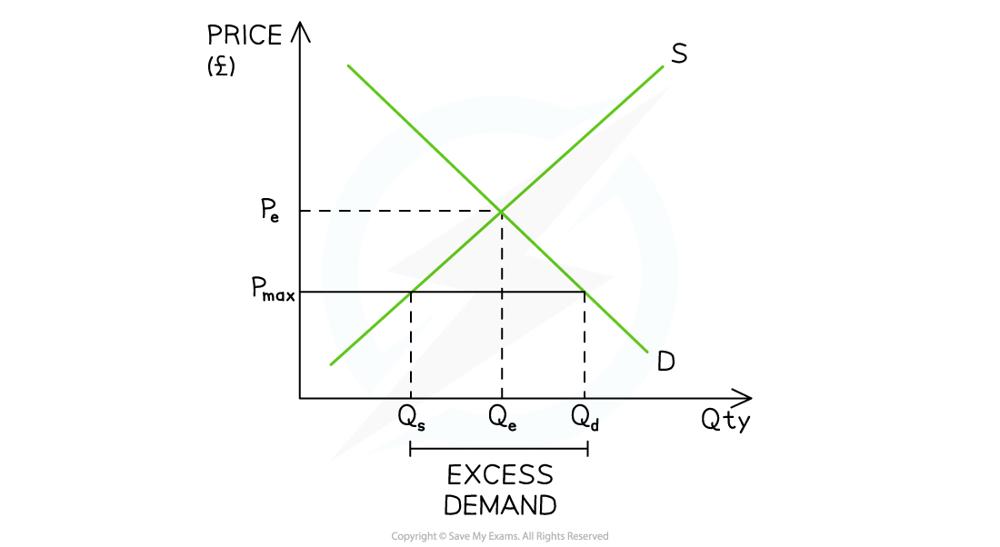
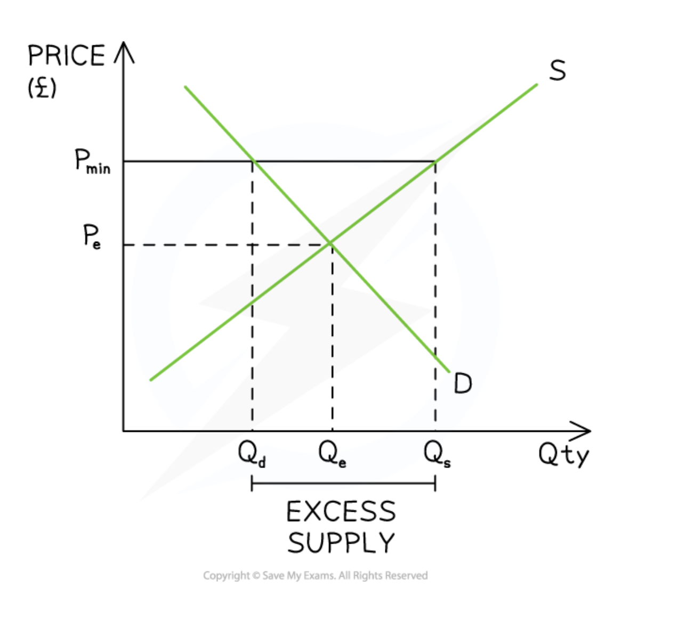

# Price Controls, Production Quotas & Prohibitions

## Price controls, production quotas and licences

> **Spec point** — `spcpt_pZn2Gw7HSHCkwbdY`

## Price controls, production quotas and licences

- These policies all work by **directly restricting price or quantity** in a market, rather than using fiscal measures such as taxes or *subsidies*

  - They are used when governments judge that the price mechanism alone is producing a **socially undesirable outcome** - either too high a price, too low a price, or too great a quantity of a harmful good
- At A Level, the focus is on ***allocative efficiency***: do these interventions move output closer to or further from the socially optimal level where **MSB = MSC**?

## Maximum prices (price ceilings)

> **Spec point** — `spcpt_W6wtz3GtzbtwGhrM`

## Maximum prices (price ceilings)

- **A maximum price is set below the free-market equilibrium price**

  - Sellers cannot legally charge above this price
- Governments use maximum prices to:

  - Make **essential goods and services** more affordable, particularly for low-income consumers
  - Increase consumption of ***merit goods*** towards the socially optimal level
  - Prevent ***monopoly *****exploitation** in markets where a single supplier would otherwise charge very high prices

#### International examples of maximum prices

- **Argentina**: the government has imposed maximum prices on basic foodstuffs such as flour, cooking oil and rice to protect low-income households from *inflation* - though both cases led to severe shortages
- **Nigeria**: the government has at various points imposed maximum prices on petrol to keep fuel affordable, given the country's heavy dependence on petroleum products

*A maximum price creates excess demand*

### Diagram analysis

- The free-market equilibrium is at **PeQe**
- A maximum price is imposed at **Pmax**, below Pe

  - The lower price **reduces the incentive to supply** - quantity supplied contracts from **Qe → Qs**
  - The lower price **increases the incentive to consume** - quantity demanded extends from **Qe → Qd**
  - This creates **excess demand (shortage)** equal to **Qs Qd**
- The shortage may lead to:

  - **Non-price rationing**: queuing, waiting lists or favouritism
  - ***Black markets***: illegal trade at prices above Pmax
- Consumer surplus increases for those who successfully purchase at the lower price
- Producer surplus falls as the price received is below the free-market level

## Minimum prices (price floors)

> **Spec point** — `spcpt_sDSMvX9zcbzvHGW5`

## Minimum prices (price floors)

- **A minimum price is set above the free-market equilibrium price**

  - Sellers cannot legally charge below this price
- Governments use minimum prices to:

  - **Protect producers** from excessively low prices, particularly in agricultural markets
  - **Reduce consumption of *****demerit goods*** by raising their price above the free-market level
  - **Protect workers** from exploitation - *minimum wages* are a form of price floor in the labour market

#### International examples of minimum prices

- **Agricultural price floors**: the EU's Common Agricultural Policy (CAP) has historically set minimum prices for agricultural products to guarantee farmer incomes - though this led to well-known surplus problems ("butter mountains", "wine lakes")
- **Demerit goods**: **Thailand** and **South Africa** have introduced minimum unit pricing on alcohol to reduce consumption and the associated negative externalities of harmful drinking
- **Minimum wages**: **Mexico**, **Brazil** and **South Africa** all operate national minimum wages as a price floor in the labour market, aiming to reduce poverty and income inequality

*A minimum price causes excess supply*

#### Diagram analysis

- The free-market equilibrium is at **PeQe**
- A minimum price is imposed at **Pmin**, above Pe

  - The higher price **increases the incentive to supply** — quantity supplied extends from **Qe → Qs**
  - The higher price **reduces the incentive to consume** — quantity demanded contracts from **Qe → Qd**
  - This creates **excess supply (surplus)** equal to **Qd Qs**
- In **demerit good markets**, the reduced consumption moves output closer to the socially optimal level - provided Pmin is set appropriately
- In **agricultural markets**, governments may purchase the excess supply at the guaranteed price, storing or exporting it - this represents a significant *fiscal cost*
- Producer surplus increases; consumer surplus falls

## Production quotas

> **Spec point** — `spcpt_rxkBbh9QqVdXfFq7`

## Production quotas

- A **production quota** is a legal limit on the **quantity** a producer is permitted to supply
- Quotas work by **directly restricting output** rather than adjusting price, shifting the effective supply curve to become perfectly inelastic at the quota level
- They are used to:

  - Reduce output of goods generating **negative externalities of production**
  - Manage **common pool resources** to prevent over-exploitation
  - Support producer prices in agricultural markets

#### International examples of production quotas

- **OPEC oil quotas**: member countries including **Saudi Arabia**, **UAE** and **Iraq** agree production quotas to restrict global oil supply and support prices — a form of cartel behaviour with significant global macroeconomic implications
- **Fishing quotas**: the **EU**, **Norway** and **Iceland** impose catch quotas on fishing fleets to prevent over-exploitation of fish stocks — a classic common pool resource problem
- **Carbon quotas**: under **cap-and-trade** systems such as the EU Emissions Trading System, firms are allocated production quotas for carbon emissions, restricting total output of a negative externality

## Prohibitions

> **Spec point** — `spcpt_dGHy42f4hsNqRm23`

## Prohibitions

- **A complete prohibition is the most extreme form of quantity restriction - output is reduced to zero in the legal market**

  - Used for goods whose consumption generates **severe negative externalities** or where consumption is judged to be entirely socially undesirable
- International examples:

  - **Illegal drugs**: most countries prohibit the production and sale of substances such as heroin and cocaine, though the effectiveness of prohibition is widely debated
  - **Ivory trade**: the **CITES** international agreement prohibits trade in elephant ivory to protect endangered species — an example of a global externality being addressed through prohibition
  - **Asbestos**: banned in over 60 countries including throughout the **EU**, **Japan** and **Australia** due to the severe health externalities of production and consumption

## Licences

> **Spec point** — `spcpt_6F2YMy4tWWcFsVgZ`

## Licences

- Licences allow governments to **control the number and quality of suppliers** without eliminating the market entirely
- They restrict supply, raising price and reducing quantity — similar in effect to a quota but with quality control built in
- International examples:

  - **Alcohol licences**: most countries require sellers of alcohol to hold a government licence, limiting the number of outlets and reducing accessibility of a demerit good
  - **Broadcasting licences**: governments licence broadcasters to control content and prevent market failure from the public good characteristics of the broadcast spectrum
  - **Taxi and transport licences**: cities including **Singapore**, **Tokyo** and **Mexico City** licence taxi operators to control supply and maintain service quality

## Evaluating price controls, quotas, prohibitions and licences

> **Spec point** — `spcpt_ddvqbMJQKTYh4mPr`

## Evaluating price controls, quotas, prohibitions and licences

### Allocative efficiency

- All of these policies create a **wedge between the market price and the equilibrium price**, or restrict output below or above the free-market level
- They improve allocative efficiency **only if** they move output closer to the socially optimal level where MSB = MSC

  - If set incorrectly, they can worsen the misallocation of resources - a form of **government failure**

### The problem of setting the correct level

- Governments face the same fundamental information problem as with taxes and subsidies: they need to know the **socially optimal price or quantity**, which is extremely difficult to measure

  - For example, fishing quotas in many countries have been set **too high** relative to the sustainable yield, failing to prevent overfishing - the EU's quota system has faced persistent criticism on these grounds

### Unintended consequences

- Maximum prices and prohibitions frequently generate **black markets**, where goods are traded illegally at prices above the legal maximum or without government oversight

  - Venezuela's price controls on food created extensive black market activity
  - Drug prohibition in many countries has given rise to large illegal markets with associated crime and violence
- Minimum prices and quotas can lead to **excess supply** that must either be purchased by the government at significant fiscal cost or destroyed

### Time and the key concept

- The effectiveness of these policies often changes over **time**

  - In the short run, supply and demand tend to be more inelastic, so price controls have a smaller effect on quantities
  - In the long run, producers and consumers adjust - shortages worsen under maximum prices as supply contracts further, and black markets grow

### Equity

- Maximum prices on essential goods improve **equity** in the short run by making goods affordable for low-income consumers
- However, if shortages result, it is often **higher-income or better-connected consumers** who access the scarce supply - undermining the equity objective
- Minimum wages as a price floor are generally **pro-equity**, raising incomes of the lowest-paid workers, though critics argue they may reduce employment if set too high

> **Exam Hint**
> For evaluation, the strongest analytical point for **any** of these policies is the **information problem**: governments cannot observe the true socially optimal price or quantity, so all interventions risk being set incorrectly and creating government failure
> 
> Link **time** explicitly to your evaluation: in the short run supply and demand are more inelastic, so the effects of price controls are more muted — but in the long run, shortages and surpluses tend to worsen as producers and consumers fully adjust
> 
> For prohibitions, always acknowledge the **black market problem**: a prohibition reduces legal supply to zero but does not eliminate demand, so illegal markets emerge. This is a particularly strong evaluative point because it shows the policy may worsen outcomes
