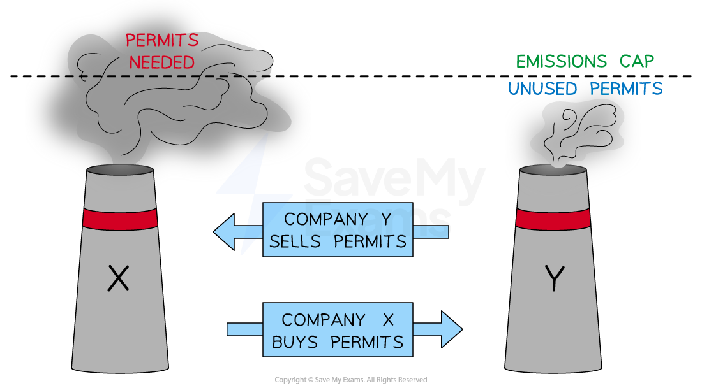

# Property Rights & Pollution Permits

## Property rights and pollution permits

> **Spec point** — `spcpt_9wFRFm5BwSMyGbkr`

## Property rights and pollution permits

- **Property rights are legally enforced entitlement that defines who owns a resource and how it may be used, transferred or exchanged**
- Many market failures arise because **property rights over resources are absent or poorly defined**

  - When no one owns a resource - such as clean air, ocean fish stocks, or a rainforest -  no one has an incentive to manage it sustainably
  - This leads to **over-exploitation**: the private cost of using the resource is below the social cost, generating a negative externality
- Governments can correct this by **assigning property rights** over previously unowned resources, giving the rights-holder a direct incentive to manage the resource efficiently

  - This **internalises the externality** - the cost of *degrading *the resource falls on the owner rather than on society
- **Pollution permits** are the most important application of this principle in economics

  - They create tradeable property rights over the right to emit pollution
- **Pollution permits are a government-issued licence that gives the holder the legal right to emit a specified quantity of pollution**

  - Permits are **tradeable**, allowing firms to buy and sell them so that emissions reductions are made where they are least costly

## Property rights

> **Spec point** — `spcpt_gzR9sVnjvF59B8Tm`

## Property rights

- When property rights are assigned over a common access resource:

  - The owner has an incentive to **prevent over-exploitation** — degrading the resource reduces its future value to the owner
  - The **negative externality is internalised** — private costs rise to reflect social costs
  - Output is reduced towards the **socially optimal level** where **MSB = MSC**

### International examples of property rights

- **Fishing rights**: **New Zealand** and **Iceland** pioneered Individual Transferable Quotas (ITQs) - tradeable property rights over a share of the total allowable fish catch

  - Rights-holders have a direct incentive to protect stock as it determines the future value of their quota

- **Forest rights**: **Community forest management** programmes in **Nepal** and **Mexico** have assigned property rights over forest resources to local communities

  - This has dramatically reducing illegal logging and *deforestation *rates compared to state-managed forests

## Evaluating property rights

| Advantages | Disadvantages |
|---|---|
| - **Internalises externalities**    - gives resource owners a direct market incentive to manage sustainably without ongoing government intervention in prices or quantities | - **Equity concerns**    - deciding who receives property rights is politically difficult; granting rights to existing users may reward past harmful behaviour and exclude others |
| - **Cost-efficient**    - harnesses market incentives rather than requiring costly ongoing regulation and enforcement | - **Cannot be applied to global commons**    - it is not possible to assign enforceable ownership of the atmosphere or oceans across national borders |
| - **Tradeable rights allow efficient allocation**    - resources flow to their highest-value use through voluntary exchange, as with water rights in Chile and Australia | - **Enforcement costs**    - establishing and policing property rights requires strong legal institutions that may not exist in lower-income economies |
| - **Reduces need for command and control**    - less reliance on regulation and its associated risks of *regulatory capture* and government failure | - **Divisibility problems**    - some resources such as clean air are not easily divided among users, making formal property rights difficult to define and monitor |

## Pollution permits

> **Spec point** — `spcpt_cGc8WJ9xm3Cpnsgc`

## Pollution permits

- A ***pollution permit**** *(also called a cap-and-trade scheme) creates a **tradeable property right** over the right to emit a specified quantity of pollution

  - The government sets a **total emissions cap** - the maximum quantity of pollution permitted across all firms in the scheme
  - This cap is divided into individual permits, each allowing the holder to emit one unit of pollution
- Permits are allocated to firms, who may then

  - **Use** them to cover their own emissions
  - **Sell** surplus permits if they reduce emissions below their allocation
  - **Buy** additional permits if they wish to emit more than their allocation allows
- The **price of permits is determined by supply and demand** in the permit market

  - The government fixes the quantity (the cap) and the market determines the price

*Pollution permits internalise the externality*

### Diagram analysis

- The **emissions cap** sets the total quantity of pollution permitted

  - This is fixed by the government and represents the socially optimal level of total emissions
- **Company Y** reduces its emissions below its allocation

  - It invests in cleaner technology and sells its surplus permits, generating revenue
- **Company X** finds it cheaper to buy permits than to reduce its own emissions

  - It purchases Company Y's surplus permits
- The **permit price** is determined by supply and demand:

  - If abatement is cheap for most firms, permit demand is low and the price falls
  - If abatement is costly, permit demand is high and the price rises, incentivising investment in cleaner technology
- If the permit price **exceeds the cost of adopting *****green technology***, firms will switch to cleaner production — the market automatically incentivises *innovation*

#### International examples of pollution permits

- **EU Emissions Trading System (ETS)**: the world's largest carbon market, covering energy, industry and aviation across EU member states — the cap has been tightened progressively to drive emissions reductions
- **South Korea's Emissions Trading Scheme**: established in 2015, covering around 70% of national *greenhouse gas emissions* across industry, energy and buildings

#### Evaluating pollution permits

| Advantages | Disadvantages |
|---|---|
| - **Achieves emissions target with certainty**    - the cap directly limits total pollution regardless of the permit price, unlike a carbon tax whose effect on quantity depends on PED | - **Setting the correct cap is difficult**    - if the cap is set too high, permits are cheap, emissions reduction is minimal and the market failure persists |
| - **Cost-efficient**    - emissions reductions are made by firms with the lowest abatement costs, achieving the overall target at least total cost across the economy | - **Permit price volatility**    - prices fluctuate with economic conditions; during *recessions*, lower output reduces permit demand and prices collapse, weakening the incentive to invest in green technology |
| - **Incentivises innovation**    - firms that develop cheaper abatement technology can sell surplus permits, generating revenue and a continuous market incentive to innovate beyond the required standard | - **Initial allocation raises equity concerns**    - if permits are given free to existing polluters ("grandfathering"), this rewards past harmful behaviour and creates a *windfall *for high-emitting incumbents |
| - **Generates government revenue**    - if permits are *auctioned *rather than allocated free, the government raises significant revenue that can be used to fund green investment or reduce other taxes | - **Carbon leakage**    - if only some countries operate permit schemes, firms may relocate production to countries without carbon costs, shifting emissions rather than reducing them globally |
| - **Market-based**    - harnesses price signals rather than requiring detailed knowledge of each firm's abatement costs, avoiding the information problems that affect regulation | - **Requires strong institutions**    - effective monitoring, reporting and verification of emissions is essential; in lower-income economies this capacity may not exist |

## Permits vs regulation vs taxation: key comparison

> **Spec point** — `spcpt_qn6bh5TyFPp2rhsp`

## Permits vs regulation vs taxation: key comparison

|   | Pollution Permits | Carbon Tax | Regulation |
|---|---|---|---|
| Mechanism | - Tradeable property rights | - Price instrument | - Legal standard |
| Certainty of quantity outcome | - High — cap fixes total emissions | - Low — depends on PED | - High — legal limit |
| Cost efficiency | - High — lowest-cost abatement first | - High — firms abate if cheaper than tax | - Low — uniform standard regardless of cost |
| Government revenue | - Yes — if permits auctioned | - Yes | - Only from fines |
| Incentive to innovate beyond standard | - Yes — continuous price incentive | - Yes — continuous price incentive | - No — only up to required standard |
| Information required | - Cap level | - Correct tax rate = MEC at Qopt | - Correct regulatory standard |

> **Exam Hint**
> Frame permits as a **property rights solution** — the government creates a market for the right to pollute, correcting the market failure of absent property rights.
> 
> **Key distinction**
> 
> - Permits fix **quantity** with certainty but allow price to fluctuate
> - A carbon tax fixes **price** but allows quantity to vary with PED
> 
> **Two strongest evaluation points**
> 
> 1. Cap too generous → permit price collapses → minimal emissions reduction (early EU ETS)
> 2. Carbon leakage → firms *relocate *to avoid carbon costs, shifting rather than reducing global emissions
> 
> Connect property rights to the externality framework: absent rights mean **MSC > MPC** → assigning rights raises private costs towards social costs → output moves towards **Qopt**.
