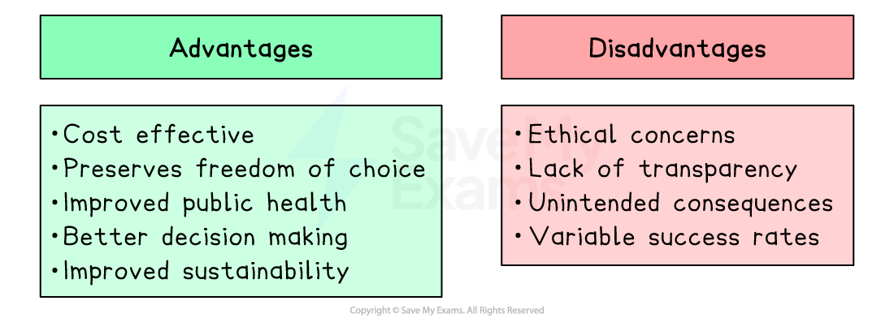

# Provision of Information, Behavioural Insights & Nudge Theory

## Provision of information, behavioural insights and nudge theory

> **Spec point** — `spcpt_3x63NKysNyWPvX8z`

## Provision of information, behavioural insights and nudge theory

- A key cause of market failure is **asymmetric information** - where one party in a transaction has more or better information than the other
- This leads to:

  - **Under-consumption of *****merit goods***
  
    - consumers underestimate private and external benefits (e.g. vaccination, education)
  - **Over-consumption of *****demerit goods***
  
    - consumers underestimate private and external costs (e.g. tobacco, sugar)
  - **Adverse selection**
  
    - buyers and sellers make suboptimal decisions based on incomplete information
- Governments can correct this market failure through three related but distinct approaches:

  - **Provision of information**: making accurate information available to consumers
  - **Behavioural insights**: using psychology and economics to understand why people make poor decisions
  - **Nudge theory**: designing the **choice architecture** to steer people towards better decisions without restricting freedom of choice

## 1. Provision of information

> **Spec point** — `spcpt_rDcYx9t2vvtQD6Xp`

## 1. Provision of information

- **Occurs when the government provides or mandates the provision of accurate information to correct the information failure between producers and consumers**
- This works by shifting consumers' perceived **marginal private benefit (MPB)** or **marginal private cost (MPC)** towards the true social values, moving consumption closer to the **socially optimal level**
- Two main approaches:

  - **Government provision**: the government directly funds and distributes information campaigns
  - **Mandated disclosure**: governments require firms to provide information to consumers - shifting the cost of information provision onto producers

> **Case Study**
> **Plain Tobacco Packaging in Australia**
> 
> **The context**
> 
> Tobacco markets suffer from a severe information failure
> 
> Consumers systematically underestimate the health costs of smoking, with branded packaging actively reinforcing this by making cigarettes appear *aspirational*
> 
> 
> 
> **Actions taken**
> 
> Australia became the first country to introduce standardised plain packaging in December 2012, removing all *branding* and replacing it with graphic images of smoking-related diseases.
> 
> - All tobacco products sold in identical olive-brown packaging with graphic health warnings covering 75% of the front and 90% of the back
> - Tobacco firms launched significant *WTO* legal challenges, which ultimately ruled in Australia's favour in 2018
> - The policy inspired subsequent adoption across Latin America, Asia and Africa
> 
> **Outcomes**
> 
> - Australian smoking rates fell from 15.1% in 2013 to 11% by 2019
> - However, isolating the impact of plain packaging from simultaneous tax increases is methodologically difficult
> 
>   - Illicit tobacco markets expanded during the same period, partially undermining the policy's effectiveness

### Evaluating provision of information

| Advantages | Disadvantages |
|---|---|
| - **Targets the root cause**    - corrects the information failure directly rather than using a blunt instrument such as a tax | - **Information overload**    - consumers may ignore or misinterpret complex information, particularly where literacy levels are low |
| - **Preserves freedom of choice**    - consumers make their own decisions with better information rather than being *coerced* | - **Opportunity cost**    - government-funded information campaigns are costly; resources could be used elsewhere |
| - **Can be targeted**    - information can be directed at the specific groups most affected by the information failure | - **Firms may resist or undermine** **mandated disclosure**    - through *lobbying*, legal challenges or presenting information in misleading ways |
| - **Internationally scalable**    - mandated disclosure requirements can be adopted across countries as global standards | - **Does not correct deep behavioural biases**    - even well-informed consumers may still make poor decisions due to present *bias*, addiction or social pressure |

## 2. Behavioural insights

> **Spec point** — `spcpt_zTDMncXPyrgNScRR`

## 2. Behavioural insights

- **Behavioural economics combines psychology and economics to explain why people systematically make decisions that appear irrational from a traditional economic perspective**
- Traditional economics assumes consumers are ***rational utility maximisers***

  - They process all available information and make decisions in their long-run best interest
- Behavioural economics identifies systematic ***cognitive biases*** that cause consumers to deviate from this rational model:

  - **Present bias**
  
    - Individuals place excessive weight on immediate costs and benefits relative to future ones - explaining why people under-save for *retirement* or over-consume addictive goods
  - **Status quo bias**
  
    - Individuals tend to stick with the default option even when alternatives would make them better off
  - **Loss aversion**
  
    - Individuals feel the pain of a loss more strongly than the pleasure of an equivalent gain - meaning framing choices as avoiding losses is more effective than framing them as making gains
  - **Social norms**
  
    - Individuals are strongly influenced by what they perceive others to do - making social norm information a powerful behavioural tool
- These biases mean that **provision of information alone is insufficient**

  - Even fully informed consumers may still make suboptimal decisions
- Governments and firms can use knowledge of these biases to design interventions that improve decision-making

  - This is the foundation of **nudge theory**

## 3. Nudge theory

> **Spec point** — `spcpt_Dw538Z2BkVsSt6dP`

## 3. Nudge theory

- **Nudge theory, developed by economists Richard Thaler and Cass Sunstein (2008), argues that choice architecture — the way options are presented — powerfully influences decisions, and that small, low-cost changes to this architecture can steer people towards better outcomes without restricting freedom of choice**
- A **nudge** is any intervention that:

  - Alters the choice environment to make a beneficial option more likely to be chosen
  - Does **not** ban any options
  - Does **not** significantly change financial incentives
- Nudges work by exploiting **cognitive biases** rather than assuming rational behaviour

### Types of nudge and international examples

#### Default options (exploiting status quo bias)

- Setting the socially desirable option as the **default** that individuals must actively opt out of, rather than opt into

  - **Organ donation**: **Wales** (2015), **Spain**, **Austria** and **France** operate *opt-out* organ donation systems - *presumed consent* dramatically increases donor rates by exploiting status quo bias. **Spain's** opt-out system gives it one of the highest donor rates in the world

#### Social norm information (exploiting social influence)

- Informing individuals about what most people in their situation do, exploiting the tendency to conform to perceived social norms

  - **Tax compliance**: **HMRC** in the UK and tax authorities in **Guatemala** and **Costa Rica** have sent letters to late taxpayers stating that "most people in your area have already paid their taxes" - significantly increasing compliance rates at very low cost

#### Simplification (exploiting information overload)

- Presenting information more simply or prominently to make the most important factors understandable at the point of decision

  - **Traffic light food labelling**: adopted across the **EU**, **Chile** and **Ecuador** — presenting nutritional information as simple red/amber/green signals rather than complex numbers reduces *cognitive load* and improves food choices

#### Framing effects (exploiting loss aversion)

- Presenting the same information in terms of losses rather than gains to increase uptake of beneficial behaviours

  - **Health screening**: framing cancer screening as "avoiding death" rather than "improving health" has been shown to increase uptake across multiple countries, including **Japan** and **South Korea**, where screening rates were previously low

### Evaluating nudge theory

*There are both pros and cons associated with Nudges*

| Advantages | Disadvantages |
|---|---|
| - **Cost-effective**    - nudges typically cost far less than taxes, *subsidies* or *regulation* to implement and administer | - **Ethical concerns**    - nudges manipulate decision-making without individuals' explicit awareness, raising questions about *autonomy* and consent |
| - **Preserves freedom of choice**    - no options are banned; individuals can always opt out or choose differently | - **Lack of transparency**    - choice architecture operates largely invisibly, making it difficult for individuals to recognise and question the influences shaping their decisions |
| - **Exploits actual behaviour**    - works with real human psychology rather than assuming rational behaviour that does not exist in practice | - **Variable success rates**    - nudges are not equally effective across cultures, income levels or contexts; a nudge that works in one country may fail in another |
| - **Complements other policies**    - can be combined with taxes or regulation to reinforce behaviour change | - **Unintended consequences**    - as nudges become widely known, individuals may actively work against them, reducing effectiveness over time |
| - **Internationally scalable**    - low-cost nudges such as default options and social norm messages can be adopted across countries at minimal additional cost | - **Does not address underlying market failure**    - nudges change behaviour at the margin but do not correct the fundamental information failure or externality causing the market failure |

## Comparing the three approaches

> **Spec point** — `spcpt_bVJqxRfDZqW4cKnW`

## Comparing the three approaches

| Feature | Provision of information | Behavioural insights | Nudge theory |
|---|---|---|---|
| Mechanism | - Corrects information failure directly | - Identifies why rational choices fail | - Redesigns choice architecture |
| Assumes rational consumers | - Yes | - No | - No |
| Restricts freedom of choice | - No | - No | - No |
| Cost to government | - Medium | - Low–medium (research) | - Low |
| Addresses root cause | - Partially | - Diagnostic only | - Partially |
| Key limitation | - Biases mean informed consumers still choose badly | - Insight alone changes nothing | - Ethical concerns, variable effectiveness |
| International example | - Brazil nutritional labelling | - Tax compliance letters (Guatemala) | - Spain opt-out organ donation |

> **Exam Hint**
> Always distinguish between the **cause** (asymmetric information) and the **policy responses** (information provision, nudge theory). Treating them as the same thing is a common error.
> 
> Nudge theory's strongest advantage is **preserving freedom of choice** - unlike taxes, regulation or prohibitions which restrict options or raise costs.
> 
> The strongest point against nudges is the **autonomy concern** - they exploit cognitive biases individuals are unaware of, raising questions about consent and paternalism. Connect this to the key concept of *the role of government and equality and equity*.
> 
> Link all three policies to **the margin and decision-making**: each changes the information or context at the decision margin rather than using price instruments or bans.
