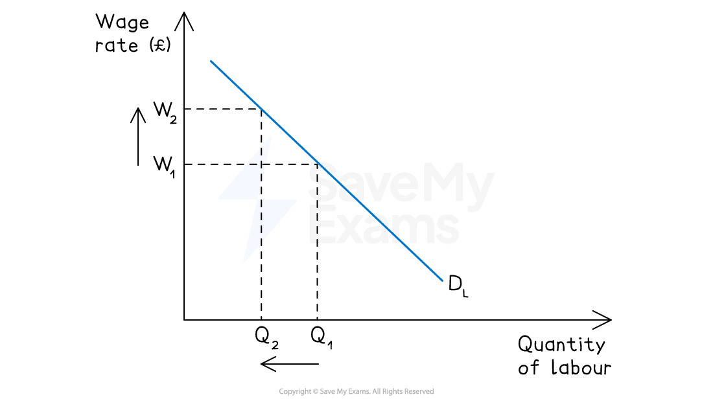
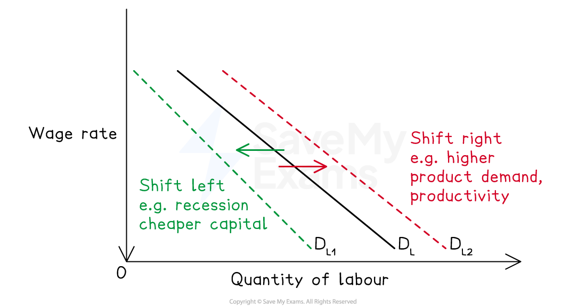

# The Demand for Labour

## Demand for labour as a derived demand

> **Spec point** — `spcpt_fH9q7kTHxzGHRWXD`

## Labour as a derived demand

- **The demand for labour is a derived demand -  it arises from the demand for the goods and services that labour helps to produce, rather than being demanded for its own sake**

  - If demand for a firm's output **rises**, more workers are needed
  
    - labour demand **increases**
  - If demand for a firm's output **falls**, fewer workers are needed
  
    - labour demand **decreases**
  - Labour demand therefore fluctuates directly with the demand for final goods and services

## Factors affecting the demand for labour

> **Spec point** — `spcpt_x3c2vwBMtbPQf3wB`

## Factors that affect the demand for labour

### 1. The demand for the final product

- As labour demand is derived, **changes in demand for the final good or service** are the most important determinant of labour demand

  - When an economy is booming and *consumer demand* is high, firms need more workers to meet output requirements - labour demand rises
  - During a ***recession***, demand for goods and services falls and firms reduce their workforce - labour demand falls
  - This applies at both **firm level** (a firm losing a major contract needs fewer workers) and **occupational level** (a declining industry such as coal mining reduces demand for miners economy-wide)
- For example, the global shift towards *renewable energy* has simultaneously **reduced** derived demand for coal miners in **South Africa**, **Poland** and **India** while **increasing** derived demand for solar panel engineers and wind turbine technicians

### 2. The price of the product being produced

- A higher product price increases the **revenue generated by each unit of output** and therefore the value of each worker's contribution to the firm

  - This raises the ***marginal revenue product of labour***** (MRP_L)** - covered in detail  on the next page
  
    - this makes firms willing to employ more workers at any given wage rate
- A fall in product price has the opposite effect

  - each worker generates less revenue, so firms demand less labour
- For example, falling global coffee prices reduce the marginal revenue product of coffee pickers in **Brazil** and **Ethiopia**, reducing labour demand in those occupations even if wages are unchanged

### 3. The productivity of labour

- If worker ***productivity *****rises** (through training, improved technology or better management) each worker produces more output per hour

  - This raises the value of employing an additional worker, increasing labour demand
  - Conversely, if productivity falls, each worker contributes less to output and labour demand falls
- For example, the introduction of automated machinery in **Chinese** and **Vietnamese** manufacturing has increased the productivity of remaining workers, raising demand for skilled machine operators while reducing demand for unskilled assembly workers

### 4. The ability to substitute capital for labour

- Firms continually assess whether it is more **cost-effective** to use capital (machinery and technology) or labour to produce their output

  - If capital becomes relatively cheaper (through technological improvement or falling equipment costs), firms substitute capital for labour, reducing labour demand
  - If labour becomes relatively cheaper (for example following a reduction in *social security* contributions), firms substitute labour for capital, increasing labour demand
- For example, the rapid adoption of **automated checkout systems** in retail across **Singapore**, **Japan** and many European economies has reduced derived demand for checkout operators, while increasing demand for technology maintenance workers

## Causes of a movement along the labour demand curve

> **Spec point** — `spcpt_ncK2DtPQcpQzZMZG`

## The demand curve for labour

- The demand curve for labour shows the **relationship between the wage rate and the quantity of labour demanded**
- It is **downward sloping** - as the wage rate falls, labour becomes cheaper relative to capital and relative to the marginal revenue it generates, so firms demand more labour
- The market demand curve for labour is the **horizontal sum of all individual firms' demand curves** for labour in that market or occupation

*As wages rise, the quantity demanded of labour falls*

### Diagram analysis

- The demand curve **D_L** is downward sloping

  - a higher wage rate reduces the quantity of labour demanded
- A **change in the wage rate** causes a **movement along** the demand curve

  - from one point to another on the same curve (W1 to W2)
- A **change in any other factor** (product demand, productivity, price of capital) causes a **shift of** the demand curve

  - the entire curve moves left or right

## Factors that shift the demand curve for labour

> **Spec point** — `spcpt_RH57chsDRVsGFmMx`

## Factors that shift the demand curve for labour

- Caused by a change in **any factor other than the wage rate**

  - **Rightward shift** (D_L increases): higher product demand, higher product price, higher labour productivity, capital becoming more expensive relative to labour
  - **Leftward shift** (D_L decreases): lower product demand, lower product price, lower productivity, capital becoming cheaper relative to labour

*Different factors cause the entire demand for labour curve to shift*

### Summary table

| Factor | Effect on labour demand curve |
|---|---|
| Wage rate rises | - Movement along - quantity demanded falls |
| Wage rate falls | - Movement along - quantity demanded rises |
| Demand for final product rises | - Shift right |
| Demand for final product falls | - Shift left |
| Product price rises | - Shift right |
| Product price falls | - Shift left |
| Labour productivity rises | - Shift right |
| Labour productivity falls | - Shift left |
| Capital becomes cheaper relative to labour | - Shift left |
| Capital becomes more expensive relative to labour | - Shift right |

> **Exam Hint**
> Always frame labour demand as **derived demand** - connect changes in labour demand explicitly back to changes in demand for the final product.
> 
> Only a change in the **wage rate** causes a movement along the demand curve - everything else causes a shift. State this distinction explicitly before applying it.
> 
> Distinguish between **firm-level** demand (affected by that firm's product demand and pricing) and **occupational** demand (reflecting economy-wide trends - a recession shifts D_L left across an entire occupation).
> 
> Link to **the margin and decision-making**: firms demand labour up to the point where the marginal benefit of an additional worker equals its marginal cost.
