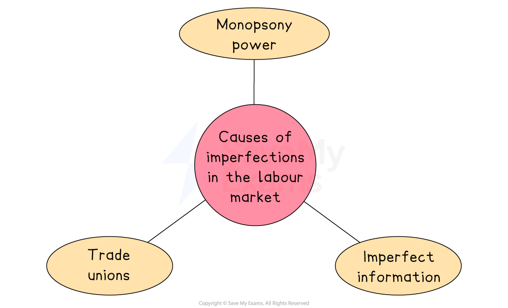
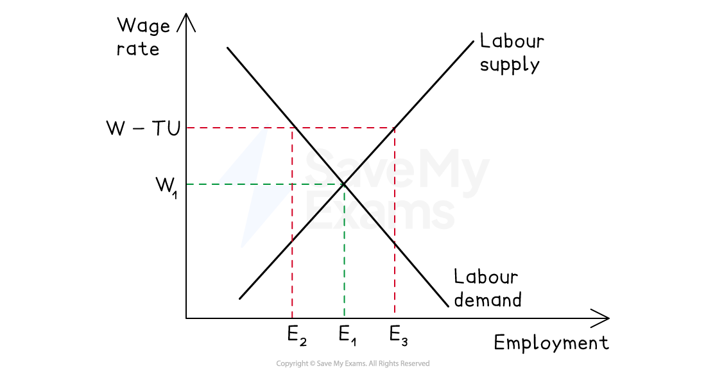
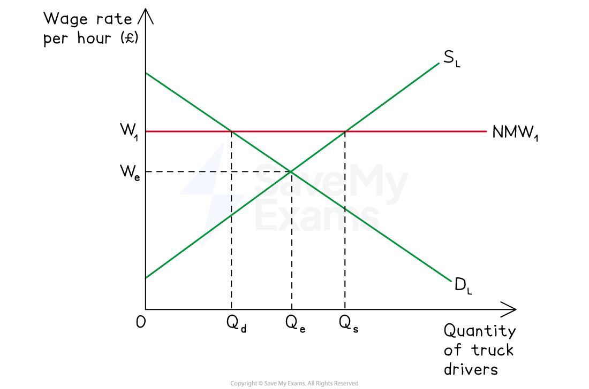
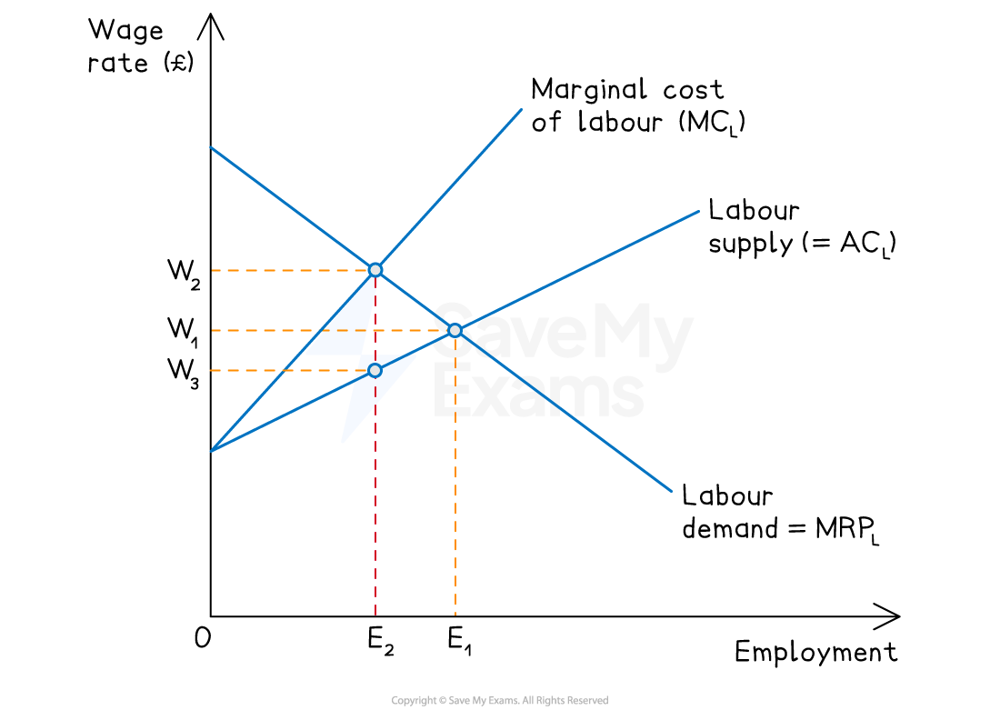

# Wage Determination in Imperfect Markets

## Wage determination in imperfect labour markets

> **Spec point** — `spcpt_TWhPXT4FqVHb2VZb`

## Wage determination in imperfect labour markets

- A perfectly competitive labour market is a theoretical construct
- **All labour markets face some level of imperfection**

### Reasons for imperfections in the labour market

*Imperfections cause wages to differ from what they would be in a perfectly competitive equilibrium *

- In reality, labour market wages are not always determined according to the **Marginal Revenue Product (MRP) theory**
- Firms and workers have some **degree of influence** over wage setting
- The less competition in the labour market, the more power employers have in **setting wages **

## Trade unions

> **Spec point** — `spcpt_3XswxXd72FXjDB4W`

## Trade unions

- A **trade union** is an organisation that represents workers in a particular occupation or industry, protecting their rights through **collective bargaining**

  - Unions negotiate wages and conditions on behalf of all members - giving workers significantly more *bargaining power* than they would have individually
- Trade union activity causes wages to be set **above the competitive equilibrium rate**, affecting both wage levels and employment

### Factors affecting trade union bargaining power

| Factor | Effect on bargaining power |
|---|---|
| **Union membership size** | - Larger unions have greater collective power    - More members means a more credible *strike* threat |
| **Unemployment level** | - High unemployment weakens unions    - Firms can more easily replace striking workers |
| **Firm's profitability** | - Higher profits strengthen union wage demands    - Firms have more capacity to pay |
| **Wage as proportion of total costs** | - If wages are a small share of costs, firms resist less    - Union power is higher |
| **Ability to substitute capital for labour** | - If *capital substitution* is easy, firms can resist wage demands    - Union power is lower |
| **Productivity of labour** | - Highly productive workers are harder to replace    - Strengthening union bargaining power |
| **State of the economy** | - Unions are stronger during *booms* when labour demand is high and weaker during *recessions* |

#### Impact of trade unions on labour markets

*Impact of a trade union on the labour market*

#### Diagram analysis

- Competitive equilibrium at **W₁, E₁** — where DL = SL
- Union raises wage to **W****TU** through collective bargaining
- Firms reduce employment from **E₁ → E₂** — movement along DL
- More workers wish to work at the higher wage - quantity supplied rises to **E₃**
- **Excess supply (unemployment)** of E₂E₃ results
- Workers in employment gain; workers priced out of employment lose

### Evaluating trade union influence

| Advantages | Disadvantages |
|---|---|
| - Raises wages for members above the competitive rate | - Creates excess labour supply    - Unemployment among non-unionised or priced-out workers |
| - Reduces *information asymmetry*    - Workers have better knowledge of their rights and market wages | - May reduce labour market flexibility    - Firms substitute capital for labour as wages rise |
| - Improves working conditions and *job security* through *collective bargaining* | - May price firms out of international competition if wages rise above productivity levels |
| - Corrects *monopsony* wage suppression | - Union power is weakest among low-paid, part-time and *gig workers* who need it most |

> **Exam Hint**
> Always define **collective bargaining** precisely - unions negotiate on behalf of all members, giving workers greater power than individual negotiation.
> 
> The key trade-off is **wages vs employment** -  higher union wages benefit members in work but create unemployment of Q₂Q₃. Always identify both sides explicitly.
> 
> Connect bargaining power to context - a union in a booming economy with low unemployment has far more power than one operating during a recession.
> 
> The employment cost depends on **PED for labour** - inelastic demand means small employment falls; elastic demand means significant unemployment.

## Impact of a National Minimum Wage

> **Spec point** — `spcpt_s77XTQB4ctbB3GGx`

## Impact of a national minimum wage

- A **national minimum wage (NMW)** is a **legally imposed price floor** in the labour market - employers cannot legally pay workers below this rate
- It is set **above the market equilibrium wage** to be effective - a minimum wage set below the equilibrium has no impact
- Governments use the NMW to:

  - Improve ***equity**** *- raising incomes of the lowest-paid workers
  - Reduce ***exploitation**** *- particularly in markets where employers have monopsony power
  - Reduce **in-work poverty** - ensuring full-time workers earn enough to meet basic needs
- The rate often varies by age - lower rates for younger workers are common in many countries

*A national minimum wage (NMW1) is imposed above the market wage rate (We) at W1*

### Diagram analysis

- Competitive equilibrium at **We, Qe** — where DL = SL
- NMW imposed at **W₁** above We
- Higher wage increases incentive to supply labour

  - quantity supplied rises from **Qe → Qs**
  - Higher wage raises cost of labour - firms reduce quantity demanded from **Qe → Qd**
  - **Excess supply of labour** equal to **QdQs** equals potential unemployment
- Workers who retain employment gain; workers priced out of employment lose

#### Evaluating the national minimum wage

| Advantages | Disadvantages |
|---|---|
| - **Reduces in-work poverty**    - Guarantees a minimum income floor for the lowest-paid workers | - **May cause unemployment**    - Firms demand less labour at W₁, creating excess supply of QdQs |
| - **Increases household income**    - Higher wages for low-paid workers may stimulate consumer spending | - **Unemployment effect depends on PED for labour**    - Inelastic demand means small employment losses; elastic demand means significant unemployment |
| - **May improve productivity**    - Higher wages can motivate workers, reduce *labour turnover* and attract more productive workers | - **Raises production costs**    - Firms may respond by raising prices, reducing international competitiveness |
| - **Empirical evidence suggests limited unemployment effects**    - Card and Krueger's US research found minimal employment losses from moderate NMW increases | - **Harms small businesses disproportionately**    - Large firms absorb higher labour costs more easily than small firms in *labour-intensive* sectors |
| - **Corrects information failure**    - Provides a clear wage floor for workers in weak bargaining positions | - **May accelerate capital substitution**    - Higher wages incentivise firms to *automate*, particularly in manufacturing and retail |

> **Case Study**
> **The National Minimum Wage in Brazil**
> 
> **The context**
> 
> Brazil has one of the most unequal income distributions in the world, with a large low-wage workforce concentrated in agriculture, domestic service and informal urban employment.
> 
> The **salário mínimo** (minimum wage) is a federally mandated minimum that applies to all formal sector workers and is adjusted annually to maintain its real value — with increases linked to *GDP growth* and *inflation* under a formula established in 2011.
> 
> **Actions taken**
> 
> - The real value of the minimum wage more than **doubled between 2003 and 2015** under Presidents Lula and Dilma, rising significantly faster than inflation
> - By 2024 the monthly minimum wage stood at **R\$1,412** — used as the reference point for social security benefits, *pensions* and transfer payments as well as wages
> - Annual uprating is recommended by the **Inter-union Department of Statistics and Socioeconomic Studies (DIEESE)**
> 
> **Outcomes**
> 
> The policy contributed significantly to poverty reduction alongside Bolsa Família — research estimates that minimum wage increases accounted for around 40% of the fall in income inequality between 2001 and 2012.
> 
> However a large *informal sector*, estimated at over 40% of the workforce, means many of the lowest-paid workers fall entirely outside the legal framework and receive no benefit.
> 
> This illustrates a fundamental limitation of minimum wage policy in lower-income economies - effectiveness depends critically on the capacity to enforce compliance.

> **Exam Hint**
> Always challenge the standard unemployment prediction with **empirical evidence** - Card and Krueger found minimal unemployment effects from moderate NMW increases, suggesting real labour markets are closer to *monopsony* than perfect competition.
> 
> Unemployment effects depend critically on **PED for labour** - inelastic demand means small employment losses; elastic demand means significant unemployment. Always state this explicitly.
> 
> Connect NMW back to **price controls.**

## Monopsony Power

> **Spec point** — `spcpt_qFjwNNxtYyddNkCK`

## Monopsony power

- A **monopsony** occurs when there is a **single buyer of labour** in a market

  - the employer has dominant purchasing power and can influence the wage rate
- Unlike a wage taker in a competitive market, a monopsonist is a **wage maker**

  - it sets the wage rate rather than accepting it
- A pure monopsony is rare - but **dominant buyers** with significant wage-setting power are common, particularly where:

  - The **government is the dominant employer** in an occupation — teachers, nurses, military personnel
  - A **single large firm** dominates employment in a region or industry

### Characteristics of a monopsonist

- **Wage maker**: sets wages below the competitive level by restricting employment
- **Profit maximiser**: minimises labour costs by paying workers as little as possible
- **Purchases a large share** of the labour supplied in that market

*Monopsony labour market*

#### Diagram analysis

- The **Labour Supply (= AC****L****)** curve is upward sloping

  - To attract more workers the monopsonist must offer a higher wage to all existing workers
- This means the **MC****L ****curve lies above and is steeper than  AC****L t**hroughout

  - The marginal cost of hiring one more worker exceeds the wage paid to that worker
- The monopsonist maximises profit by hiring where **MRP****L**** = MC****L** - at employment level **E₂**

  - The wage paid is read off the **AC****L**** = S****L**** curve** at E₂ - giving the monopsony wage **W₃**
- The competitive outcome would be where **MRP****L**** = AC****L** - at the higher employment level **E₁** and higher wage **W₁**

  - **W₂** is the wage at which **MC****L** intersects **MRP****L **- it is not the wage paid, but is used to identify the profit-maximising employment level E₂
- Monopsony therefore produces:

  - **Lower wages**: W₃ < W₁ - the monopsony wage is below the competitive wage
  - **Lower employment**: E₂ < E₁ - fewer workers are hired than in the competitive outcome
  - A **deadweight welfare loss** -  workers who would have been productively employed at the competitive wage W₁ are not hired

#### Correcting monopsony

- A **minimum wage** set between W₃ and W₁ can correct monopsony wage suppression - raising both wages and employment simultaneously towards the competitive outcome
- This is the strongest economic case for a national minimum wage - it corrects *market failure* rather than creating unemployment

### Evaluating monopsony

| Point | Explanation |
|---|---|
| **Allocative inefficiency** | - Wages below MRPL and employment below the competitive level — deadweight welfare loss |
| **Equity concern** | - Workers paid less than their marginal contribution    - Income redistributed from workers to employer |
| **Minimum wage as a corrective** | - NMW set between W₃ and W₁ raises both wages and employment    - Strongest economic case for intervention |
| **Pure monopsony is rare** | - Oligopsony — a few dominant buyers — is more common, with similar but less extreme *wage suppression* |
| **Dynamic efficiency concern** | - Suppressed wages reduce workers' incentive to invest in human capital and training |

> **Exam Hint**
> Always explain **why MC****L**** lies above AC****L** - hiring one more worker requires raising the wage for all existing workers, making marginal cost exceed average cost.
> 
> The monopsony outcome - **lower wages (W₃) and lower employment (E₂) than the competitive benchmark (W₁, E₁)** - is the key result. Always identify both effects and the resulting deadweight welfare loss.
> 
> Note that **W₂ is not the wage paid** - it is simply the point where MCL intersects MRPL, used only to identify the profit-maximising employment level E₂. Students frequently confuse W₂ with the monopsony wage - the wage paid is always W₃, read off ACL at E₂.
> 
> The minimum wage corrective is particularly powerful here - unlike in a competitive market where NMW risks unemployment, in a monopsony it can **raise both wages and employment simultaneously**.
