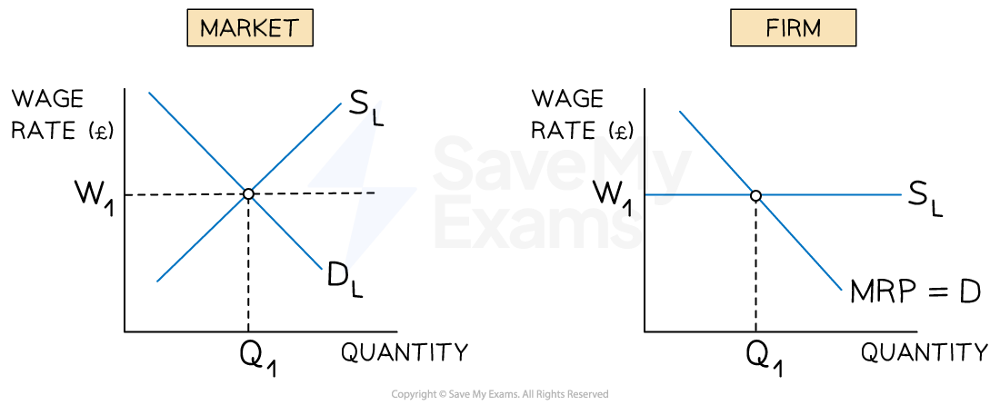

# Wage Determination in Perfect Markets

## Equilibrium wage rate and employment

> **Spec point** — `spcpt_hMnYPp56r2bCSvYM`

## Conditions for a perfectly competitive labour market

- A perfectly competitive labour market requires:

  - **many buyers and sellers**: many firms hiring and many workers supplying labour, so no individual participant can influence the wage rate
  - ***homogeneous *****labour**: all workers in the occupation are assumed to have identical skills and productivity
  - **perfect information**: all workers and firms have full knowledge of wage rates and job opportunities
  - **freedom of entry and exit**: workers can move freely between occupations and firms
- In reality these conditions are never fully met

  - labour markets are inherently imperfect due to skill differences, *asymmetric information* and *geographical immobility*
  - the perfectly competitive model is therefore a theoretical benchmark rather than a description of reality

*In the labour market for perfectly competitive firms, the wage rate is set by the industry wage rate*

### Diagram analysis

#### Wage determination at market level

- The equilibrium wage rate is determined where **demand for labour (D****L****) = supply of labour (S****L****)**
- At the equilibrium wage **W₁**, the quantity of labour demanded equals the quantity supplied - **Q₁** workers are employed
- As in product markets, if the wage rate is above or below W₁, market forces push it back towards equilibrium

  - excess labour supply drives wages down; excess demand drives wages up

#### Wage determination at firm level

- In a perfectly competitive labour market, the individual firm is a **wage taker**

  - it is too small to influence the market wage rate and must pay W₁
- The firm faces a **perfectly elastic supply of labour** at W₁:

  - If it offers a lower wage, it cannot recruit any workers - all will work elsewhere at W₁
  - If it offers a higher wage, it attracts more workers than it needs and pays above the market rate unnecessarily
- Because every additional worker costs the same wage rate W₁, the supply curve is also the firm's **average cost of labour (AC****L****)** and **marginal cost of labour (MC****L****)**:

  - ACL = W₁ for every worker hired
  - MCL = W₁ for every additional worker hired
  - Therefore **S****L**** = AC****L**** = MC****L**** = W₁**
- The firm's demand curve for labour is its **marginal revenue product of labour (MRP****L****)** curve - see [marginal revenue product theory](https://www.savemyexams.com/a-level/economics/cie/23/revision-notes/government-microeconomic-intervention/labour-market-forces-and-government-intervention/marginal-revenue-product-theory/)
- The firm maximises profit by hiring labour up to the point where **MRP****L**** = MC****L** - i.e. where **MRP****L** = W₁
- Equilibrium for the individual firm occurs at wage **W₁** and employment level **Q₁**

> **Exam Hint**
> Connect wage determination to **equilibrium and disequilibrium**: excess demand pushes wages up; excess supply pushes wages down -  the same mechanism as a product market.
> 
> For higher-mark responses, note that the perfectly competitive model predicts **allocative efficiency** - workers are paid their marginal revenue product, directing labour to its highest-value use. This is the benchmark against which imperfect labour market outcomes are judged.

## Evaluating the perfectly competitive labour market model

> **Spec point** — `spcpt_whp236YhYxXtZdT7`

## Evaluating the perfectly competitive labour market model

| Strength | Limitation |
|---|---|
| - Provides a clear theoretical benchmark for wage determination | - Assumes homogeneous labour    - In reality workers have different skills, experience and productivity |
| - Predicts that wages adjust to clear the market    - A useful starting point for analysis | - Assumes perfect information    - In reality workers and firms face significant information asymmetries |
| - Explains why wage rates tend to equalise across firms in the same occupation | - Ignores *trade union* power, minimum wages and monopsony    - All of which prevent the competitive outcome |
| - The model of DL = SL is directly applicable to large unskilled labour markets | - Labour is geographically immobile    - Workers cannot always move freely to where wages are highest |
