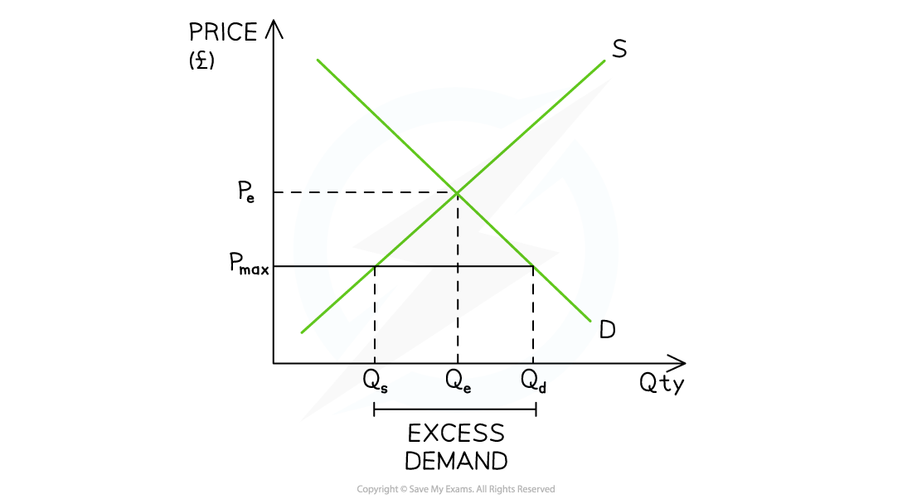
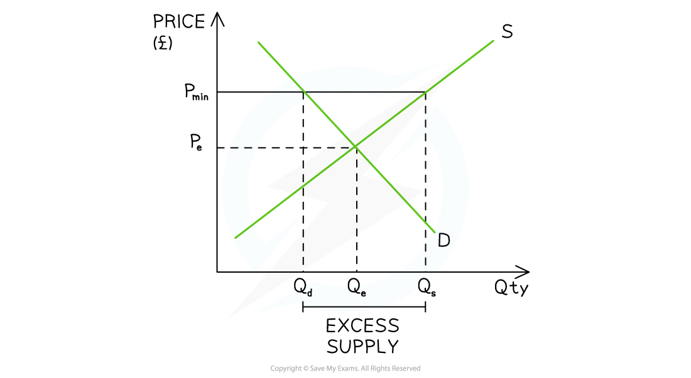

# Price Controls & Direct Provision

## State provision of goods and services

> **Spec point** — `spcpt_5Mt9VVZ54F3kHtBz`

## State provision

- ***Merit goods*** and** *****public goods*** are under-provided in a free market, causing a market failure
- Public goods are** beneficial for society** and are** not provided by private firms **due to the ***free rider problem***

  - They are usually provided **free at the point of consumption**, but are paid for through **general taxation**
  - Examples include roads, parks, lighthouses, national defence
- Merit goods are **beneficial to society** but consumers cannot always access them as they are priced out of the market (e.g. private education or healthcare)
- To **solve the market failure**, governments can provide these goods and services

### The advantages and disadvantages of state provision

| **Advantages** | **Disadvantages** |
|---|---|
| - Essential goods and services are usually provided **free at the point of consumption** - These goods and services are accessible to everyone, regardless of income - These usually provide both **private and external benefits** to society | - Paid for through **general taxation** - There is an opportunity cost associated with their provision - Products which are free may result in **excess demand** and long waiting times, e.g. procedures at public hospitals or lengthy waits to see a GP |

> **Case Study**
> **Context**
> 
> Access to healthcare in Indonesia has been uneven, with many low-income and rural populations unable to afford private services. Healthcare generates **positive externalities**, but the market under-provided it as firms focused on **private benefits**, leading to under-provision (**Qe < Qopt**)
> 
> **Action taken**
> 
> - Expansion of the **Jaminan Kesehatan Nasional (JKN)** scheme
> - Government-funded **universal health insurance**
> - Subsidised or free access for low-income households
> - Increased state support for healthcare provision
> 
> **Outcome**
> 
> Coverage has expanded to over **80% of the population**, improving access and moving provision closer to the **socially optimal level**. Preventative care and affordability have improved.
> 
> However, the scheme faces **funding pressures** and capacity issues, raising concerns about long-term sustainability and potential ***government failure***

## Maximum prices

> **Spec point** — `spcpt_jKzhTpnrmDK9D3vc`

## Price ceilings (maximum prices)

- **A price ceiling is a maximum price set by the government. Sellers cannot legally sell the good or service at a higher price**
- The price ceiling is set **below** the existing **equilibrium market price**
- Governments will often use price ceilings to help consumers if the market price is too high, especially for essential goods and services

  - This may increase consumption of **merit goods**, helping to generate **positive externalities (external benefits)**
  - It may also improve **equity by making essential goods more affordable for low-income consumers**
  - Sometimes they are used for **long periods** of time, e.g., rent controls to keep rents lower in housing rental markets
  - Other times, they are **short-term solutions** aimed at limiting unusual price increases, e.g., petrol

### Impact of a price ceiling

*The price ceiling (Pmax) sits below the free market price (Pe) and creates a condition of excess demand (shortage)*

#### Diagram analysis

- The initial **market equilibrium** is at PeQe
- A **price ceiling **is imposed at **P****max**** below the equilibrium level**

  - The lower price **reduces the incentive to supply** and there is a contraction in quantity supplied (QS) from Qe → Qs
  - The lower price **increases the incentive to consume** and there is an extension in quantity demanded (QD) from Qe → Qd
- This creates a condition of **excess demand (shortage) **equal to QsQd

  - The shortage may lead to **non-price rationing**, such as queues, waiting lists or favouritism
  - It may also encourage the development of **black markets**
- The aim of this policy is to promote** equity** in the market for essential goods and services and it attempts to solve market failure caused by income inequality

#### Evaluating the use of price ceilings

| **Advantages** | **Disadvantages** |
|---|---|
| - **Some consumers benefit** as they purchase at lower prices. For these consumers, their ***consumer surplus***** **increases - Price ceilings can **stabilise markets in the short-term **during periods of intense disruption, e.g. Covid supplies at the start of the pandemic | - Some consumers are **unable to purchase** due to the shortage - Producers lose out as the price is below what they would usually receive: their ***producer surplus*** falls - The unmet demand usually encourages the creation of **illegal markets** and exploitation of consumers - Maximum prices distort market forces and therefore can result in an **inefficient allocation of scarce resources**    - e.g. price ceilings of housing rentals in the property market create a shortage  - When used in necessity markets, Governments may be forced to intervene further by **supplying the good/service themselves** in order to meet the excess demand |

## Minimum prices

> **Spec point** — `spcpt_vTQvPfzxrvXHyyvB`

## Price floors (minimum prices)

- **A price floor (minimum price) is set by the government above the existing free market equilibrium price and sellers cannot legally sell the good/service at a lower price**
- Governments will often use **price floors** to **help producers **or to** decrease consumption of a demerit good**

  - By reducing consumption of demerit goods, price floors can help to reduce **negative externalities (external costs)** and move output closer to the **socially optimal level**
  
    - In Wales and Scotland, governments have introduced a minimum price of alcohol at 50 pence per unit
- Minimum prices are also used in the **labour market to protect workers** from wage exploitation. These are called **minimum wages**

### Impact of a price floor

*Price floor (Pmin) is set above the free market price (Pe) creating a condition of excess supply (surplus)*

#### Diagram analysis

- The initial **market equilibrium** is at PeQe
- A **price floor **is imposed at **Pmin **above the equilibrium level

  - The higher price **increases the incentive to supply** and there is an extension in supply from Qe → Qs
  - The higher price decreases** the incentive to consume** and there is a contraction in demand from Qe → Qd
  - This creates an **excess supply equal to Q****d****Q****s**** **
- In the case of **demerit goods**, this **discourages consumption,** reducing output to a level that may be closer to the socially optimal level **if the price floor is set appropriately**
- Consumers lose from higher prices, while producers gain
- There is likely to be a **deadweight loss**, indicating a loss of allocative efficiency

> **Exam Hint**
> The effectiveness of a price floor depends on the **price elasticity of demand. **If demand is **price inelastic**, the higher price leads to only a small fall in quantity demanded, so the policy may have **limited impact on reducing consumption**

#### Evaluating the use of price floors

| **Advantages** | **Disadvantages** |
|---|---|
| - In some cases, governments** may purchase the excess supply** (e.g. agricultural price support schemes) and store or export it - Producers are protected from **price volatility** - When used in **demerit markets, output falls** (Governments will not purchase the **excess supply **of a demerit good)    - **Producers** usually **lower their output** in the market to match the QD at the minimum price and this helps to reduce the **external costs** | - It costs the government to purchase the excess supply and an **opportunity cost** is involved - Some producers such as farmers may become **over-dependent **on the Government's help - Producers lower output which may result in an **increase in unemployment** in the industry - If **demand** is **price inelastic**, the increase in price **does not impact QD** or solve the market failure |

> **Case Study**
> **Context**
> 
> Alcohol consumption in Scotland was high, creating significant **negative externalities**, including increased healthcare costs, crime and lower productivity. Cheap, high-strength alcohol was widely available, encouraging excessive consumption, particularly among heavy drinkers
> 
> The market price did not reflect the **full social costs** of consumption, leading to over-consumption (**Qe > Qopt**) and market failure
> 
> **Action taken**
> 
> 
> 
> *The minimum price was considered effective*
> 
> - The government introduced a **minimum price of 50p per unit of alcohol** in 2018
> - This set a **price floor above equilibrium** for low-cost alcohol
> - Retailers were legally prohibited from selling alcohol below this price
> - The policy specifically targeted **cheap, high-strength products**
> 
> **Outcome**
> 
> The policy led to a **reduction in alcohol consumption**, particularly among heavy drinkers, helping to move consumption closer to the **socially optimal level**. There is evidence of falling alcohol-related hospital admissions and deaths
> 
> However, the effectiveness depends on the **price elasticity of demand**, with some consumers relatively unresponsive to higher prices
> 
> The policy may also be considered *regressive*, although it has reduced the negative externalities associated with alcohol misuse
