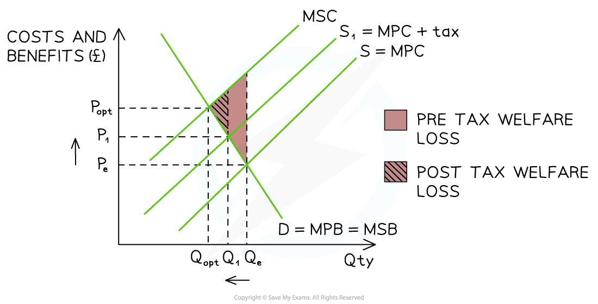
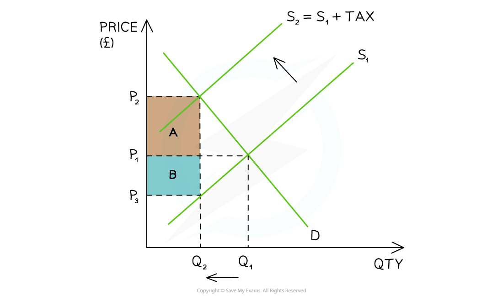
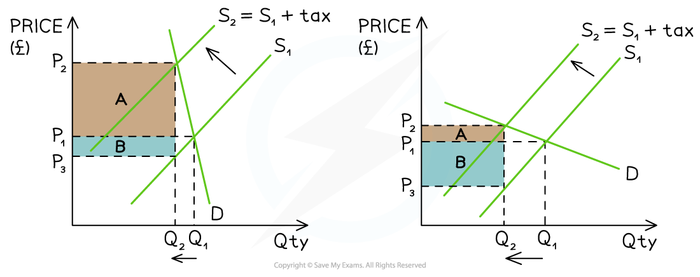

# Indirect Taxes

## Why governments use indirect taxes

> **Spec point** — `spcpt_2dRC6kbPDpxwmtzn`

## Indirect taxes

- An **indirect tax **is paid on the consumption of goods or services

  - It is only paid if consumers make a **purchase**
  - It is usually levied by the government on ***demerit goods*** to reduce the quantity demanded (QD) and/or to raise **government revenue**
  - **Government revenue** is used to fund **government provision of goods and services**, e.g., education.

### Specific tax on negative externality of production

- **A specific tax is a fixed amount of tax per unit of output (e.g. £2 per unit)**

  - This differs from an **ad valorem tax**, which is a percentage of the price
- Governments frequently tax firms that pollute or create harmful external costs in production

*A diagram that shows the impact of a tax on a product that is over-provided in society. The tax reduces the welfare loss and moves production closer to the optimum level of production*

#### Diagram analysis

- The **free-market** equilibrium is at PeQe - where **MSB = MPC**

  - Market failure exists as **MSC > MSB **at equilibrium
  - The optimum level of output is at **Q****opt**
  - There is **over-provision **of this product
- A **specific tax **shifts the supply curve left from **S → S****1**

  - The tax does not completely eradicate the welfare loss but **moves the market closer** to the optimum level of output (Qopt)
  - The **welfare loss has been reduced** as shown in the diagram
- The **new** market equilibrium is at **P****1****Q****1**

  - This is a **higher price** and **less output**
  - There is less **over-provision** and so less market failure
  - The **external costs** have been reduced

- Governments frequently tax the production of goods and services that create environmental harm or damaging health consequences

  - Some examples include intensive factory farming, oil drilling, the manufacture of chemicals and the construction of new roads or runways at airports

### Incidence of a specific tax

- **A specific tax is a fixed tax per unit of output (specific amount) e.g. \$3.25/packet of cigarettes**

*The impact of an indirect tax is split between the consumer (A) and the producer (B)*

#### Diagram Analysis

- **Initial equilibrium **is at P1Q1
- The government places a **specific tax** on a **demerit good**

  - The supply curve shifts left from S1→S2 by the amount of the tax
- The **price the consumer pays has increased** from P1 before the tax, to P2 after the tax
- The **price the producer receives has decreased** from P1 before the tax to P3 after the tax
- The **government receives tax revenue** = (P2-P3) x Q2
- **Producers and consumers **each pay a share (***incidence***) of the tax

  - The **consumer incidence** (share) of the tax is equal to **area A: (P****2****-P****1****) x Q****2**
  - The **producer incidence** (share) of the tax is equal to **area B: (P****1****-P****3****) x Q****2**
- **New equilibrium** is at P2Q2

  - The final price is** higher **(P2) and QD is **lower** (Q2)
  - If the **decrease in QD** is significant enough, it may force producers to **lay off some workers**

> **Exam Hint**
> Irrespective of whether you are dealing with taxes or subsidies, always use the new equilibrium point to determine your incidence boxes
> 
> The consumer incidence is paid from the **consumer surplus** area, and the producer incidence is paid from the **producer surplus** area

## The effectiveness of indirect taxes

> **Spec point** — `spcpt_CCH25WKvhqkh9kMy`

## PED and tax incidence

- **Aiming to maximise their profits, **producers **pass on** as much of the indirect tax as they can to **consumers **and pay the balance themselves

  - The amount **passed on** to consumers depends on the **price elasticity of demand (PED)** of the product

*A diagram that demonstrates the tax incidence for a product whose PED is inelastic (left) and elastic (right). A is the consumer incidence and B is the producer incidence*

#### Diagram analysis

- In both diagrams, the **specific tax** shifts the **supply curve** from S1→S2

  - There is a **higher market price** at P2 and **lower QD** at Q2
  - **Tax revenue** for the government is the sum of **A+B**
  - **Consumer incidence** is represented by A and **producer incidence** by B
  - ***Total revenue*** for the seller is calculated using **P****3**** X Q****2**
- The **difference in PED** results in a **different steepness** to the demand curve

  - For a** price inelastic product** (e.g. cigarettes), producers pass on a much **higher proportion of the tax to consumers** (A) and pay the rest themselves (B)
  
    - The **QD decreases **(Q1→Q2) but by a much **smaller proportion** than the increase in **price** (P1→P2)
  - For a** price elastic product** (e.g. pizza), producers pass on a much **smaller proportion of the tax to consumers** (A) and pay the rest themselves (B)
  
    - The **QD decreases **(Q1→Q2) but by a much **larger proportion** than the increase in **price** (P1→P2)

> **Exam Hint**
> It is essential to apply knowledge of PED to the impact it will have on producers, consumers and the government
> 
> The **more price inelastic** the demand, the greater the proportion of the tax paid by consumers
> 
> The **more price elastic** the demand, the greater the proportion of the tax paid by producers
