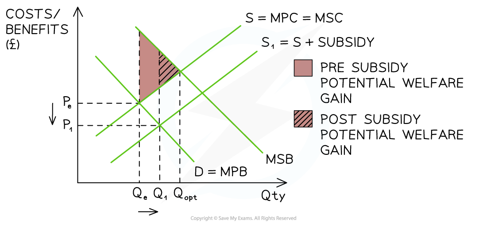
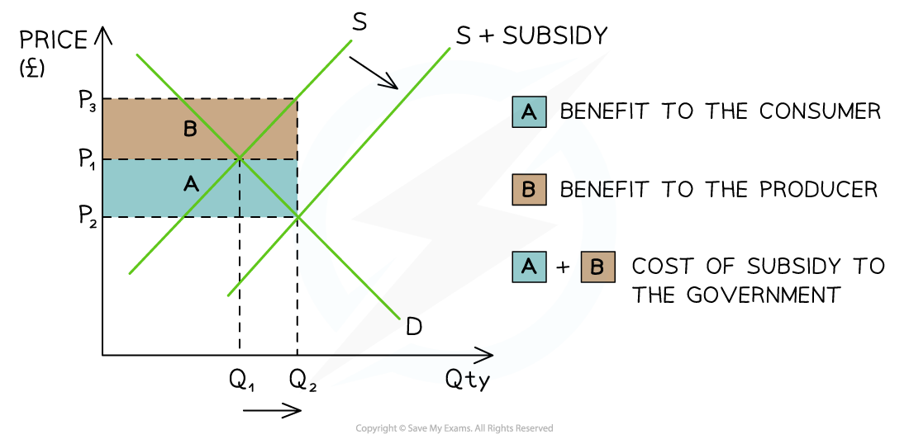

# Subsidies

## Subsidies

> **Spec point** — `spcpt_nKZVXPqVsXd3KXr5`

## Subsidies

- **A subsidy is a payment made by the government to producers to reduce the cost of production**
- Governments frequently use subsidies to encourage production or consumption of ***merit goods*** such as energy-efficient products, electric vehicles, healthcare, and education

*How a subsidy reduces the welfare loss (or generates a welfare gain)*

#### Diagram analysis

- The **free-market** equilibrium is at PeQe - where **MPB = MSC**

  - Market failure exists as **MSB > MSC at the free market equilibrium**, meaning the good is under-consumed
  - Optimum level of output is at **Q****opt**
- A **subsidy **shifts the supply curve right from **S → S****1**

  - It does not completely eradicate the potential welfare gain but **moves the market closer** to the optimum level of output (Qopt)
  - The **potential** **welfare gain has been reduced** as shown in the diagram
  
    - This represents a reduction in **deadweight loss** and an improvement in **allocative efficiency**
- The **new** market equilibrium is at **P****1****Q****1**

  - This is a **lower price** and **higher output**
  - There is less **under-consumption** and so less market failure
  - Some of the **external benefits available have been realised**

### Subsidy incidence

- The **incidence** (share) of the **subsidy** is determined by the **PED of the product**

  - If governments subsidise goods or services with high PED, **the increase in QD** will be **more than proportional** to the **decrease in price**
  - Producers **keep some** of the subsidy and **pass the rest on** to the consumers

*A diagram which demonstrates the cost of a subsidy to the government (A+B) and the incidence received by the consumer (A) and producer (B)*

#### Diagram analysis

- The original **equilibrium** is at **P****1****Q****1**
- The **subsidy** shifts the supply curve from **S → S + subsidy**:

  - This **increases the QD **in the market from **Q****1****→Q****2**
  - The **new** market **equilibrium** is P2Q2
  - This is a **lower price **and **higher QD** in the market

- Producers receive **P****2** from the consumer **PLUS** the subsidy per unit from the government

  - Producer revenue is therefore **P****3 ****x Q****2**
  - **Producer incidence **of the subsidy is marked B in the diagram
- The subsidy **decreases the price** that consumers pay from **P****1 ****→ P****2**

  - **Consumer incidence** of the subsidy is marked A in the diagram
- The **total cost** to the government of the subsidy is **(P****3 ****- P****2****) x Q****2**** **represented by **area A+B**

  - This creates an **opportunity cost**, as government funds could be used for alternative purposes

> **Exam Hint**
> When dealing with a **subsidy,** the **producer benefit is now the top portion of the incidence area, and consumer incidence is below**

## The effectiveness of subsidies

> **Spec point** — `spcpt_4cs65dpfR8prtKGq`

## The effectiveness of subsidies

- Estimating the **appropriate size of a subsidy** can be difficult
- Many subsidies are applied **uniformly**, meaning they are not linked to consumers’ income levels or ability to pay. Unlike income-based taxes or benefits, subsidies usually reduce the price by the same amount for all users
- As a result, **both higher-income and lower-income consumers benefit equally per unit consumed**, even though the policy may be intended to support those on lower incomes

  - This makes it important to consider **who actually gains** from a subsidy

### Examples

#### 1. Domestic energy subsidies

- In some countries, governments** subsidise electricity or gas** to keep household energy bills affordable
- While this can help low-income households cope with rising living costs, **wealthier households also benefit,** often to a greater extent because they consume more energy
- In addition, lower prices may increase demand, leading to supply pressures or higher government spending.
- If subsidies are paid directly to energy suppliers, there is no guarantee that firms will become more efficient or invest in cleaner technologies

#### 2. Subsidies for education and training

- Governments often subsidise further education or vocational training to improve workforce skills and productivity
- These subsidies can increase access to education and benefit society through higher employment and economic growth
- However, some of the financial benefits may go to individuals who could afford training without support, raising questions about whether the subsidy is well targeted

> **Exam Hint**
> A great evaluation point is that:
> 
> There is no guarantee that subsidies will fully correct market failure, as firms may not pass on the full benefit to consumers

## Taxes vs Subsidies (Comparison)

> **Spec point** — `spcpt_rsGRMXNhZyhJB32b`

## Taxes vs Subsidies (Comparison)

- Taxes discourage consumption and production, while subsidies encourage them

| Feature | Indirect tax | Subsidy |
|---|---|---|
| Effect on supply | - Shifts **left** (S → S + tax) | - Shifts **right** (S → S + subsidy) |
| Effect on price | - **Increases** price for consumers | - **Decreases** price for consumers |
| Effect on output | - **Reduces** quantity traded | - **Increases** quantity traded |
| Market failure targeted | - **Negative externalities** (demerit goods) | - **Positive externalities** (merit goods) |
| Welfare effect | - **Reduces** over-consumption | - **Reduces** under-consumption |
| Government finances | - Generates **tax revenue** | - Creates a **cost to the government** |
| Incidence | - Split between consumers and producers depending on **elasticity** | - Split between consumers and producers depending on **elasticity** |
