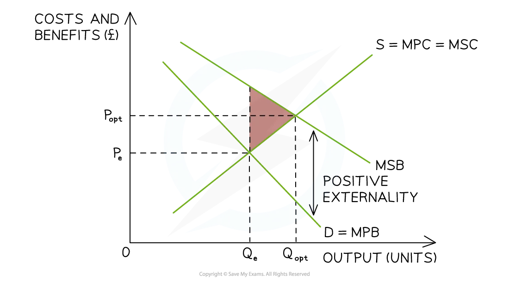
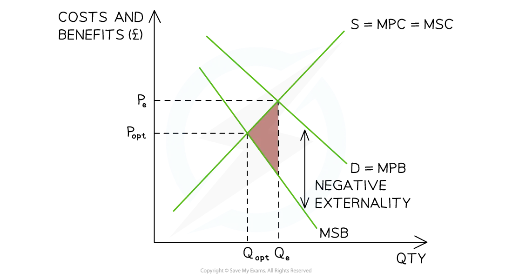

# Demerit & Merit Goods

## Under consumption of merit goods

> **Spec point** — `spcpt_ZPdyK9hqP99FYby4`

## Under-consumption of merit goods

- Merit goods are products that are beneficial for society but the free market does not provide enough of them
- Demerit goods are products which have harmful impacts on consumers or society
- ***Value judgements*** play a role in determining whether goods are classified as merit or demerit goods
- Some goods are clearly defined as being a merit or demerit good, such as education (merit good) and illegal drugs (demerit good)
- The classification of some goods can be unclear, as it is based on a **value judgement**

### Classification of goods based on value judgements

| **Good** | **Merit good** | **Demerit good** |
|---|---|---|
| **Cannabis** | - Can help with physical pain - May allow some to enjoy life more | - Can contribute to poor health and psychological conditions |
| **Contraception** | - Supporters of family planning argue contraception can help reduce costs of an unwanted pregnancy | - Some religions argue that contraception is a sin and encourages sexual promiscuity, undermining family values |

### Merit goods

- Consumers **under-consume** merit goods, as they do not fully recognise the **private **or** external benefits**
- Merit goods are often **under-consumed **in a **free-market** and are a cause of **partial market failure**

  - Common examples include vaccinations, education and electric cars
  - Governments often have to **subsidise** these goods in order to lower the price and/or increase the **quantity demanded**

*Positive externalities from the consumption of merit goods*

#### Diagram analysis

- The **marginal social costs (MSC)** are assumed to be equal to the **marginal private cost (MPC) **as the **focus is on the consumer** **(demand side) **of the market
- The **optimal allocation** of resources for** society** would generate an equilibrium where **marginal social benefit (MSB) = MSC**

  - At **P****e****Q****e** where there is **no market failure**
- The free-market equilibrium for **merit goods **is **underconsumed **as consumers fail to consider the **external benefits** from consumption

  - This is shown at **P****e****Q****e** where the **MPB=MSC**
- The quantity consumed at Qe is **below **the socially optimal level resulting in an **under-consumption** and a ***partial market failure***

  - There is a ***deadweight loss***** to society** (pink triangle)
- To be **socially efficient**, **more** factors of production should be **allocated **to producing this good/service

> **Worked Example**
> Which one of the following applies to** merit goods?**
> 
> - They are always overconsumed by individuals
> - They are likely to be provided by the market
> - They can only be supplied by the government
> - They are always free
> 
> **Answer**
> 
> They are likely to be provided by the market
> 
> Merit goods (education and healthcare) can often be provided by the market.  They are beneficial to society, and usually not enough are provided

## Over-consumption of demerit goods

> **Spec point** — `spcpt_c2SVhCR7X5RKdQNP`

## Over-consumption of demerit goods

- Consumers** over-consume **demerit goods to a greater extent than is considered** desirable by society**
- Consumers are unlikely to consider all of the consequences when making consumption decisions

  - The **social costs** of **consumption outweigh **the** private costs **

- Demerit goods are often **over-consumed **in a **free-market **and are a cause of **partial market failure**

  - These goods are **usually addictive and harmful** for consumers, e.g. gambling, alcohol, drugs, sugary foods/drinks
  - Governments often have to **regulate** these goods in such a way that they raise the prices and/or limit the quantity demanded

- The **activities of producers **can generate significant external costs, e.g. pollution caused by coal-burning power stations during the production of electricity

  - However, electricity is considered to be a **merit good**
  - The smoke is a by-product and not a good or service
- For this reason, economists usually consider **demerit goods** to be goods used in **consumption**

*Negative externalities from the consumption of demerit goods*

### Diagram analysis

- **The MSC **is assumed to be equal to the **MPC** as the focus is on the **consumer (demand) side** of the market
- The **optimal allocation** of resources for** society** would generate an equilibrium where **MSB = MSC**

  - At** P****e****Q****e** where there is **no market failure**

- The free-market equilibrium for **demerit goods** is **overconsumed **as consumers fail to consider the **external costs** from consumption

  - This is shown at **P****e****Q****e** where the **MPB=MSC**
- The quantity consumed at Qe is **above** the socially optimal level, resulting in overconsumption and a ***partial market failure***. There is a ***deadweight loss***** to society** (pink triangle)
- To be **socially efficient**, **fewer** factors of production should be **allocated **to producing this good/service

> **Exam Hint**
> Not all products with positive or negative externalities in consumption are merit or demerit goods
> 
> You should be able to illustrate the misallocation of resources resulting from the consumption of merit and demerit goods using diagrams showing marginal private and social cost and benefit curves

> **Worked Example**
> Which of the following applies to **demerit goods?**
> 
> - Their marginal private benefit is greater than their marginal social benefit
> - They are always underprovided by the market
> - Their marginal social benefit is greater than their marginal private benefit
> - They have the characteristics of non-excludability and non-rivalry
> 
> **Answer **
> 
> Their marginal private benefit is greater than their marginal social benefit
> 
> Individuals may derive some private benefit from consuming demerit goods, but the overall social benefit is** less **due to the negative consequences on society. The **MPB **(the benefit to the individual consumer) tends to exceed the **MSB **(the benefit to society as a whole)
> 
> The other options are incorrect:
> 
> - Demerit goods may tend to be over-provided and over-consumed by the free market
> - Demerit goods are associated with negative externalities, implying that the social benefit is less than the private benefit
> - Demerit goods can often be characterised by excludability and rivalry, meaning they can be restricted to to those willing and able to pay and their consumption by one person reduces its availability to others
