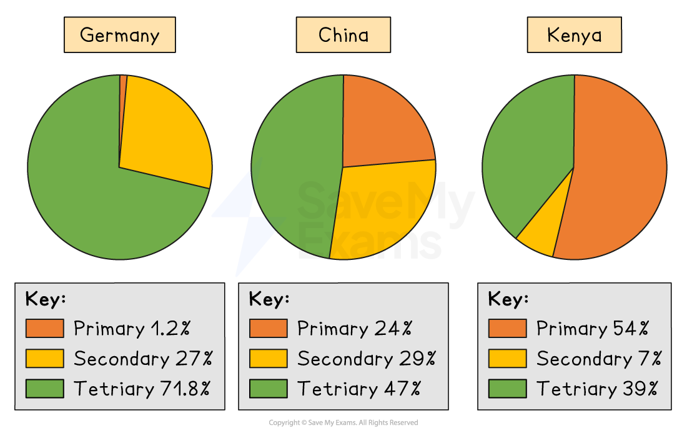

# Economic Structure

## Employment in primary, secondary and tertiary sectors

> **Spec point** — `spcpt_xVbHJ4FQ6PyRmsDy`

## Employment in primary, secondary and tertiary sectors

- **Primary sector is defined as economic activity involving the direct extraction or harvesting of natural resources** - including agriculture, fishing, forestry, mining and quarrying
- **Secondary sector is defined as economic activity involving the processing of raw materials and the manufacture of goods** - including construction, manufacturing and energy production
- **Tertiary sector is defined as economic activity involving the provision of services **- including retail, finance, transport, healthcare, education and tourism
- Some classifications also identify a **quaternary sector** covering knowledge-intensive activities such as research and development, information technology and consultancy, though this is not required at this syllabus level

### Employment composition and level of development

- The share of employment in each sector changes predictably as an economy develops - this pattern is sometimes referred to as the **structural transformation** of an economy
- Low-income economies are typically characterised by a large primary sector, particularly subsistence and smallholder agriculture, which may account for 50–80% of employment

- As economies industrialise, employment shifts from the primary to the secondary sector

  - Manufacturing absorbs rural labour moving into cities, raising productivity and wages
- Advanced high-income economies are dominated by the tertiary sector, which typically accounts for over 70% of employment

  - The primary sector shrinks to a very small share as agricultural productivity rises and manufacturing relocates or automates

| Development stage | Primary | Secondary | Tertiary |
|---|---|---|---|
| Low-income | - High (often 60%+) | - Low | - Low |
| Middle-income | - Declining | - Rising | - Growing |
| High-income | - Very low (often <5%) | - Moderate | - Very high (often 70%+) |

#### Limitations of the three-sector model

- The boundaries between sectors are not always clear

  - *Agro-processing *sits between primary and secondary
  - Financial services linked to commodity exports blur further distinctions
- Employment shares do not capture productivity differences

  - A small but highly productive agricultural sector in a high-income economy contributes more **value per worker** than a large low-productivity sector elsewhere
- The informal economy, which is large in low-income countries, is often underrepresented in official employment statistics, distorting apparent sector shares

> **Worked Example**
> Which row shows characteristics of a fast-growing economy?
> 
> |   | GDP per capita | Birth rate | Household saving ratio |
> |---|---|---|---|
> | **A** | falling | falling | rising |
> | **B** | falling | rising | falling |
> | **C** | rising | falling | rising |
> | **D** | rising | rising | falling |
> 
> **Final answer:** **Answer: C**
> 
> - Option C correctly combines rising GDP per capita with falling birth rate and rising saving ratio -  the classic profile of a mid-development economy in structural transformation
> - A fast-growing economy would see rising GDP per capita as output expands faster than population — this eliminates options A and B immediately
> 
> **Worked solution**
> 
> - Between C and D, the key distinction is the birth rate and saving ratio: a fast-growing economy undergoing structural transformation typically experiences a falling birth rate (as urbanisation and female education rise) and a rising household saving ratio (as incomes grow and households accumulate capital for investment)
> - Option D is incorrect — rising birth rates are associated with lower-income, pre-industrial economies; a fast-growing economy typically already shows demographic transition with birth rates declining

## Pattern of trade at different levels of development

> **Spec point** — `spcpt_HyD4JRyrW9GbVJGt`

## Pattern of trade at different levels of development

- The composition and direction of a country's trade changes significantly with its level of development

  - This reflects shifts in *factor endowments*, productivity, and *comparative advantage*

### Low-income economies

- Trade is typically dominated by primary commodity exports - agricultural products, minerals, timber and fuels - which are produced using the abundant factor of unskilled labour and natural resources
- Imports tend to consist of manufactured goods, capital equipment and technology that cannot be produced domestically
- This pattern creates vulnerability to commodity price volatility - primary commodity prices are subject to large swings, meaning export revenues and government income can be highly unstable

### Middle-income economies

- As *industrialisation* proceeds, the export mix shifts towards labour-intensive manufactured goods - clothing, footwear, basic electronics and assembled products
- Export earnings become more stable and less dependent on a single commodity
- Imports shift towards more sophisticated capital goods, *intermediate inputs* and services required for further industrial development
- Countries may pursue *export-led growth strategies* - actively orienting manufacturing towards global markets as a driver of income growth; South Korea, Taiwan and Vietnam are frequently cited examples

### High-income economies

- Trade is dominated by high-value manufactured goods and knowledge-intensive services, such as financial services, insurance, business consulting, software and intellectual property
- *Intra-industry trade* becomes significant - countries both export and import similar categories of goods, reflecting product differentiation and economies of scale rather than simple factor endowments
- Trade in services grows as a share of total trade - in the most advanced economies services can account for a larger share of export earnings than goods

#### Key implications of trade pattern differences

|   | Low-income | Middle-income | High-income |
|---|---|---|---|
| Main exports | - Primary commodities | - Labour-intensive manufactures | - High-value goods and services |
| Main imports | - Manufactures and capital goods | - Capital goods and intermediates | - Differentiated goods and services |
| Terms of trade risk | - High - commodity price volatility | - Moderate | - Low |
| Diversification | - Low | - Growing | - High |
| *Value added* per export dollar | - Low | - Moderate | - High |

> **Case Study**
> **Nigeria vs South Korea**
> **Pattern of trade at different levels of development**
> 
> **The context**
> 
> Nigeria and South Korea had broadly comparable GDP per capita in the early 1960s. Over the following six decades their trade patterns diverged dramatically, making them a compelling contrast between commodity-dependent and export-led industrial development.
> 
> **Actions taken**
> 
> - Nigeria remained heavily reliant on oil exports following the discovery of crude oil in the late 1950s - by the 2010s petroleum accounted for over 90% of export earnings, with manufactured goods and services contributing very little
> - South Korea pursued a deliberate export-led industrialisation strategy from the 1960s, shifting from low-value exports such as textiles into electronics, shipbuilding, steel and automobiles through targeted industrial policy and investment in human capital
> 
> **Outcomes**
> 
> 
> 
> - Nigeria's trade pattern remains characteristic of a low-income commodity exporter - high dependence on a single primary export, vulnerability to oil price volatility, and persistent importation of manufactured goods and capital equipment
> - South Korea's export mix transformed entirely
> 
>   - It now exports high-value manufactures and technology products, with Samsung and Hyundai among the world's leading exporters in their sectors
> - South Korea's GDP per capita reached over \$33,000 by 2023; Nigeria's remained below \$2,100
> 
>   - This illustrates how trade pattern and development level reinforce each other over time

> **Exam Hint**
> The structural transformation from primary to secondary to tertiary employment is one of the most frequently tested development concepts - always link sector shifts to rising productivity, urbanisation and changing comparative advantage rather than describing them as automatic.
> 
> For trade pattern questions, the strongest evaluation point is that the pattern of trade reflects but also reinforces development levels:
> 
> - commodity dependence traps low-income economies in a low-value-added export structure
> - while export-led industrialisation requires deliberate policy to shift up the value chain.
