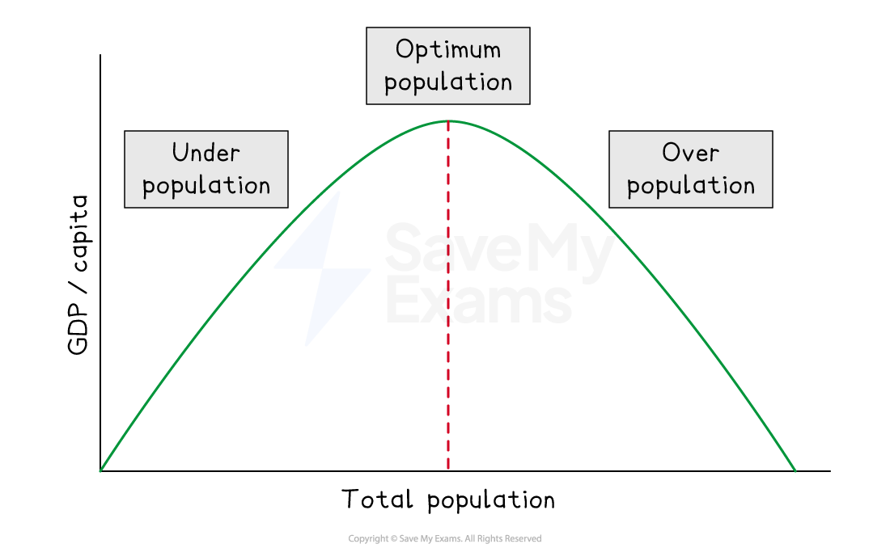

# Optimum Population & the Level of Urbanisation

## The optimum population

> **Spec point** — `spcpt_Ypp2d7SXHkKMhBcn`

## The optimum population

- **Optimum population** **is defined as the population size at which output per head - and therefore average living standards - is maximised, given a country's existing resources and technology**

  - **Overpopulation occurs when there are more people in a country or region than can be supported by its resources and technology** and leads to
  
    - Higher levels of pollution
    - Higher crime rates
    - Higher unemployment or ***underemployment***
    - Higher levels of **food and water shortages **
    - Higher pressure on services such as hospitals and schools
  - **Underpopulation** **occurs when there are more resources available than the population can use effectively **and may lead to
  
    - Fewer people paying tax which can lead to higher taxes
    - **Underused resources**, which can lead to wastage
    - A shortage of workers
    - Lower levels of exports and production, which affects the wealth of an area
    - Fewer customers for goods and services 
    ** **

*Optimum theory of population*

- **The optimum population** results in the highest standard of living

  - There are not so many people or so few resources that the standard of living falls
  - There are enough people to develop the resources of the country

### Limitations of the concept

- Output per head is an imperfect measure of living standards - the distribution of output matters
- The optimum is never precisely observable in practice
- Technology can continuously expand the *productive capacity* of a given population, making the concept dynamic and difficult to apply

## Level of urbanisation

> **Spec point** — `spcpt_MzQDQppDg7qtZQgY`

## Level of urbanisation

- **Urbanisation is defined as the process by which an increasing proportion of a country's population lives in urban areas -  cities and towns - rather than rural areas**

  - It is measured as the percentage of the total population living in urban settlements
- Urbanisation is strongly correlated with economic development

  - High-income economies typically have urbanisation rates above 80%, while low-income economies may be below 40%

### Causes of urbanisation

- **Rural-urban migration**

  - Individuals move from rural areas to cities in search of higher wages, better employment opportunities and improved access to services
  - This is the primary driver of urbanisation in developing economies
- **Natural population growth in cities**

  - Urban birth rates exceeding urban death rates add to city populations independently of migration
- **Reclassification**

  - As settlements grow, areas previously classified as rural are reclassified as urban, raising measured urbanisation rates without actual migration

#### Consequences of urbanisation

| Positive | Negative |
|---|---|
| - *Agglomeration* economies    - Concentration of firms and workers raises productivity | - Urban overcrowding    - Strain on housing, transport and public services |
| - Better access to healthcare, education and social services | - Growth of informal settlements and slums with poor *sanitation* |
| - Higher average incomes and living standards | - Environmental degradation    - Pollution, congestion, waste |
| - Greater *innovation* and knowledge spillovers | - Urban-rural inequality widens as rural areas are left behind |

#### Urbanisation and development

- Low-income economies tend to have lower urbanisation rates but are urbanising rapidly

  - Sub-Saharan Africa is the fastest urbanising region in the world
- The relationship between urbanisation and development is not automatic

  - Rapid urbanisation without corresponding industrial growth produces "urbanisation without development", characterised by large *informal sectors* and urban poverty rather than rising productivity

> **Case Study**
> **Indonesia — urbanisation and Jakarta, 1990–2023**
> 
> **The context**
> 
> Indonesia's urbanisation rate rose from approximately 31% in 1990 to 58% by 2023, driven primarily by rural-urban migration into Jakarta and other major cities as manufacturing and services expanded.
> 
> 
> 
> **Actions taken**
> 
> - Rural workers migrated to Jakarta in search of higher wages in manufacturing, construction and the informal service sector
> - The government invested in urban infrastructure but consistently struggled to match the pace of population growth
> - In 2019 the government announced plans to relocate the capital to Nusantara in Borneo, partly in response to Jakarta's chronic overcrowding, flooding and *land subsidence*
> 
> **Outcomes**
> 
> - *Agglomeration* in Jakarta raised productivity and incomes, contributing to Indonesia's GDP per capita rising from around \$800 in 1990 to over \$4,900 by 2023
> - However, rapid urbanisation outpaced formal job creation — Jakarta's large informal sector and sprawling low-income settlements illustrate "urbanisation without development"
> - Environmental costs, including severe air pollution, regular flooding and sinking land, undermined living standards for many urban residents despite rising average incomes

> **Exam Hint**
> The optimum population is a theoretical concept - examiners will penalise students who treat it as a fixed or measurable number. Always emphasise that it shifts with technology and capital accumulation, and that it cannot be observed directly in practice.
> 
> For urbanisation questions, the key evaluation point is that rapid urbanisation does not automatically produce development - where urban growth outpaces industrial job creation, the result is an expansion of the informal sector and urban poverty rather than rising productivity.
