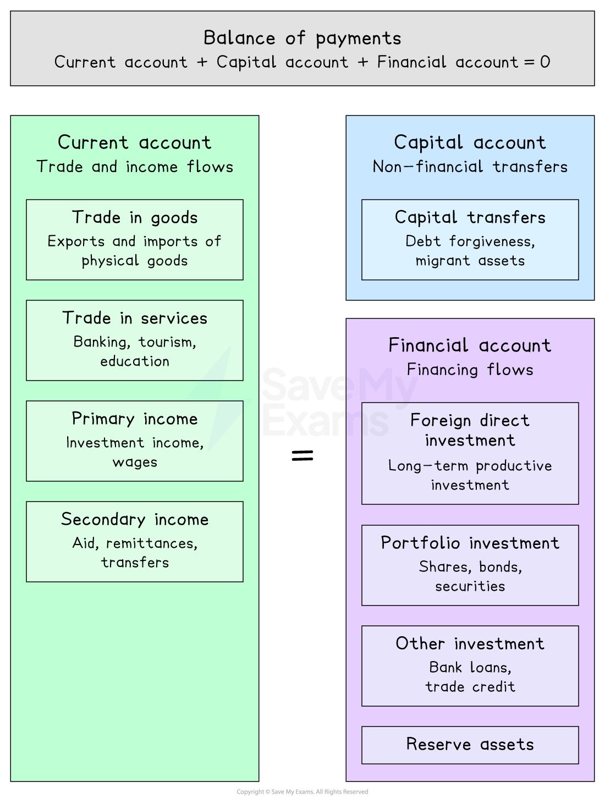

# Components of the Balance of Payments Accounts:

## Components of the balance of payments accounts

> **Spec point** — `spcpt_fQXq6wd4hGcbvfF6`

## Components of the balance of payments accounts

- **The balance of payments is a record of all financial transactions between a country and the rest of the world over a given time period - it must always balance as an accounting identity**
- The balance of payments has three main accounts:

  - the **current account**,
  - the **financial account** and,
  - the **capital account**

*The structure of the Balance of Payments*

### The current account

- **The current account** was covered in detail in the AS Section, [Components of the Current Account](https://www.savemyexams.com/a-level/economics/cie/23/revision-notes/international-economic-issues/current-account-of-the-balance-of-payments/components-of-the-current-account/)

  - It records trade in goods, trade in services, primary income and secondary income
  - A **current account deficit** means *debits* exceed *credits* - the country is a net payer of funds to the rest of the world
  - A **current account surplus** means credits exceed debits - the country is a net receiver of funds

### The financial account

- **The financial account records flows of financial assets and liabilities between a country and the rest of the world - it finances imbalances on the current account**
- It has four main components:

| Component | What it records | Example |
|---|---|---|
| **Foreign direct investment (FDI)** | - Long-term investment in productive capacity abroad or by foreigners domestically | - A US firm building a factory in Vietnam |
| **Portfolio investment** | - Purchase and sale of foreign financial assets - *shares*, *bonds*, *securities* | - A UK *pension fund* buying Japanese government bonds |
| **Other investment** | - *Bank loans*, *trade credit*, currency deposits | - A German bank lending to a Brazilian firm |
| **Reserve assets** | - Changes in a central bank's holdings of foreign exchange reserves and gold | - The *central bank* selling dollars to support the domestic currency |

- A current account deficit must be financed by a **surplus on the financial account** - either through attracting foreign investment, borrowing abroad or running down *reserve assets*
- A current account surplus must be offset by a **deficit on the financial account** - the country is exporting capital, building up foreign asset holdings

### The capital account

- **The capital account is the smallest of the three accounts - it records non-financial, non-produced asset transfers and capital transfers between countries**

  - Examples include: *debt forgiveness* between governments, transfer of assets by migrants moving country, purchases and sales of *intellectual property* rights (*patents*, *trademarks*)
- The capital account is typically very small relative to the current and financial accounts

### How does the balance of payments balance?

#### The accounting identity

**Current account + financial account + capital account = 0**

- In practice, measurement errors mean a **balancing item** (errors and omissions) is included to ensure the accounts balance
- A current account deficit does not mean the overall balance of payments is in deficit - it means the financial and capital accounts must show a corresponding surplus to finance it

> **Worked Example**
> Which components are included in the current account and financial account of the balance of payments?
> 
> |   | Current account | Financial account |
> |---|---|---|
> | **A** | Trade in goods | Official reserve assets |
> | **B** | Primary income and secondary income | Trade in goods |
> | **C** | Trade in goods and trade in services | Secondary income |
> | **D** | Trade in services and secondary income | Portfolio investment and official reserve assets |
> 
> **Final answer:** **Answer: D**
> 
> Option D is correct - trade in services and secondary income are both current account items; portfolio investment and official reserve assets are both financial account items
> 
> **Worked solution**
> 
> - Option A is incorrect - official reserve assets belong to the **financial account**, not the current account; trade in goods alone does not represent the full current account
> - Option B is the **trap** - primary income and secondary income are correctly identified as current account components, but trade in goods is a **current account** component, not a financial account component; students who confuse the two accounts may select this
> - Option C is incorrect - secondary income is a current account component, not a financial account component

> **Exam Hint**
> The balance of payments always balances as an accounting identity - a current account deficit must be matched by a surplus on the financial and capital accounts combined.
> 
> A common error is confusing which components belong to which account:
> 
> - trade in goods and services, primary income and secondary income belong to the current account;
> - *FDI*, portfolio investment and reserve assets belong to the financial account;
> - capital transfers belong to the capital account.
> 
> In calculations, always identify the account before assigning credits or debits - money flowing in is a credit, money flowing out is a debit.
