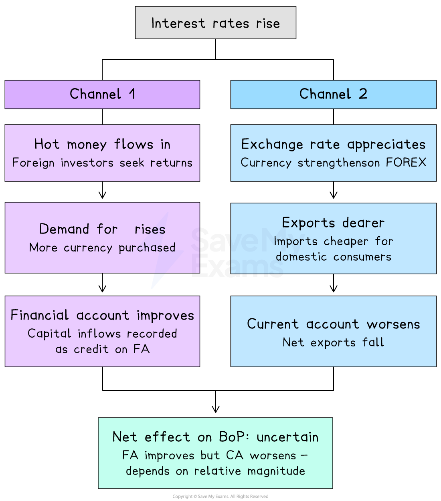
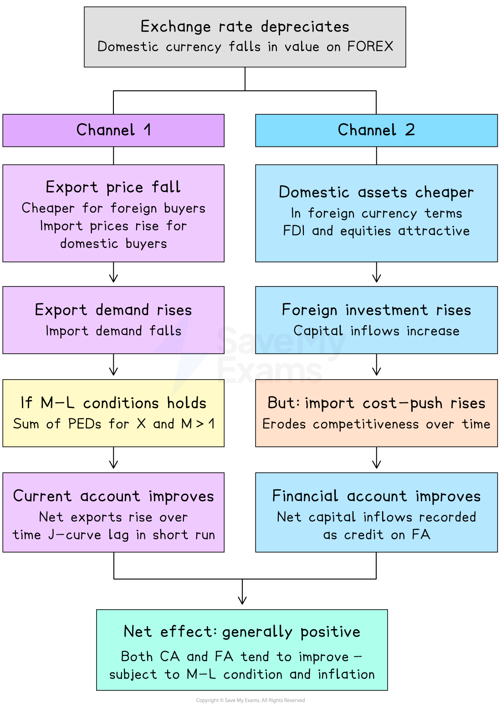

# Effect of Policies on the Balance of Payments

## Effect of fiscal policies on the balance of payments

> **Spec point** — `spcpt_442B5gVQXD3Ynptz`

## Effect of fiscal policies on the balance of payments

- At A Level the focus shifts from correcting current account imbalances to correcting **overall balance of payments disequilibrium** - this requires considering the interaction between the current account and the financial account

### Fiscal policy

- **Contractionary fiscal policy** (higher taxes, lower government spending) reduces domestic aggregate demand, lowering incomes and reducing import spending - the current account deficit narrows
- However, lower growth may **reduce the attractiveness of the economy to foreign investors**, potentially weakening financial account inflows
- **Expansionary fiscal policy** increases incomes and import demand, worsening the current account - but higher growth may attract *FDI* and *portfolio investment*, improving the financial account
- The **net effect on the overall balance of payments** depends on whether the trade deterioration or the investment improvement dominates

## Effect of monetary policies on the balance of payments

> **Spec point** — `spcpt_JFHQx9WspGpkfrSQ`

## Effect of monetary policies on the balance of payments

- **Higher *****interest rates*** attract *hot money* as foreign investors seek better returns - the financial account improves as capital flows in
- The *exchange rate* appreciates as demand for the domestic currency rises, making exports dearer and imports cheaper - the current account may worsen

*The impact of a higher interest rate on the Balance of Payments*

- The **net effect** depends on the relative size of the capital inflow versus the trade deterioration
- **Lower interest rates** cause capital outflows and depreciation - the financial account deteriorates but the current account may improve if the *Marshall-Lerner condition* is satisfied

## Effect of supply-side policies on the balance of payments

> **Spec point** — `spcpt_HQ5hVXp3t5CG9KMz`

## Effect of supply-side policies on the balance of payments

- Supply-side policies raise *productivity *and international competitiveness, improving the current account sustainably over time
- Higher productivity also attracts FDI as the country becomes a more attractive location for investment - improving the financial account
- Supply-side policies therefore offer the most durable improvement to the **overall** balance of payments position - addressing both the current account (through competitiveness) and the financial account (through investment attractiveness)
- The main limitation is the **time lag** - supply-side improvements take years to materialise

## Effect of protectionist policies on the balance of payments

> **Spec point** — `spcpt_jWfq6P89FTZ4G8Sx`

## Effect of protectionist policies on the balance of payments

- *Tariffs *and *quotas *directly reduce import volumes, improving the current account in the short run
- However, trading partners may retaliate with their own protectionist measures, reducing export demand and worsening the current account
- Protectionism does not address the financial account and may **discourage FDI** if it signals a closed, inefficient economy - the overall balance of payments effect may therefore be negative in the long run

## Effect of exchange rate policies on the balance of payments

> **Spec point** — `spcpt_FVvKP9Dg5XRP3rsD`

## Effect of exchange rate policies on the balance of payments

- **Depreciation** makes exports cheaper and imports dearer - if the Marshall-Lerner condition is satisfied, the current account improves over time

- A depreciation also makes domestic assets cheaper for foreign investors in foreign currency terms, potentially attracting FDI and portfolio investment and improving the financial account
- However, depreciation raises import costs, contributing to *cost-push inflation *which may erode the initial competitiveness gain

*The impact of an exchange rate depreciation on the Balance of Payments*

- **Appreciation** improves the financial account by making foreign investment in domestic assets more expensive in local currency - but worsens the current account by reducing export competitiveness
- A **managed exchange rate** allows the government to target a rate that balances current and financial account objectives

> **Worked Example**
> What is most likely to lead to a **persistent surplus** in a country's current account of its balance of payments?
> 
> A. - highly contractionary monetary policy
> 
> B. - an undervalued exchange rate
> 
> C. - highly protectionist policies by other countries
> 
> D. - low investment income from abroad
> 
> **Final answer:** **Answer: B**
> 
> A **persistent current account surplus** requires a structural condition that consistently makes exports competitive and suppresses imports over many years - this points to exchange rate policy
> 
> An **undervalued exchange rate** keeps exports artificially cheap for foreign buyers and imports artificially expensive for domestic consumers on a continuous basis - this is the mechanism that underpins persistent surpluses (China's management of the renminbi is the classic example)
> 
> **Worked solution**
> 
> - Option A is a trap — contractionary monetary policy raises interest rates, which typically **appreciates** the exchange rate, making exports **dearer** and actually **worsening** the current account, not creating a surplus
> - Option C is plausible but wrong — protectionist policies by **other countries** reduce demand for the country's exports, which would **worsen** rather than improve its current account
> - Option D is incorrect — low investment income from abroad is a **debit** on primary income in the current account, which would tend to **worsen** rather than improve the current account balance

### Summary table

| Policy | Effect on current account | Effect on financial account | Net effect on BoP |
|---|---|---|---|
| Contractionary fiscal | - Improves (lower imports) | - May worsen (lower growth deters FDI) | - Uncertain |
| Higher interest rates | - May worsen (appreciation) | - Improves (hot money inflows) | - Uncertain |
| Supply-side | - Improves sustainably | - Improves (attracts FDI) | - Positive long-run |
| Protectionism | - Improves short-run | - May worsen (deters FDI) | - Uncertain long-run |
| Depreciation | - Improves (if M-L satisfied) | - May improve (cheaper assets) | - Generally positive |

> **Worked Example**
> A government decides to allow the country's currency to depreciate to remove the deficit on its current account of the balance of payments. What is the most likely reason why this would not work?
> 
> A. - the country gains a competitive advantage from the depreciation
> 
> B. - the country has a surplus on its capital and financial accounts
> 
> C. - the price elasticities of demand for the country's exports and imports are greater than one
> 
> D. - there are high trade barriers with the country's main trading partners
> 
> **Final answer:** **Answer: D**
> 
> Depreciation works by making exports cheaper in foreign currency and imports dearer in domestic currency - this switches expenditure away from imports and towards domestic goods, improving the current account
> 
> For this to work, foreign buyers must actually respond by purchasing more of the country's exports - but if **high trade barriers** exist with trading partners (tariffs, quotas, *sanctions*), foreign buyers cannot easily access the goods even if they are now cheaper; the price signal is blocked before it can take effect
> 
> **Worked solution**
> 
> - Option A is incorrect - gaining competitive advantage is precisely the mechanism by which depreciation **should** work, not a reason it would fail
> - Option B is incorrect - a surplus on the capital and financial accounts is actually what finances the current account deficit; it does not prevent depreciation from correcting the CA
> - Option C is the **trap** - students who partially recall the Marshall-Lerner condition may think PED > 1 causes a problem; in fact the opposite is true: if the sum of PED for exports and imports **exceeds one**, the M-L condition **is satisfied** and depreciation **will** improve the current account; it would only fail if PEDs were less than one

> **Exam Hint**
> The key examiner trap in this topic is confusing the effect of a policy on the current account with its effect on the financial account — they often move in opposite directions.
> 
> Higher interest rates improve the financial account via hot money inflows but worsen the current account via appreciation; always analyse both channels separately and state the net effect as uncertain.
> 
> For exchange rate depreciation, never state it improves the current account without conditioning it on the Marshall-Lerner condition being satisfied.
> 
> Supply-side policy is the only approach that improves both accounts simultaneously and sustainably — this makes it the strongest evaluative conclusion when asked to compare policies.
