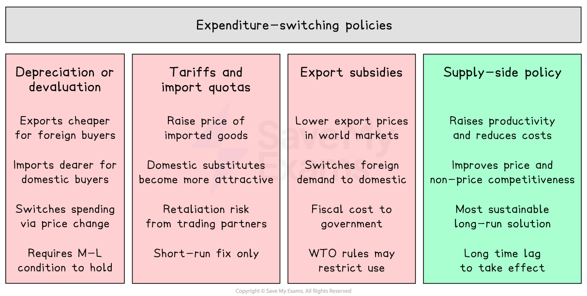

# Expenditure-Switching & Expenditure-Reducing Policies

## Expenditure-switching policies

> **Spec point** — `spcpt_6szpNTFtjc8CSrZf`

## Expenditure-switching policies

- Policies to correct a current account deficit can be classified into two broad categories - **expenditure-switching** and **expenditure-reducing** - a distinction that is central to A Level evaluation

- **Expenditure-switching policies aim to redirect domestic and foreign expenditure away from *****imports *****and towards domestically produced goods and services, without necessarily reducing the total level of spending in the economy**

  - They work by changing **relative prices** - making imports more expensive or domestic goods more competitive

*Typical expenditure-switching polices*

- **Depreciation or devaluation of the *****exchange rate***

  - Makes *exports* cheaper for foreign buyers and imports dearer for domestic consumers
- ***Tariffs *****and *****import quotas***

  - Raises the price of imported goods relative to domestic substitutes
- **Export *****subsidies***

  - Lowers the price of exports in world markets, switching foreign expenditure towards domestic goods
- **Supply-side policies**

  - Improves *productivity* and reduce *unit costs*, switching both domestic and foreign expenditure towards domestically produced goods through improved price and non-price competitiveness

- Expenditure-switching policies can improve the current account **without reducing domestic output and employment**

  - They redirect spending rather than reduce it
- Their effectiveness depends on ***price elasticities of demand***

  - If demand for imports and exports is inelastic, switching will be limited

> **Worked Example**
> A government decides to devalue its currency to reduce a deficit on the current account of the balance of payments. How should this policy be classified?
> 
> A. - an expenditure-reducing policy
> 
> B. - an expenditure-switching policy
> 
> C. - the law of comparative advantage
> 
> D. - the Marshall-Lerner condition
> 
> **Final answer:** **Answer: B**
> 
> Devaluation works by changing **relative prices** - exports become cheaper in foreign currency terms and imports become dearer in domestic currency terms, redirecting domestic and foreign spending towards domestically produced goods without necessarily reducing the total level of expenditure in the economy
> 
> This is the defining characteristic of an **expenditure-switching** policy: it switches the composition of spending rather than reducing it
> 
> **Worked solution**
> 
> - Option A is the **trap** -  students who know that contractionary fiscal policy and contractionary monetary policy also reduce the current account deficit may over-generalise and classify all CA policies as expenditure-reducing; but these work through cutting total AD, not through price switching
> - Option C is incorrect - comparative advantage explains the basis for trade, not a policy mechanism
> - Option D is incorrect - the Marshall-Lerner condition is a **prerequisite** for devaluation to work (the combined PED for exports and imports must exceed 1), not a classification of the policy itself; confusing a condition with a policy type is a common exam error

## Expenditure-reducing policies

> **Spec point** — `spcpt_5zwJrCQ8B2gPKwwW`

## Expenditure-reducing policies

- **Expenditure-reducing policies aim to reduce the total level of domestic aggregate demand, which automatically lowers import spending as incomes fall**

  - They work through the **income effect** - as domestic incomes fall, households spend less on all goods, including imports
- Examples include:

  - **Contractionary fiscal policy** - higher taxes and lower government spending reduce *disposable income* and aggregate demand
  - **Contractionary monetary policy** - higher interest rates reduce consumption and investment, lowering aggregate demand and import spending
- Expenditure-reducing policies are **reliable in reducing imports** - but carry significant costs:

  - Lower growth and rising unemployment as domestic demand falls
  - Potential *deflation* if demand falls sharply
  - The current account improves but at the cost of other macroeconomic objectives - a major policy trade-off

### Comparing the two policies

|   | Expenditure-switching | Expenditure-reducing |
|---|---|---|
| **Mechanism** | - Changes relative prices | - Reduces total spending |
| **Effect on output** | - Can maintain or raise output | - Reduces output |
| **Effect on employment** | - Neutral or positive | - Negative |
| **Effectiveness** | - Depends on price elasticities | - Reliable but costly |
| **Time lag** | - Can be long (*J-curve* effect) | - Relatively quick |
| **Examples** | - Depreciation, tariffs, subsidies, supply-side | - Higher taxes, higher interest rates |

- In practice, governments often use a **combination** of both approaches - expenditure-switching to improve competitiveness while using expenditure-reducing measures to prevent the economy from overheating if the switch in spending creates excess demand

> **Exam Hint**
> When asked to assess policies to correct a current account deficit, always classify each as switching or reducing and explain the trade-offs.
> 
> Switching is preferable with spare capacity - it improves the current account without sacrificing growth.
> 
> Reducing suits excess demand but carries output and employment costs. The strongest evaluative point is that supply-side policy is uniquely both switching and supply-expanding - making it the most sustainable long-run solution.
