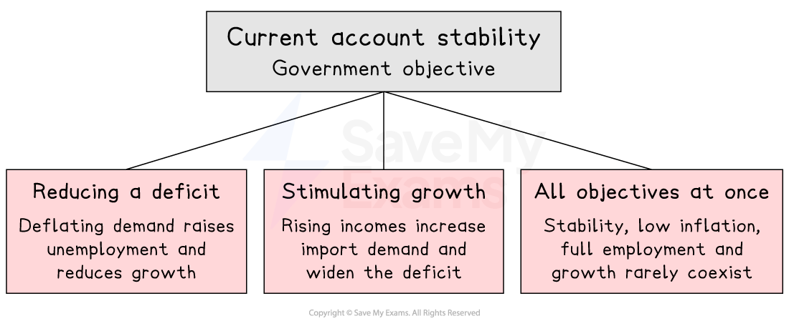

# Policies To Correct Imbalances on the Current Account

## Government policy objective of stability of the current account

> **Spec point** — `spcpt_nzFnpByCRfKHqprG`

## Government policy objective of stability of the current account

- **Current account stability refers to a government's objective of avoiding persistent and large imbalances - either deficits or surpluses - on the current account of the balance of payments**

  - A **persistent current account deficit** is unsustainable in the long run as it requires continuous financing through the financial account - building up *foreign liabilities* and increasing future primary income outflows
  - A **persistent current account surplus** may attract international political pressure and reflect suppressed domestic consumption, reducing *living standards* below productive capacity
- Governments therefore aim for a **broadly balanced current account** over time rather than targeting an exact figure in any single period

### Achieving current account stability may cause conflicts

- The objective of current account stability may conflict with other macroeconomic objectives

*Potential macroeconomic conflicts which may arise in trying to achieve stability on the current account balance*

- Policies to reduce a deficit (e.g. deflating domestic demand) may increase unemployment and reduce growth
- Policies to stimulate growth may worsen the current account by increasing import demand
- Achieving current account stability while maintaining low *inflation*, full employment and growth simultaneously is rarely possible - *policy trade-offs* are inevitable

## Effect of fiscal policies on the current account

> **Spec point** — `spcpt_dJ4WFxX6qMTdWqS9`

## Effect of fiscal policies on the current account

- **Contractionary fiscal policy** (higher taxes, lower government spending) reduces domestic aggregate demand, lowering household incomes and reducing expenditure on imports

  - The current account deficit narrows as import spending falls
  - However, lower growth and higher unemployment are likely side effects - a significant policy trade-off
- **Expansionary fiscal policy** worsens the current account as rising incomes pull in more imports
- Fiscal policy works through the **demand channel** - it affects the current account indirectly by changing the level of domestic income rather than directly targeting trade competitiveness

## Effect of monetary policies on the current account

> **Spec point** — `spcpt_dz8F2m4wHG757Wgx`

## Effect of monetary policies on the current account

- **Higher interest rates** attract *hot money* inflows from foreign investors seeking better returns, increasing demand for the domestic currency and causing an **appreciation**

  - Appreciation makes exports more expensive and imports cheaper, tending to **worsen** the trade balance
  - However, higher interest rates also reduce domestic consumption and investment, lowering import demand - a partially offsetting effect
- **Lower interest rates** cause depreciation of the exchange rate, making exports cheaper and imports dearer, tending to **improve** the trade balance
- The effectiveness of monetary policy on the current account depends critically on ***price elasticities of demand*** for exports and imports

## Effect of supply-side policies on the current account

> **Spec point** — `spcpt_gk3PYnk755H6fRg3`

## Effect of supply-side policies on the current account

- **Supply-side policies** improve the current account by raising the productive efficiency and international competitiveness of domestic firms
- Improved competitiveness lowers *unit costs*, making exports more price competitive in world markets and reducing dependence on imports
- Examples include:

  - **Investment in education and training** - raises *labour productivity*, lowering unit labour costs
  - **Research and development subsidies** - encourages *innovation*, improving export quality and non-price competitiveness
  - **Deregulation** - reduces costs of production, improving efficiency
- Supply-side policies address the **structural causes** of a current account deficit rather than merely suppressing demand - they are therefore regarded as the most sustainable long-run solution
- The main limitation is that supply-side policies operate **slowly** - improvements in productivity and competitiveness take years to feed through into export performance

## Effect of protectionist policies on the current account

> **Spec point** — `spcpt_sbzMcTDj4DDrjMV7`

## Effect of protectionist policies on the current account

- ***Tariffs**** *raise the price of imports, reducing import volumes and narrowing the trade deficit directly
- ***Import quotas*** limit the volume of imports entering the country, directly reducing import expenditure
- ***Export subsidies*** lower the price of exports in foreign markets, boosting export demand and improving the trade balance
- Protectionist policies can improve the current account in the **short run** but carry significant risks:

  - Trading partners may **retaliate** with their own protectionist measures, reducing export demand and potentially worsening the current account
  - They reduce competitive pressure on domestic firms, allowing **inefficiency** to persist rather than addressing the underlying causes of the deficit
  - They may violate ***WTO rules***, exposing the country to trade disputes and *sanctions*
  - *Consumer welfare* falls as import prices rise

### Summary table of policy effects

| Policy | Mechanism | Effect on current account | Key limitation |
|---|---|---|---|
| Contractionary fiscal | - Reduces domestic demand and import spending | - Improves deficit | - Raises unemployment; slows growth |
| Lower interest rates / depreciation | - Makes exports cheaper, imports dearer | - Improves deficit | - Import cost-push inflation |
| Supply-side | - Raises productivity and export competitiveness | - Improves deficit sustainably | - Slow to take effect |
| Tariffs / quotas | - Directly restricts import volumes | - Improves deficit | - Risk of retaliation; WTO rules |
| Export subsidies | - Lowers export prices, boosts export demand | - Improves deficit | - Risk of retaliation; fiscal cost |

> **Worked Example**
> A government aims to reduce unemployment through expansionary fiscal policy and borrows more from *commercial banks*, increasing its borrowing requirement. What will be the result?
> 
> A. - a decrease in the budget deficit
> 
> B. - a decrease in the national debt
> 
> C. - an increase in the balance of payments deficit on the current account
> 
> D. - an increase in interest rates
> 
> **Final answer:** **Answer: D**
> 
> When the government borrows more from commercial banks, it increases the **demand for loanable funds** in the financial system - competition for available funds pushes up the price of borrowing, which is the **rate of interest**
> 
> This is the **crowding out** mechanism - government borrowing competes with private sector borrowing, driving up interest rates and potentially reducing private investment
> 
> **Worked solution**
> 
> - Option A is incorrect - borrowing more to fund expenditure **increases** the budget deficit, not decreases it
> - Option B is incorrect - additional borrowing **adds to** the national debt, not reduces it
> - Option C is the **trap** - students who know that expansionary fiscal policy increases incomes and therefore imports may select this; while this is a valid long-run consequence of expansionary fiscal policy, the **direct and immediate** result of increased government borrowing from commercial banks is upward pressure on interest rates, not a current account change

> **Exam Hint**
> When evaluating policies to correct a current account deficit, always consider both the mechanism and the limitations - a policy that improves the current account may simultaneously worsen other macroeconomic objectives.
> 
> Supply-side policy is generally the strongest evaluation point as it addresses the root causes of uncompetitiveness rather than suppressing demand or distorting trade.
