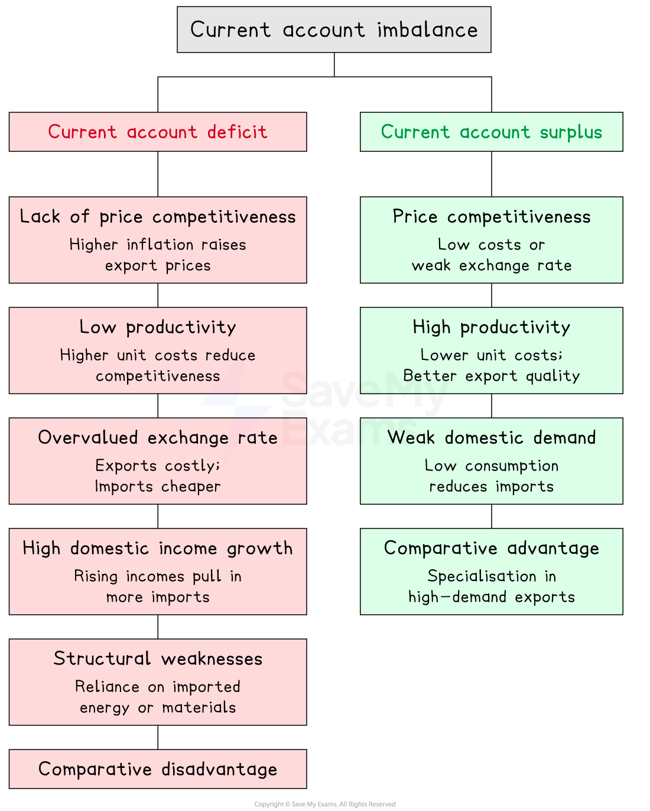

# Causes & Consequences of Imbalances

## Causes of imbalances in the current account

> **Spec point** — `spcpt_gyGx4rpbHFz9zB9P`

## Causes of imbalances in the current account

*Causes of imbalances in the current account*

### Causes of a current account deficit

- **Lack of price competitiveness**

  - If domestic *inflation *is persistently higher than that of trading partners, export prices rise relative to foreign competitors, reducing export demand and increasing demand for cheaper imports
- **Low productivity**

  - If domestic firms produce less efficiently than foreign competitors, *unit costs* are higher, making exports less price-competitive in world markets
- **Overvalued exchange rate**

  - An appreciation makes exports more expensive abroad and imports cheaper domestically, worsening both the trade in goods and trade in services balances
- **High domestic income growth**

  - Rising incomes increase demand for imports, particularly if the *marginal propensity to import* is high; if trading partners grow more slowly, export demand does not rise to match
- **Structural weaknesses**

  - A lack of manufacturing capacity or over-dependence on imported energy and raw materials creates a structural tendency towards deficit that cannot be corrected by price adjustments alone
- **Comparative disadvantage**

  - If a country lacks *comparative advantage* in traded goods, it will persistently import more than it exports in those sectors

#### Causes of a current account surplus

- **Price competitiveness**

  - Low unit labour costs or a weak exchange rate makes exports cheap in world markets and imports relatively expensive, boosting net exports
- **High productivity**

  - Efficient production lowers unit costs and improves export quality, raising demand for exports in world markets
- **Weak domestic demand**

  - If domestic consumption is low, fewer imports are demanded; combined with strong export performance this generates a surplus - Germany and China are key examples
- **Comparative advantage in traded goods**

  - *Specialisation *in goods for which world demand is strong and *income-elastic* generates persistent export surpluses

> **Worked Example**
> What is most likely to cause a current account deficit?
> 
> A .- a *recession *in the domestic economy
> 
> B. - a relatively high rate of inflation
> 
> C. - an undervalued exchange rate
> 
> D. - high labour productivity
> 
> **Final answer:** **Answer: B**
> 
> High inflation makes exports more expensive in world markets and imports relatively cheaper - export demand falls and import demand rises, worsening the current account towards deficit
> 
> **Worked solution**
> 
> - Option A is the **trap** - recession feels like economic weakness so students assume it causes a deficit, but falling incomes reduce import spending, which actually improves the current account
> - Option C is incorrect - an undervalued exchange rate makes exports cheaper and imports dearer, improving the current account towards surplus
> - Option D is incorrect - high productivity lowers unit costs, raising export competitiveness and improving the current account

## Consequences of imbalances in the current account

> **Spec point** — `spcpt_vPRMyZkDcmqDCNxW`

## Consequences of imbalances in the current account

- The consequences of a current account imbalance affect both the **domestic economy** (growth, employment, inflation, policy) and the **external economy** (exchange rates, trading partners, international relations)

### Consequences of a current account deficit

| Consequence | Domestic economy | External economy |
|---|---|---|
| **Exchange rate** | - Depreciation raises import costs, contributing to *cost-push inflation* and squeezing real incomes | - Depreciation may improve export competitiveness over time - a potential self-correcting mechanism |
| **Financing the deficit** | - Government may borrow to finance the deficit, raising national debt and future *debt servicing costs* | - Reliance on *foreign capital inflows* increases foreign ownership of domestic assets and future primary income outflows |
| **Policy response** | - Contractionary fiscal or monetary policy reduces domestic demand, slowing growth and raising unemployment | - Reduced import demand may ease pressure on trading partners' current account surpluses |
| **Productive capacity** | - A persistent deficit on goods may reflect *deindustrialisation *- manufacturing capacity is difficult and costly to rebuild | - Loss of export market share to foreign competitors entrenches comparative disadvantage in traded goods |
| **Foreign exchange reserves** | - A central bank may run down reserves to support the exchange rate, reducing capacity to manage future shocks | - Falling reserves signal external vulnerability, potentially triggering *capital flight* by foreign investors |

### Consequences of a current account surplus

| Consequence | Domestic economy | External economy |
|---|---|---|
| **Exchange rate** | - Appreciation raises import purchasing power, lowering inflation and raising real incomes | - Appreciation erodes export competitiveness over time - the surplus may be self-correcting |
| **Accumulation of assets** | - *Sovereign wealth funds* and overseas holdings generate future primary income inflows, boosting living standards | - Surplus countries accumulate claims on deficit countries, creating persistent global imbalances |
| **Domestic demand** | - Suppressed consumption means households enjoy lower living standards than productive capacity allows | - Trading partners face pressure on their own current accounts, risking *protectionist retaliation* |
| **Inflationary pressure** | - Strong export demand may drive up domestic prices if the economy is near full capacity | - Competitive currency policies by surplus countries create tensions in international trade relations |
| **International pressure** | - Government may face demands to stimulate domestic demand, requiring expansionary fiscal policy | - *IMF *and trading partners may pressure the country to revalue its currency - China-USA trade tensions are a prominent example |

> **Worked Example**
> A government succeeds in changing a current account deficit into a current account surplus. Why might this current account surplus increase the country's inflation rate?
> 
> A. - it raises aggregate demand
> 
> B. - it raises production costs
> 
> C. - it reduces the exchange rate
> 
> D. - it reduces the money supply
> 
> **Final answer:** **Answer: A**
> 
> A surplus means net exports (X-M) are positive and rising - since AD = C + I + G + (X-M), rising net exports increase AD, creating demand-pull inflationary pressure near full capacity
> 
> **Worked solution**
> 
> - Option C is the **trap** - students know depreciation causes inflation through higher import costs and may select this, but a surplus increases demand for the domestic currency, which appreciates rather than reduces the exchange rate
> - Option B is incorrect - a surplus does not directly raise production costs
> - Option D is incorrect - export revenue inflows increase the money supply, not reduce it

> **Exam Hint**
> Always distinguish between all four components of the current account - a deficit on trade in goods has different causes and implications from a deficit on primary income; never treat the current account as synonymous with trade in goods alone.
> 
> When evaluating consequences, address both the domestic economy (growth, employment, inflation, policy responses) and the external economy (exchange rate movements, trading partner reactions, retaliation risk) as the syllabus requires.
> 
> A current account deficit is not always harmful - if financed by productive *FDI *that raises long-run productive capacity it may be sustainable; always consider the cause and method of financing before evaluating severity.
