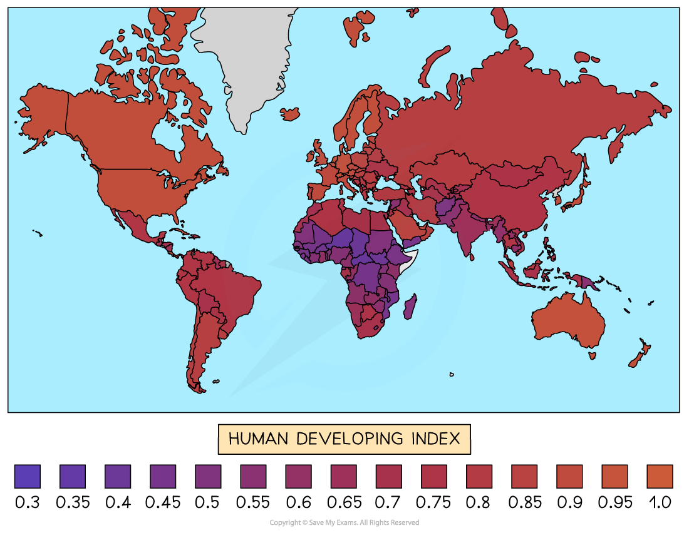

# Composite Economic Indicators

## The Human Development Index (HDI)

> **Spec point** — `spcpt_Vbrs2p28R6NctP5p`

## The Human Development Index (HDI)

- The HDI is defined as a composite index published annually by the **United Nations Development Programme (UNDP)**, measuring average achievement across three dimensions of human development

*World HDI values*

### The three dimensions and their indicators

| Dimension | Indicator |
|---|---|
| Health | - Life expectancy at birth |
| Education | - Mean years of schooling + expected years of schooling |
| Standard of living | - GNI per capita (PPP-adjusted) |

- Each dimension is scored between 0 and 1; the HDI is the geometric mean of the three dimension scores
- Countries are classified as very high, high, medium or low human development based on their HDI score

  - A value of < 0.550 is considered **low development**
  
    - E.g. Senegal was at 0.514 in 2021
  - A value of 0.550-0.699 is considered **medium development**
  
    - E.g.Bangladesh was at 0.667 in 2021
  - A value of 0.700-0.799 is considered **high development**
  
    - E.g Thailand was at 0.777 in 2021
  - A value ≥ 0.800 is considered **very high development**
  
    - E.g. Austria was at 0.918 in 2021

#### Evaluating the HDI

- **Advantage over GNI alone**

  - Two countries with identical GNI per capita can have very different HDI scores depending on how income is translated into health and education outcomes
  - **Cuba** and **Qatar **are classic examples of this divergence
- **Limitations**

  - Does not capture inequality within countries
  
    - A high HDI can coexist with extreme income concentration
  - Does not include political freedom, *environmental sustainability* or gender equality
  - Education and health indicators measure quantity, not quality

## Measure of economic welfare (MEW)

> **Spec point** — `spcpt_RNNRGjXKtc4Hpptf`

## Measure of economic welfare (MEW)

- The MEW is defined as an adjusted measure of GDP developed by economists **Nordhaus and Tobin** in 1972, which attempts to correct GDP to better reflect actual economic welfare
- MEW adjusts GDP in two directions:

| Adjustment | Direction | Examples |
|---|---|---|
| Add welfare-enhancing activities excluded from GDP | - Upward | - Value of leisure time, unpaid domestic work, subsistence output |
| Deduct welfare-reducing activities included in GDP | - Downward | - Costs of pollution, *urban* congestion, crime, military spending |

- The rationale is that GDP counts all output equally regardless of whether it improves welfare - MEW attempts to strip out the output that does not, and add back the welfare that GDP misses

### Limitations

- Extremely difficult to measure in practice — assigning monetary values to leisure time and environmental damage is inherently subjective
- Not produced regularly for most countries, limiting its use for international or time-series comparisons
- Methodological choices about what to add and deduct are contested

## Multidimensional poverty index (MPI)

> **Spec point** — `spcpt_bbytG88sBgdGyVRy`

## Multidimensional poverty index (MPI)

- The MPI is defined as a composite index developed by the **Oxford Poverty and Human Development Initiative (OPHI) **and the **UNDP**, measuring acute poverty across three dimensions using ten indicators

### The three dimensions and their indicators

| Dimension | Indicators |
|---|---|
| Health | - Nutrition - Child mortality |
| Education | - Years of schooling - School attendance |
| Living standards | - Cooking fuel - Sanitation - Drinking water - Electricity - Housing - Assets |

- A household is classified as multidimensionally poor if it is deprived in at least one third of the weighted indicators
- The MPI score = headcount ratio (proportion of population that is poor) × intensity (average share of deprivations experienced by poor households)

#### Evaluating the MPI

- **Advantage over income poverty measures**

  - The MPI identifies which specific deprivations people experience simultaneously, allowing more targeted policy responses than a simple income threshold
- **Limitations**:

  - Does not include income as an indicator - due to data constraints rather than conceptual exclusion
  - Data relies on household surveys, which are infrequent in many low-income countries, reducing *timeliness*
  - Thresholds and weights are partly arbitrary - small changes can alter a country's classification

#### Comparison of composite indicators

|   | HDI | MEW | MPI |
|---|---|---|---|
| Published by | - UNDP | - Not regularly published | - UNDP / OPHI |
| Focus | - Human development broadly | - Welfare-adjusted GDP | - Acute poverty |
| Best suited to | - Comparing development levels across countries | - Critiquing GDP as a welfare measure | - Identifying and targeting poverty |
| Key limitation | - Ignores inequality and environment | - Hard to measure consistently | - Excludes income; data gaps |

> **Worked Example**
> What is not included as a weighted indicator of poverty in the Multidimensional Poverty Index (MPI)?
> 
> |   |   |
> |---|---|
> | **A** | cooking fuel |
> | **B** | electricity |
> | **C** | medication |
> | **D** | water |
> 
> **Final answer:** **Answer: C**
> 
> The MPI measures acute poverty across three dimensions - health, education and living standards - using ten weighted indicators
> 
> - Under **living standards**, the MPI includes: cooking fuel, electricity, drinking water, sanitation, housing quality and assets - so options A, B and D are all genuine MPI indicators
> - **Medication** is not one of the ten MPI indicators - the health dimension covers nutrition and child mortality, not access to medication specifically
> 
> **Worked solution**
> 
> - Options A, B and D are distractors that test whether students know the actual composition of the MPI rather than guessing what "sounds like" a poverty indicator
> - The key distinction: the MPI health dimension measures **outcomes** (mortality, nutrition) not **inputs** (medication, healthcare access) — this is precisely why medication is excluded despite seeming intuitively relevant

> **Exam Hint**
> The key distinction examiners test is why composite indicators are superior to single indicators - always argue that they capture multiple dimensions simultaneously, meaning a country cannot mask poor health or education behind high income.
> 
> The strongest evaluation point across all three is that even composite indicators have **blind spots**: HDI ignores inequality, MEW cannot be measured consistently, and MPI excludes income entirely.
> 
> In essays, naming the specific limitation of the indicator in question will always score higher than generic criticism.
