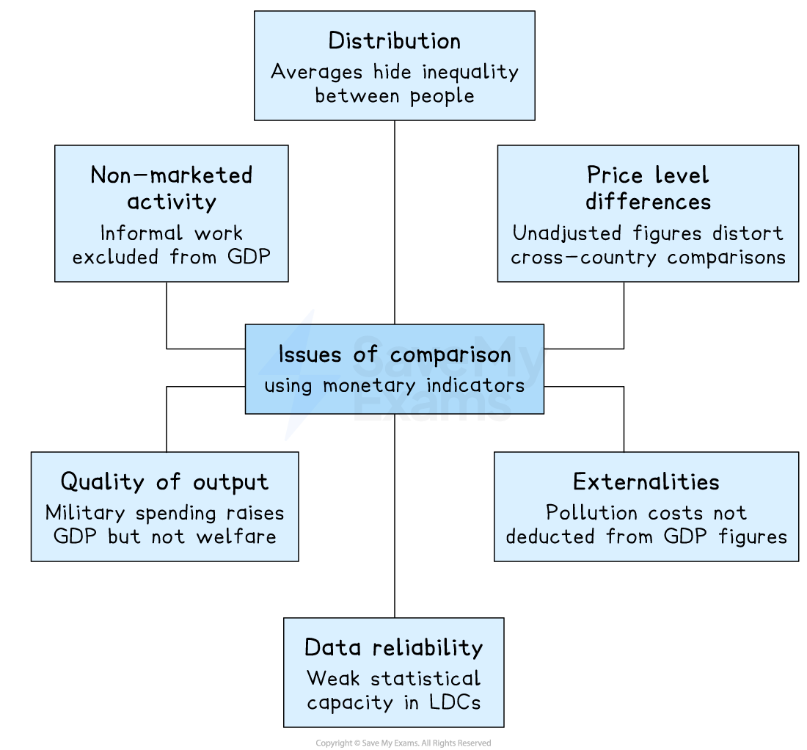

# Single Economic Indicators

## Introducing single economic indicators

> **Spec point** — `spcpt_Dr7QMNW6HQHjw7rN`

## Introducing single economic indicators

- **Single economic indicators measure one dimension of living standards or development using a single metric**

  - They are straightforward to calculate and compare but cannot capture the full complexity of human welfare
- They are divided into:

  - **monetary indicators**, which express living standards in income or output terms
  - **non-monetary indicators**, which measure specific aspects of welfare such as health and education that income data cannot directly capture

## Monetary indicators of development

> **Spec point** — `spcpt_JKZ672hH5TXt22ZZ`

## Monetary indicators of development

- **Monetary indicators are measures of living standards expressed in money terms, typically based on national income statistics such as GDP, GNI or NNI per capita**

  - They provide a quantitative, internationally comparable measure of average economic output or income

### What each measures

| Indicator | Definition | Best used for |
|---|---|---|
| Real GDP per capita | - Total value of output produced within a country's borders, divided by population, adjusted for inflation | - Measuring domestic economic output per person |
| Real GNI per capita | - GDP plus net income from abroad, divided by population, adjusted for *inflation* | - Comparing residents' average income across countries |
| Real NNI per capita | - GNI minus *depreciation* of the capital stock | - Most accurate measure of net income available to residents |

- **GNI per capita is preferred to GDP** **per capita** for international comparisons

  - It captures *remittance inflows* and foreign-owned production that GDP misses
- **Purchasing Power Parity (PPP)** is not an indicator but an adjustment method

  - It converts income figures using *exchange rates* that equalise purchasing power across countries, correcting for price-level differences
  - PPP-adjusted GNI per capita is a more accurate measure of real living standards than nominal GNI per capita

#### Issues of comparison using monetary indicators

*The issues that arise from monetary comparisons*

- **Distribution**

  - Identical GNI per capita can coexist with extreme inequality - the average tells you nothing about the typical person
- **Non-marketed activity**

  - *Subsistence farming* and *informal work* are real output but invisible to GDP, systematically understating living standards in low-income economies
- **Price level differences**

  - A dollar buys far more in Ethiopia than Germany - only PPP-adjusted figures allow valid cross-country comparisons
- **Quality of output**

  - A country spending heavily on weapons and prisons will show higher GDP than one spending the same on healthcare and schools
- **Externalities**

  - GDP counts the output of polluting industries but not the environmental damage they cause, overstating welfare in *industrialised* economies
- **Data reliability**

  - Low-income economies often lack the statistical capacity to measure GDP accurately, so the figures that matter most are the least reliable

> **Worked Example**
> The table shows what has happened to three economic indicators between two years in a country. When would GDP have been the most accurate measure of the standard of living in that country?
> 
> |   | Population | Inflation rate | Income distribution |
> |---|---|---|---|
> | **A** | constant | low and stable | equal |
> | **B** | constant | low and unstable | unequal |
> | **C** | rising | low and stable | equal |
> | **D** | rising | low and unstable | unequal |
> 
> **Answer: A**
> 
> **Population constant** - GDP per capita is most meaningful when population is stable; if population is rising, per capita figures may fall even as total output rises, or mask differences between people
> 
> **Inflation low and stable** - when inflation is low and stable, nominal and real GDP move closely together; high or volatile inflation distorts GDP figures and makes comparisons between years unreliable
> 
> **Income distribution equal** - GDP per capita is an average; it only reflects individual living standards accurately when income is evenly distributed across the population. Unequal distribution means the average can rise while many people experience no improvement
> 
> **Worked solution**
> 
> - Option B fails because unstable inflation makes GDP an unreliable real measure
> - Option C fails because rising population means per capita GDP may not rise even if total GDP does
> - Option D fails on all three grounds — rising population, unstable inflation and unequal distribution all undermine GDP as a living standards measure

> **Exam Hint**
> The critical distinction is GDP vs GNI
> 
> GDP measures output within borders regardless of ownership, while GNI measures income earned by residents regardless of location. In countries with large multinational presences, GDP significantly overstates residents' living standards because profits are repatriated abroad.
> 
> Always check whether a figure is adjusted for inflation, population growth and price level differences before drawing conclusions about living standards.

## Non-monetary indicators of development

> **Spec point** — `spcpt_tpVsyTYTw8y7rGg2`

## Non-monetary indicators of development

- **Non-monetary indicators are measures of living standards expressed in non-income terms**

  - They capture dimensions of welfare such as health, education and access to basic services that monetary figures alone cannot reflect

| Indicator | What it measures | Key limitation |
|---|---|---|
| Life expectancy at birth | - Health outcomes and access to healthcare | - Influenced by diet and lifestyle    - Not solely a function of healthcare quality |
| Infant mortality rate | - Deaths per 1,000 live births before age one    - Sensitive to healthcare, nutrition and sanitation | - Improvements may reflect targeted interventions rather than broad development |
| Adult literacy rate | - Percentage of adults who can read and write    - Reflects education access and human capital | - Does not capture quality of education, only basic attainment |
| Access to clean water and sanitation | - Proportion of population with safe water and basic sanitation    - Closely linked to health outcomes | - Definition of "access" varies across countries, limiting comparability |
| Mean years of schooling | - Average years of formal education completed by adults | - Quantity of schooling does not capture quality or relevance to labour market |

- Non-monetary indicators share a common limitation — they are **single-dimensional**, measuring one aspect of living standards in isolation without capturing the full picture of welfare or developmenthere I go
