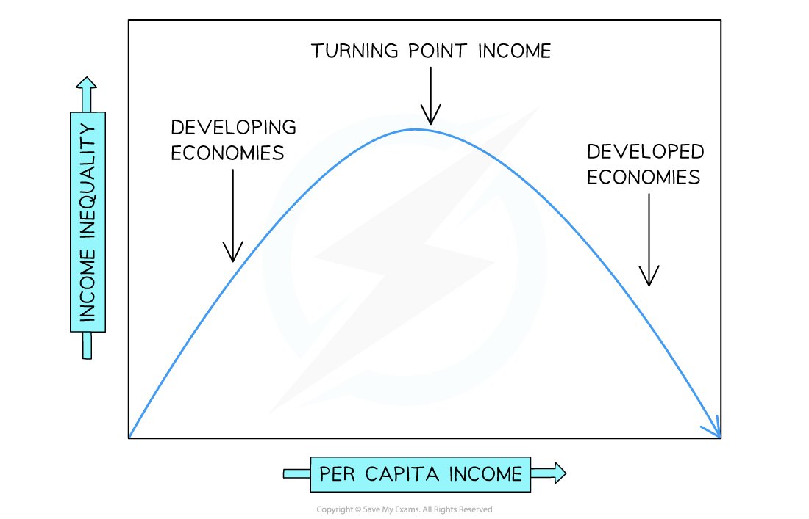

# The Kuznets Curve

## The Kuznets curve

> **Spec point** — `spcpt_GBqqsGnHCkDcbqXr`

## The Kuznets curve

- **The Kuznets curve is defined as an inverted U-shaped curve showing the hypothesised relationship between per capita income and income inequality as an economy develops**

  - Proposed by economist **Simon Kuznets** in 1955
- The curve suggests that inequality first rises then falls as a country grows richer, tracing an inverted U shape

### The mechanism - three stages

- **Early development (low per capita income)**

  - As an economy begins to industrialise, workers move from low-productivity *subsistence agriculture* into higher-wage urban manufacturing;
  
    - inequality rises because only a small share of the population initially benefits from industrial growth
- **Turning point (middle income)**

  - Inequality reaches its peak at a critical level of per capita income;
  
    - The benefits of growth are concentrated among a relatively small urban industrial class, while the rural majority remains poor
- **Advanced development (high per capita income)**

  - As more workers move into the modern industrial and service sectors, wages converge
  
    - Governments also accumulate sufficient tax revenue to fund *redistributive policies* such as social insurance, public education and progressive taxation - inequality falls

*The Kuznets Curve*

#### Diagram analysis

- The y-axis measures income inequality (e.g. the *Gini coefficient*); the x-axis measures per capita income
- Developing economies sit on the upward-sloping left side of the curve — growth initially worsens inequality
- The turning point income is the peak of the curve — the level of per capita income at which inequality is greatest
- Developed economies sit on the downward-sloping right side — further growth is associated with falling inequality

### Evaluation of the Kuznets Curve

| Limitation | Explanation |
|---|---|
| Mixed empirical evidence | - Many countries do not follow the pattern    - **China** has experienced rapid growth alongside persistently high inequality, and some low-income countries have relatively equal distributions |
| Historical bias | - The relationship may reflect patterns in now-developed economies that do not necessarily repeat in today's developing world |
| Role of government policy | - The curve implies a mechanical relationship between growth and inequality    - But outcomes depend heavily on institutional quality and deliberate redistribution choices |
| Ignores absolute poverty | - Inequality can fall while many people remain in *absolute poverty*    - The curve measures relative distribution, not the living standards of the poorest |

> **Worked Example**
> What does the Kuznets curve represent?
> 
> | **A** | Changes in income inequality over time |
> |---|---|
> | **B** | Changes in the Human Development Index over time |
> | **C** | Changes in the Multidimensional Poverty Index over time |
> | **D** | The inverse of a Lorenz curve |
> 
> **Answer: A**
> 
> The Kuznets curve plots income inequality (y-axis) against per capita income (x-axis), showing an inverted U-shaped relationship - inequality rises as a country industrialises then falls as it develops further
> 
> **Worked solution**
> 
> - Option B is incorrect - the HDI is a separate composite indicator measuring health, education and income; it has its own trajectory and is not what the Kuznets curve shows
> - Option C is incorrect - the MPI measures acute poverty across multiple dimensions; it is not related to the Kuznets curve
> - Option D is the most tempting distractor - the *Lorenz curve* does measure income distribution, but the Kuznets curve is not its inverse; they are entirely different diagrams with different axes

> **Exam Hint**
> The Kuznets curve is frequently used as an evaluation tool in essays on development - it challenges the assumption that growth automatically reduces inequality.
> 
> The strongest evaluation point is that the curve is empirically contested: many developing economies have experienced rising inequality alongside rapid growth without reaching the turning point, suggesting that redistribution requires deliberate policy rather than automatic market forces.
