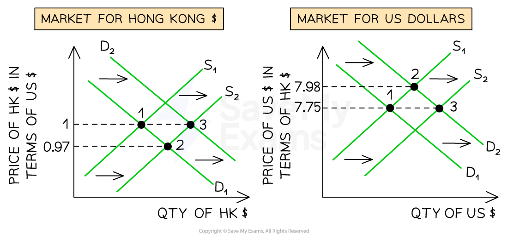
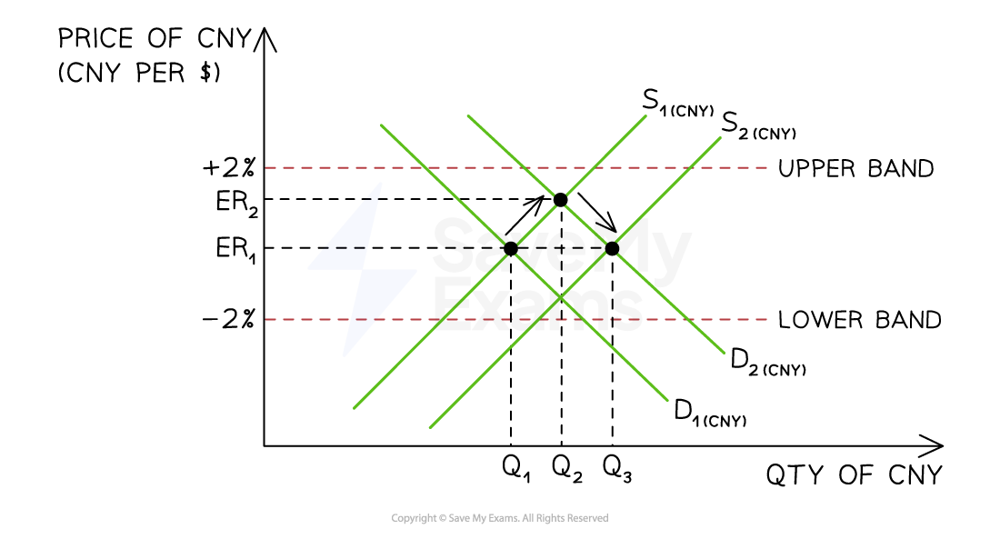

# Fixed & Managed Exchange Rate Systems

## Fixed exchange rate system

> **Spec point** — `spcpt_ktvBd7RkFHhw2HW6`

## Fixed exchange rate system

- A system in which the country’s **central bank intervenes** in the currency market to **fix (peg) the exchange rate** in relation to another currency e.g US\$

  - When they want their currency to appreciate, they buy it on forex markets using their ***foreign reserves***, thus increasing its demand
  - When they want their currency to depreciate, they sell it on forex markets, thus increasing its supply
- Sometimes the peg is at **parity** e.g. 1 Brunei Dollar = 1 Singapore Dollar
- Often the peg is not at parity e.g. Hong Kong has pegged its currency to the US\$ at a rate of HK\$ 7.75 = US\$ 1
- A** revaluation** occurs if the Central Bank decides to change the peg and increase the strength of its currency
- A **devaluation **occurs if the Central Bank decides to change the peg and decrease the strength of its currency

*The Hong Kong Monetary Authority intervenes to maintain the exchange rate of HK$ 7.75 = US$ 1*

### Diagram analysis

- The HK/US exchange rate is maintained at HK\$7.75 = US\$1 by the Hong Kong Monetary Authority (HKMA).

#### Left diagram — market for HK\$

- Increased imports from the USA raise demand for US\$ — firms must sell HK\$ to buy US\$, increasing the supply of HK\$ on the forex market
- This puts downward pressure on HK\$, depreciating it from HK\$7.75 to HK\$7.79 per US\$1 — point 2
- To defend the peg, the HKMA buys HK\$ using its US\$ foreign exchange reserves, shifting the demand curve back to D2

  - The rate returns to HK\$7.75 = US\$1 — point 3

#### Right diagram — market for US\$

- The same import demand raises demand for US\$, appreciating it from \$1 = HK\$7.75 to \$1 = HK\$7.99 — point 2
- The HKMA sells US\$ from its reserves, increasing supply to S2

  - The rate returns to HK\$7.75 = US\$1 — point 3

#### Key mechanism

- Both diagrams show the same intervention — the HKMA uses US\$ reserves to buy HK\$ simultaneously increasing HK\$ demand and US\$ supply
- If reserves run out, the central bank can no longer defend the peg and it collapses — this is what forced sterling out of the European *Exchange Rate Mechanism* in September 1992 when the Bank of England exhausted its reserves trying to support the pound

## Distinction between revaluation and devaluation

> **Spec point** — `spcpt_H8XhJcjm3dSxBPxc`

## Distinction between revaluation and devaluation

- These terms apply specifically to **fixed exchange rate systems**, where the government actively decides to change the officially pegged rate
- **Devaluation** is a deliberate decision by the government to **lower the official fixed exchange rate** - the domestic currency is pegged at a lower value against foreign currencies

  - Makes exports cheaper and imports dearer
  - Used to improve international competitiveness and correct a persistent *current account deficit*
  - Example: if the rate is fixed at £1 = \$2.00 and the government devalues to £1 = \$1.50, sterling has been devalued by 25%
- **Revaluation** is a deliberate decision by the government to **raise the official fixed exchange rate** - the domestic currency is pegged at a higher value against foreign currencies

  - Makes exports dearer and imports cheaper
  - Used to reduce inflationary pressure from import costs, or in response to international pressure where a currency is perceived as undervalued
  - Example: China was under sustained international pressure to revalue the renminbi upwards given its persistent *current account surplus*

#### Key distinction from floating system terminology

| Fixed rate system | Floating rate system |
|---|---|
| - **Devaluation** - government decision to lower the peg | - **Depreciation** - market-driven fall in currency value |
| - **Revaluation** - government decision to raise the peg | - **Appreciation** - market-driven rise in currency value |

> **Exam Hint**
> Devaluation and revaluation are **policy decisions**
> 
> Depreciation and appreciation are **market outcomes** - this distinction is frequently tested in MCQs and essays

> **Worked Example**
> An increase or decrease in exchange rates can take place in both a floating and a fixed exchange rate system but different terminology is used for each system. What is the correct terminology?
> 
> |   | Floating rate decreases | Fixed rate increases |
> |---|---|---|
> | **A** | depreciation | appreciation |
> | **B** | depreciation | revaluation |
> | **C** | devaluation | appreciation |
> | **D** | devaluation | revaluation |
> 
> **Final answer:** **Answer: B**
> 
> Under a **floating exchange rate**, the rate is determined by market forces - when it falls due to excess supply of the currency in the foreign exchange market, this is called **depreciation**. When it rises, it is called **appreciation**. These are market outcomes, not policy decisions
> 
> Under a **fixed exchange rate**, the government or central bank sets the official pegged rate - when it deliberately raises the fixed rate, this is called **revaluation**. When it deliberately lowers the fixed rate, it is called **devaluation**. These are policy decisions, not market outcomes
> 
> **Worked solution**
> 
> - Option A is incorrect - appreciation applies to a floating rate rising, not a fixed rate rising; students who use appreciation and depreciation for both systems will select this
> - Option C is the **trap** - devaluation correctly describes a fixed rate falling but appreciation is wrong for a fixed rate rising; students who know devaluation/revaluation only partially may confuse appreciation with revaluation
> - Option D is incorrect - devaluation applies to a fixed rate falling, not a floating rate falling; students who conflate the two systems' terminology in both directions will select this

## Managed exchange rate system

> **Spec point** — `spcpt_cSK3SWsd8Wq5CPmM`

## Managed exchange rate system

- The exchange rate is allowed to **fluctuate within a specified band** around a desired valuation. If it goes outside of this band, the central bank will intervene to bring it back within the band

  - When they want their currency to **appreciate back within the band**, they buy it on forex markets using their ***foreign reserves***, thus increasing its demand
  - When they want their currency to **depreciate back into the band**, they sell it on forex markets, thus increasing its supply
- Currently, almost all currencies are** managed currencies**

  - The width of the band varies from country to country
  - These bands are not published, as it would help  currency ***speculators*** to know when **currency reversals** would be initiated by the central bank, and they would seek to profit from that knowledge

*The Peoples Bank of China intervenes to maintain the exchange rate within a specified band of trading and is in the region of 2% around a value of 1US$ = 6.75 CNY   *

### Diagram analysis

- China has not released their currency bands, however, the value seems to fluctuate up to 2% **around a value of 1US\$ = 6.75 CNY**
- The initial market equilibrium is found at ER1 Q1

#### Action to correct currency appreciation

- **Increased demand **for the Chinese Yuan leads to a rightward shift of demand D1→D2 leading to an **appreciation** from ER1→ER2
- The currency is approaching the upper band so the Peoples Bank of China intervenes by selling their own currency (and buying foreign reserves)

  - This increases the **supply of the Yuan** causing a rightward shift from S1→S2
  - A new equilibrium is established at ER1Q3, well within the band

#### Action to correct currency depreciation

- **Increased supply **of the Chinese Yuan on world markets leads to a rightward shift of supply from S1→S2 leading to a **depreciation** from ER1 towards the bottom currency band
- The currency is approaching the bottom band so the Peoples Bank of China intervenes by buying their own currency (and selling foreign reserves)

  - This increases the **demand of the Yuan** causing a rightward shift from D1→D2
  - A new equilibrium is established at ER1Q3, well within the band
