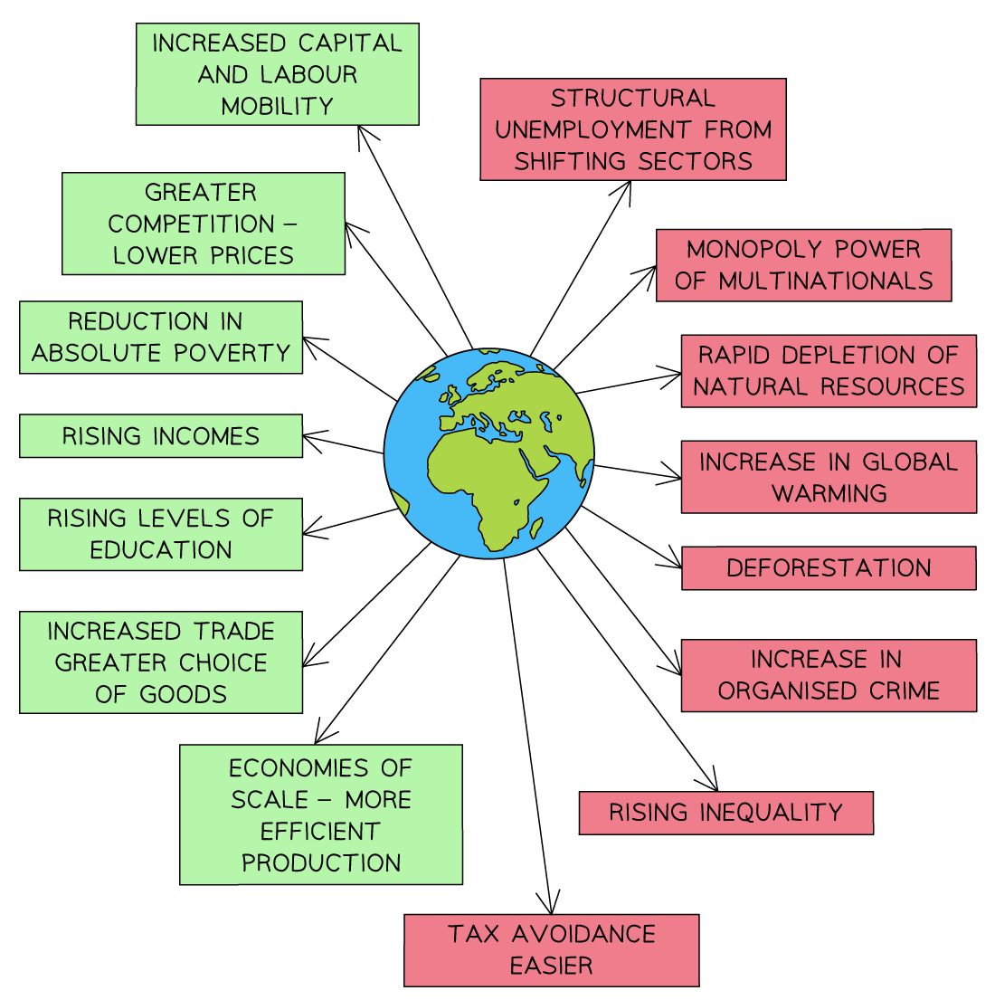

# Causes & Consequences of Globalisation

## Meaning of globalisation

> **Spec point** — `spcpt_9rq2S4gJsNCx9nWt`

## Meaning of globalisation

- **Globalisation is the process by which national economies become increasingly integrated with one another through cross-border flows of goods, services, capital and people.**

  - Trade links expand, with goods and services produced in one country and consumed in another
  - Capital flows across borders in the form of FDI, portfolio investment and international lending
  - People move between countries as migrants, tourists and temporary workers
  - Production processes are increasingly **subdivided across multiple countries**
  
    - A single product may be designed in one country, have components made in several more, and be assembled in another
- Globalisation also involves the transfer of technology and the strengthening of cultural and political ties between countries

## Causes of globalisation

> **Spec point** — `spcpt_qjC8jHPsWmfc5Hb8`

## Causes of globalisation

- Globalisation has accelerated rapidly since the late 20th century due to a combination of technological, economic and political factors.

*Some causes of globalisation*

| Cause | Explanation |
|---|---|
| **Falling transport costs** | - Containerisation, larger cargo ships and cheaper air freight have sharply reduced the cost of moving goods internationally |
| **Advances in communications** | - The internet, mobile technology and low-cost international telecommunications enable real-time coordination of global business |
| **Trade liberalisation** | - Tariff reductions through the WTO, regional trade agreements and bilateral deals have lowered barriers to international trade |
| **Capital market liberalisation** | - Removal of controls on cross-border capital flows has enabled investment to move freely between countries |
| **Growth of multinational companies** | - MNCs have expanded operations across borders, building global supply chains and production networks |
| **Economic reforms in major economies** | - Market-oriented reforms in China (from 1978), India (from 1991), Vietnam and the former Soviet bloc have integrated large populations into the global economy |

## Consequences of globalisation

> **Spec point** — `spcpt_57zHqfnsyM34XqHQ`

## Consequences of globalisation

- The consequences of globalisation are contested. Outcomes vary by country, by time period and by the economic sector considered

*The positive and negative impacts of globalisation*

### Positive consequences

| Consequence | Explanation |
|---|---|
| **Higher global output** | - Specialisation according to comparative advantage raises total world production |
| **Lower prices and wider choice for consumers** | - Access to goods produced at lowest global cost benefits consumers worldwide |
| **Economic growth in developing economies** | - Export-led growth has lifted hundreds of millions out of poverty, particularly in East and Southeast Asia |
| **Technology and skills transfer** | - Globalisation accelerates the spread of technology and management practices to developing economies |
| **Employment opportunities** | - FDI and export industries create jobs in developing economies |
| **Competitive pressure on firms** | - Exposure to global competition forces firms to improve productivity and quality |

### Negative consequences

| Consequence | Explanation |
|---|---|
| **Widening inequality** | - Benefits of globalisation have been uneven — both between countries and within countries    - High-skilled workers and capital owners have often gained more than low-skilled workers |
| **Loss of jobs in developed economies** | - Manufacturing employment in high-wage countries has declined as production has shifted abroad |
| **Exploitation concerns** | - Labour conditions in some global supply chains have raised significant ethical concerns |
| **Economic dependency** | - Small or specialised economies may become highly dependent on global demand, leaving them vulnerable to external shocks |
| **Destruction of indigenous industries** | - Local firms may be outcompeted and forced to close, reducing domestic production capacity |
| **Environmental damage** | - Global trade increases emissions; MNC operations in weakly regulated economies can cause pollution |
| **Vulnerability to global shocks** | - The 2008 financial crisis and the 2020 COVID-19 pandemic demonstrated how problems in one part of the global economy spread rapidly to others |

> **Case Study**
> **China's Integration into the Global Economy**
> 
> **The context**
> 
> Before 1978, China was largely closed to the global economy. Mao-era central planning had isolated the country from international trade and investment.
> 
> The **reform and opening up** programme launched by Deng Xiaoping in 1978 began China's transformation into the world's largest manufacturing economy — and the single most significant case of globalisation in modern economic history.
> 
> **Actions taken**
> 
> - Creation of **Special Economic Zones** (starting with Shenzhen in 1980) offering foreign investors tax incentives and flexible regulation
> - Progressive trade liberalisation, culminating in **WTO accession in 2001**
> - Massive investment in ports, transport and energy infrastructure to support export-led growth
> - Integration into global supply chains, particularly in electronics, textiles and machinery
> 
> **Outcomes**
> 
> - China became the **world's largest exporter** by the 2010s
> - Over 800 million people lifted out of extreme poverty between 1978 and 2020 — the largest poverty reduction in human history
> - GDP per capita rose from under US\$200 in 1978 to over US\$12,000 by 2022
> - Rapid development also brought severe air and water pollution, rising inequality between coastal and inland regions, and growing trade tensions with major partners including the US and EU
> 
> The Chinese case illustrates both the scale of benefits globalisation can deliver and the tensions it creates —** rapid development alongside environmental costs**, inequality and trade disputes.

> **Exam Hint**
> The strongest analytical point on globalisation is that **consequences are unevenly distributed** — both between countries and within countries. Strong responses identify specific winners and losers rather than treating globalisation as uniformly good or bad.
> 
> CIE mark schemes for globalisation essays reward the definition as **flows of goods, services, capital and people between countries, with production processes increasingly subdivided across multiple countries**. This precise wording is worth learning.
> 
> For evaluation, the **two strongest critical points** are uneven distribution of benefits (some countries and groups gain far more than others) and vulnerability to global shocks (interconnected economies transmit crises rapidly, as shown in 2008 and 2020).
> 
> Use **country-specific examples**: China and Vietnam for successful integration; commodity-dependent African economies and Latin American economies facing volatile capital flows for the risks. Avoid vague references to "developing countries".
> 
> For synoptic depth, link globalisation to MNCs, FDI and international trade theory. Globalisation is the overarching process; these are its main mechanisms.
