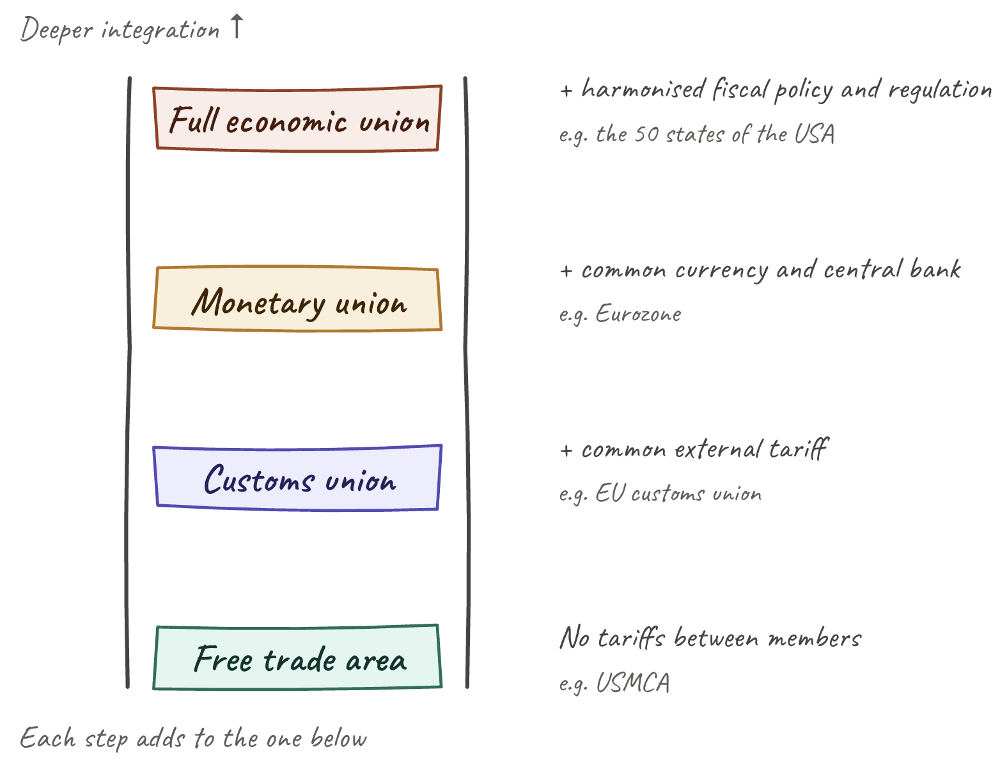
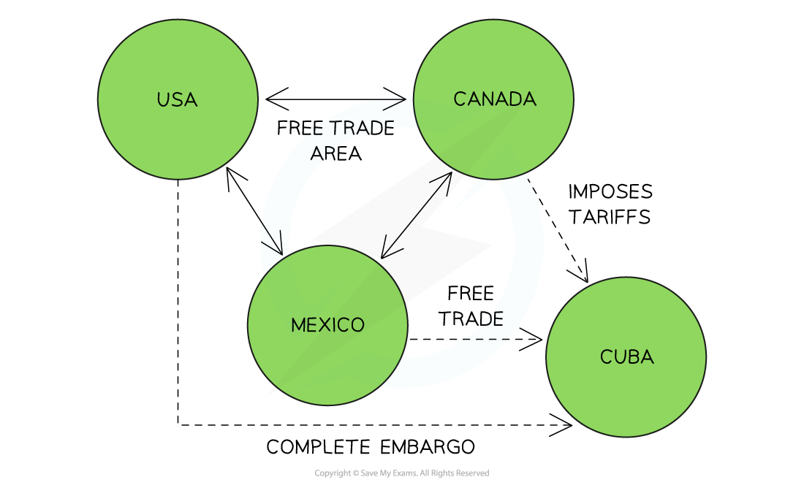
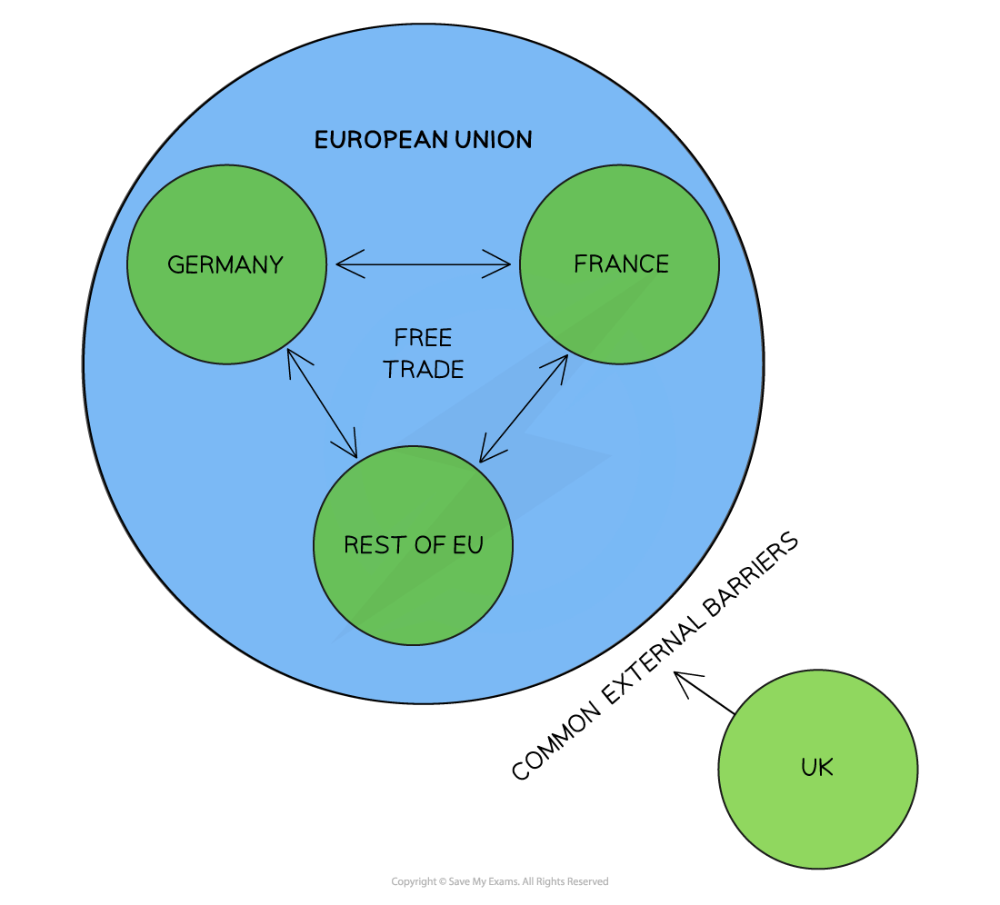

# Economic Integration

## What is economic integration?

> **Spec point** — `spcpt_3wqZzdzjvRvkWmrj`

## What is economic integration?

- **Economic integration** occurs when countries reduce trade and other economic barriers between themselves and become more economically interdependent
- The syllabus requires students to distinguish between **four forms** of economic integration — each representing a deeper level of integration than the last

*Increasing levels of integration*

| Form | Depth of integration |
|---|---|
| **Free trade area** | Lowest |
| **Customs union** | Increasing |
| **Monetary union** | Increasing |
| **Full economic union** | Highest |

## Free trade area

> **Spec point** — `spcpt_Y5jY4Cht8vPDMbqv`

## Free trade area

- **A free trade area is an agreement between member countries to abolish tariffs and other trade barriers on goods and services traded *****between themselves***

  - Each member retains its **own independent trade policy** with non-member countries
  - Members can set different external tariffs on the same good
  - This is the least integrated form — countries cooperate on mutual trade but remain free to trade externally on their own terms

*How a FTA works*

- **Example**: The **United States-Mexico-Canada Agreement (USMCA)**
- Mexico, Canada and the USA have** reduced/eliminated many trade restrictions** between themselves

  - The USA **refuses to trade** with Cuba and has placed a complete ban on all exports/imports to Cuba
  - Canada trades with Cuba but imposes **tariffs on all imports**
  - Mexico **trades freely** with Cuba

## Customs union

> **Spec point** — `spcpt_tMG2kRTxpWZ6VYtK`

## Customs union

- **A customs union extends a free trade area by adding a common external tariff — all members agree to apply the same tariffs on imports from non-member countries**

  - Goods and services are traded freely between members
  - Members lose the ability to set independent trade policies with non-members
  - The common external tariff is a key distinction from a free trade area

*The European Union Customs Union*

- Countries in the **European Union** have **eliminated all tariff barriers** between themselves but impose **common tariff barriers** on third party countries such as the UK or China

## Monetary union

> **Spec point** — `spcpt_43Vhg9MWsmkQCjtc`

## Monetary union

- **A monetary union takes integration a step further by establishing a common currency and a single central bank that controls monetary policy for all members**

  - Members share all the benefits of a customs union
  - A common currency eliminates exchange rate risk within the union and reduces transaction costs
  - Members lose independent monetary policy - they cannot set their own interest rates or adjust their exchange rate against other members
- **Example**: The **Eurozone**

  - 20 of the 27 EU members (as of 2023) use the euro as their common currency
  - The **European Central Bank (ECB)** sets monetary policy for the whole Eurozone

> **Worked Example**
> In which exchange rate regime would the central bank of a country be best able to pursue an independent monetary policy to control the rate of inflation?
> 
> A. a freely floating exchange rate system
> 
> B. a system where the country's currency has a targeted value in relation to the US\$
> 
> C. a system where the central bank buys and sells foreign currency at a fixed rate
> 
> D. where the country participates in a monetary union with other countries
> 
> **Answer: A**
> 
> Independent monetary policy means a central bank can set its **own interest rates** to control inflation in its economy, without being constrained by the need to maintain a particular exchange rate or by monetary policy decisions made elsewhere.
> 
> A **freely floating exchange rate** leaves the central bank completely free to adjust interest rates — the exchange rate simply moves in response to market forces.
> 
> **Worked solution**
> 
> - Option B is incorrect — targeting the currency against the US\$ forces the central bank to use interest rates to defend the target; monetary policy becomes dedicated to the exchange rate, not inflation
> - Option C is incorrect — a fixed exchange rate removes monetary policy independence even more strictly, since interest rates must be set at whatever level maintains the fix
> - Option D is the **trap** — students may pick this because monetary unions are a Section 11 topic and seem most relevant; but in a monetary union, members have *no* independent monetary policy at all — a single central bank sets rates for the whole union

## Full economic union

> **Spec point** — `spcpt_67jqvt2T6zjrxWkh`

## Full economic union

- **A full economic union is the deepest form of integration**

  - **Members share a common currency *****and***** harmonise fiscal policy, economic regulation and institutions across the union**
  
    - Members share monetary policy (as in a monetary union)
    - Members also coordinate fiscal policy, with some transfers of tax and spending powers to union-level institutions
    - Regulations on labour, product standards, competition and the environment are harmonised
    - In effect, member economies operate as a single integrated economy
- **Example**: No current trading bloc fully meets this definition — the EU comes closest but fiscal policy remains largely national. The clearest real-world example is the **50 states of the USA**:

  - A common currency (the US dollar) used across all states
  - A common central bank (the Federal Reserve) setting monetary policy nationally
  - Coordinated fiscal policy through federal taxes and federal spending
  - Harmonised regulation on interstate commerce, labour law and product standards
  - Free movement of goods, services, capital and people between states
- The USA illustrates what full economic union means in practice: member states operating as if they were regions of a single economy.

## Benefits and costs of economic integration

> **Spec point** — `spcpt_gnqRzkywHx7sB6nN`

## Benefits and costs of economic integration

- Deeper integration brings greater potential benefits but also greater loss of national autonomy

### Benefits

| Benefit | Explanation |
|---|---|
| **Increased trade between members** | - Lower barriers lead to more trade and specialisation according to comparative advantage |
| **Lower prices and wider consumer choice** | - Free movement of goods increases competition and allows consumers to access the best products |
| **Economies of scale** | - Firms can serve a larger integrated market, lowering average costs |
| **Increased FDI** | - Integrated markets attract investment seeking access to the full bloc |
| **Stronger bargaining power** | - Blocs can negotiate better trade terms with external partners than individual countries |

### Costs

| Cost | Explanation |
|---|---|
| **Loss of policy autonomy** | - Countries give up independent trade policy (customs union), monetary policy (monetary union) or fiscal policy (full economic union) |
| **Trade diversion** | - Trade may shift from lower-cost non-members to higher-cost members due to preferential access |
| **Asymmetric shocks** | - In a monetary union, members affected by different shocks cannot adjust their exchange rate or interest rates independently |
| **Uneven distribution of gains** | - Some members or regions benefit more than others, potentially widening internal inequality |

> **Exam Hint**
> The strongest exam move is to present the four forms as a **progression of deepening integration** — each adds something to the previous. This structure is what mark schemes reward.
> 
> The key distinction between a **free trade area and customs union** is the common external tariff — customs unions have one, free trade areas do not. This distinction is frequently tested.
> 
> The key cost of **monetary union** is the loss of independent monetary policy — members facing different economic conditions cannot respond with their own interest rate or exchange rate adjustments. The Eurozone crisis (2010–12) is the classic example of this constraint in practice.
> 
> Use **specific bloc examples**: USMCA (free trade area), EU (customs union), Eurozone (monetary union). Avoid vague references to "trade blocs".
> 
> For synoptic depth, link to trade creation and trade diversion (11.6.3) — these are the main analytical tools for evaluating whether economic integration improves or reduces overall welfare.
