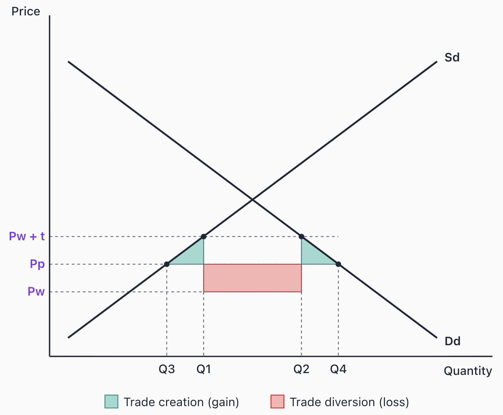

# Trade Creation & Trade Diversion

## What are trade creation and trade diversion?

> **Spec point** — `spcpt_mXR3tgqn7Pmpwgyx`

## What are trade creation and trade diversion?

- When countries form a **customs union**, they remove tariffs between members while imposing a **common external tariff** on non-members
- This reallocates where imports come from, producing two opposite welfare effects: **trade creation** and **trade diversion**
- The **net welfare effect** of a customs union depends on which dominates

### Trade creation

- **Trade creation occurs when a customs union causes high-cost *****domestic***** production to be replaced by lower-cost imports from a partner country**

  - Before the union, a tariff protected domestic producers, allowing inefficient domestic production to continue
  - After the union, the tariff on partner imports is removed, so consumers switch to cheaper imports from the partner
  - Resources are reallocated away from inefficient domestic production towards sectors where the country has a comparative advantage
- This represents a **net welfare gain** — consumers pay lower prices and global output is produced more efficiently

### Trade diversion

- **Trade diversion occurs when a customs union causes imports to shift from a lower-cost *****non-member***** producer to a higher-cost *****partner***** producer**

  - Before the union, the country imported from the world's most efficient producer (paying the world price plus tariff)
  - After the union, the tariff is removed on partner imports but remains on non-member imports
  - Even if the partner is less efficient than the non-member, it can now undercut the non-member's tariff-inclusive price
  - Imports are **diverted** from the most efficient global producer to a less efficient partner
- This represents a **net welfare loss** — global resources are used less efficiently, even though consumers may still pay a lower price than before

## Welfare analysis

> **Spec point** — `spcpt_b8mvDDz8YxMYyxxk`

## Welfare analysis

*Welfare analysis for trade creation and trade diversion*

### Diagram analysis

- **Before the customs union**

  - Price is **Pw + t** (world price plus tariff)
  - Domestic producers supply **Q1**, consumers demand **Q2**
  - Imports (Q2 − Q1) come from the world's lowest-cost producer
  - Government receives **tariff revenue** = t × (Q2 − Q1)
- **After the customs union**

  - Price falls to **Pp** (partner's price, below Pw + t but above Pw)
  - Domestic production contracts to **Q3**; consumption expands to **Q4**
  - All imports (Q4 − Q3) now come from the **partner**, not the world producer
  - Tariff revenue falls to **zero**
- **Trade creation (welfare gain)** — shown by the **two triangles**

  - Production-side triangle: inefficient domestic production between Q3 and Q1 is replaced by lower-cost partner imports
  - Consumption-side triangle: additional consumption between Q2 and Q4 generates new consumer surplus
- **Trade diversion (welfare loss)** — shown by the **rectangle** of width (Q2 − Q1) and height (Pp − Pw)

  - The original imports (Q2 − Q1) used to come from the world at price Pw
  - They now come from the partner at a higher price Pp
  - Society effectively loses the former tariff revenue without a compensating efficiency gain

#### Net welfare effect

- If **triangles > rectangle** → trade creation dominates → net **welfare gain**
- If **rectangle > triangles** → trade diversion dominates → net **welfare loss**
- This result is **ambiguous** — it depends on the specific shapes of supply and demand, tariff levels, and the price gap between partner and world producers

#### International examples

| Customs union / trade bloc | Empirical evidence on trade creation vs diversion |
|---|---|
| **European Union** | - Widely studied as a net trade creator - Removal of internal tariffs and deep market integration have reallocated production towards more efficient European producers, with trade creation generally found to exceed trade diversion |
| **EU–Turkey Customs Union** (1995) | - World Bank research estimates that trade creation has been roughly **twice as large** as trade diversion, though the overall impact on Turkish welfare has been relatively small |
| **Mercosur** (Argentina, Brazil, Paraguay, Uruguay) | - Significant evidence of trade diversion - Member countries have shifted imports away from more efficient non-member suppliers towards higher-cost regional producers, particularly in automotive and capital goods |

> **Worked Example**
> Country X imposes a 20% tariff on all imported wheat. It then forms a customs union with Country Y. Before the union, some domestic demand was met by Country X's producers and the rest was imported from Country Z, the world's lowest-cost producer. After the union, all imported wheat comes from Country Y at a price below Country Z's tariff-inclusive price but above Country Z's pre-tariff price.
> 
> Which of the following is most likely to have occurred?
> 
> A. Only trade creation; world welfare increases
> 
> B. Only trade diversion; world welfare decreases
> 
> C. Both trade creation and trade diversion; the net effect on world welfare is ambiguous
> 
> D. Neither trade creation nor trade diversion, since the tariff still applies to Country Z
> 
> **Answer: C**
> 
> Two effects occur simultaneously. Some of Country X's inefficient domestic wheat production is displaced by cheaper imports from Y — **trade creation** (welfare gain). At the same time, imports previously sourced from Z (the world's most efficient producer) now come from Y — **trade diversion** (welfare loss). The net effect on world welfare is ambiguous without information on the relative magnitudes
> 
> **Worked solution**
> 
> - **Option A is incorrect** — it ignores the shift in imports from Country Z to Country Y, which is trade diversion
> - **Option B is incorrect** — it ignores the displacement of inefficient domestic production by partner imports, which is trade creation
> - **Option D is the trap** — students may pick this because the tariff on Country Z has not been removed. But trade diversion does not require the tariff to change; it occurs because Country Y's tariff-free price is now lower than Country Z's tariff-inclusive price, making Y more attractive even though Z is the more efficient producer globally

> **Exam Hint**
> The strongest analytical point is that the net welfare effect is **ambiguous** — it depends on the balance between trade creation and trade diversion. Avoid claiming integration is unambiguously good or bad.
> 
> In FTA and customs union essays, mark schemes typically reward a **simpler tariff-removal diagram** showing price falling from Pw + t to Pp with the consumer surplus gain shaded. Draw this in the exam and discuss trade creation and trade diversion verbally as AO3 evaluation
