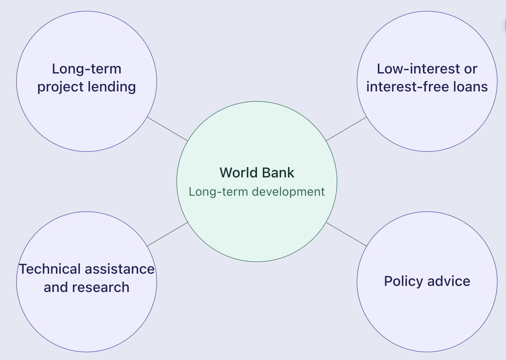

# Role of IMF & World Bank

## Introducing the IMF and World Bank

> **Spec point** — `spcpt_xSCsb6XhRMm3YcsM`

## Introducing the IMF and World Bank

- The **International Monetary Fund (IMF)** and the **World Bank** are two major international financial institutions that support member countries, but they have distinct roles.

  - Both institutions were established in 1944 as part of the post-war Bretton Woods system
  - Both are funded by member countries (almost all countries are members)
  - They work in complementary ways - the IMF focuses on **short-term financial stability**, while the World Bank focuses on **long-term development**

## Role of the IMF

> **Spec point** — `spcpt_76sWHJgRDdJYyBtn`

## Role of the IMF

- The IMF's core role is to promote **global financial stability**. It does this through three main activities:

| Activity | Explanation |
|---|---|
| **Surveillance** | - Monitors the global economy and individual member countries, identifying risks and advising on economic policy |
| **Lending** | - Provides short- to medium-term financial assistance to countries facing balance of payments problems or debt crises |
| **Technical assistance** | - Helps member countries strengthen their capacity in areas such as tax administration, monetary policy and financial regulation |

### IMF conditionality

- IMF lending typically comes with **conditions**

  - These are policy reforms the borrowing country must implement in exchange for financial support. Common conditions include:
  
    - **Austerity measures**: cuts to public spending and tax rises to reduce fiscal deficits
    - **Privatisation** of state-owned enterprises
    - **Currency devaluation** or floating to correct overvalued exchange rates
    - **Trade liberalisation** and removal of subsidies
- The rationale is that these reforms restore macroeconomic stability and the country's ability to repay
- Conditionality is also one of the most **controversial** aspects of IMF lending

  - Critics argue that austerity can worsen poverty and that reforms may not suit the country's circumstances.

#### Examples of IMF lending

- **Sri Lanka (2023)** — approximately US\$3 billion bailout following the 2022 default
- **Argentina** — multiple IMF programmes reflecting recurring debt crises
- **Ghana (2022)** — US\$3 billion programme following debt distress

> **Worked Example**
> The following are four conditions sometimes attached to IMF loans to developing countries. Which condition would conflict with the 'infant industry' argument?
> 
> A. the need to allow free trade
> 
> B. the need to control inflation
> 
> C. the need to have a contractionary fiscal policy
> 
> D. the need to privatise government enterprises
> 
> **Answer: A**
> 
> The **infant industry argument** states that new industries in developing countries need **temporary protection from foreign competition** until they achieve economies of scale and become internationally competitive.
> 
> This protection is typically provided through **tariffs or import restrictions** — the opposite of free trade. Any condition that removes trade protection directly conflicts with the argument.
> 
> **Worked solution**
> 
> - Option A is correct — free trade **removes the protection** infant industries need; it exposes them immediately to established foreign competitors against whom they cannot yet compete
> - Option B is incorrect — controlling inflation benefits all firms, including infant industries, by maintaining price stability
> - Option C is incorrect — contractionary fiscal policy reduces aggregate demand but does not directly remove trade protection for infant industries
> - Option D is the **trap** — students may select this assuming any IMF condition conflicts with government support; but privatisation changes *ownership*, not the *trade protection* that the infant industry argument requires

## Role of the World Bank

> **Spec point** — `spcpt_8k3KSxQ4BJzz7DDJ`

## Role of the World Bank

- The World Bank's core role is to promote **long-term economic development** and **poverty reduction** in lower- and middle-income countries

*Acitivities undertaken by the World Bank to generate long term development*

| Activity | Explanation |
|---|---|
| **Long-term project lending** | - Provides loans to fund infrastructure, education, healthcare and agriculture projects |
| **Low-interest or interest-free loans** | - Lending to the poorest countries at concessional rates or as grants |
| **Technical assistance and research** | - Provides expertise and produces economic data, including the World Bank's country income classifications |
| **Policy advice** | - Works with governments on development strategies, often in coordination with the IMF |

### Examples of World Bank activity

- Funding for transport infrastructure across Sub-Saharan Africa
- Support for education and health programmes in South Asia and Latin America
- Investment in renewable energy projects aligned with climate goals

## Comparing the IMF and World Bank

> **Spec point** — `spcpt_QwVq9z4Bz2nCHMfy`

## Comparing the IMF and World Bank

| Feature | IMF | World Bank |
|---|---|---|
| **Primary focus** | - Short-term financial stability | - Long-term development |
| **Typical lending** | - Balance of payments support | - Infrastructure and social projects |
| **Time horizon** | - Months to a few years | - Years to decades |
| **Typical borrower** | - Any member facing crisis | - Lower- and middle-income countries |
| **Conditions attached** | - Strong conditionality (austerity, reforms) | - Project-specific conditions |

### Evaluating the role of the IMF and World Bank

#### Positive contributions

- Provide financial support that countries cannot access through private markets, particularly during crises
- Support long-term investment in infrastructure and human capital that would otherwise be unaffordable
- Offer technical expertise and policy advice based on global experience

#### Criticisms

- **Conditionality may worsen outcomes** — austerity measures can deepen recessions and increase poverty in the short run
- **One-size-fits-all approach** — critics argue policies are imposed without sufficient regard for local conditions
- **Governance concerns** — voting power is weighted towards wealthier economies, raising questions about whose interests are prioritised
- **Long-term dependency** — repeated programmes may reflect failure to address underlying problems rather than successful support

> **Exam Hint**
> The most common exam use of these syllabus points is **as context in questions on other topics** — especially debt, privatisation and government policy. You don't need to know institutional detail beyond the core distinction: **IMF = short-term stability; World Bank = long-term development**.
> 
> When discussing **IMF conditionality**, always acknowledge both sides - reforms may restore stability but may also impose short-term hardship. This balanced framing is what AO3 evaluation rewards.
> 
> A strong analytical move is to link these institutions to **other syllabus points**: IMF programmes often require privatisation and austerity; World Bank loans are a form of concessional external finance that complements aid and FDI.
> 
> Use **country-specific examples**: Sri Lanka, Argentina and Ghana for IMF programmes; Ethiopia, India and Vietnam have received substantial World Bank support for development projects. Vague references lose AO2 marks.
