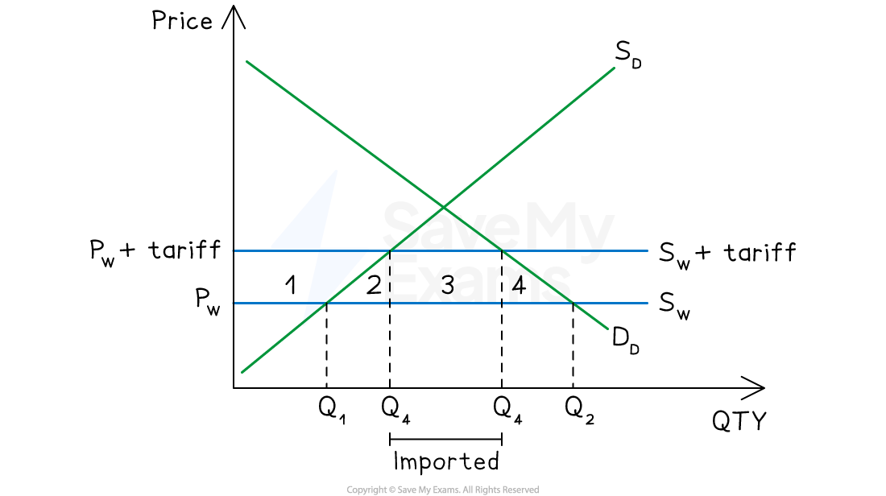
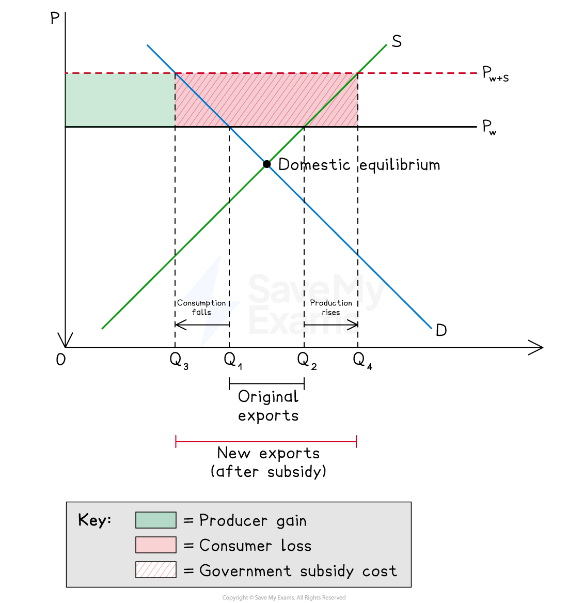

# Tariffs & Export Subsidies

## Why engage in protectionism?

> **Spec point** — `spcpt_Py7dSRKFg7qSwR9Z`

## Why engage in protectionism?

- **Protectionism** **refers to government policies that restrict international trade in order to protect domestic industries from foreign competition**
- Typical protectionist methods include:

  - tariffs
  - import quotas
  - export subsidies
  - embargoes
  - excessive administrative burdens (‘red tape’)

### Arguments for and against protectionism

| Argument for | Explanation | Argument against |
|---|---|---|
| **Infant industry** | - New domestic industries need protection from established foreign competitors until they achieve** *****economies of scale*** and become internationally competitive | - Protection may become permanent - industries never become competitive; consumers pay higher prices indefinitely |
| **Declining industry** | - Allows time to manage ***structural unemployment***** **as sunset industries contract, avoiding sudden job losses | - Delays necessary structural adjustment; resources remain in **inefficient **industries |
| **Strategic industries** | - Certain industries (defence, food, energy) must be maintained for national security **regardless of comparative advantage** | - Governments may misidentify strategic industries; risk of *political lobbying *distorting decisions |
| **Prevent dumping** | - Protects domestic producers from foreign firms selling below cost of production to **gain *****market share*** | - Difficult to identify genuine dumping; **retaliatory tariffs **may harm consumers and trigger trade wars |
| **Correct a balance of payments deficit** | - Reducing imports through tariffs or quotas may reduce a **current account deficit** | - Effect **depends on *****PED**** *of imports; may trigger retaliation worsening the deficit further |
| **Protect employment** | - Prevents job losses in industries facing low-cost foreign competition | - Creates inefficiency; **protects uncompetitive jobs** at the expense of consumers and export industries |
| **Terms of trade argument** | - A large country imposing a tariff may improve its **terms of trade** by reducing world demand for the imported good | - Only applies to large economies; smaller countries **cannot influence world prices**; risks retaliation |

## Tariffs

> **Spec point** — `spcpt_vQfbStRkJdrHZZ7Q`

## Tariffs

- **A tariff is a tax imposed on *****imported goods*****, raising their price in the domestic market**

*A tariff results in fewer imports*

### Diagram analysis

- Without a tariff, the world supply curve (Sw) is perfectly elastic at world price Pw
- At Pw, domestic producers supply Q1 and domestic consumers demand Q2 - imports = Q1 to Q2
- The tariff raises the price from Pw to Pw + tariff, shifting world supply up to Sw + tariff

  - At the higher price, domestic producers expand output from Q1 to Q3
  - Domestic consumers reduce demand from Q2 to Q4
- Imports fall from (Q1 to Q2) to (Q3 to Q4) - shown by the "imported" bracket

  - Area 1 = consumer surplus transferred to domestic producers
  - Area 2 + 4 = deadweight welfare loss - inefficiency created by the tariff
  - Area 3 = government tax revenue from the tariff
- Employment in domestic industries rises as output expands from Q1 to Q3

#### Impact of a tariff

| Stakeholder | Effect |
|---|---|
| Domestic producers | - Higher price; output rises from Q1 to Q3; employment rises |
| Domestic consumers | - Higher price; consumption falls from Q2 to Q4; consumer surplus falls |
| Government | - Gains tax revenue equal to tariff × volume of imports (area 3) |
| Foreign producers | - Export volumes fall; revenue falls |
| Economy | - Net welfare loss (areas 2 + 4) - resources allocated inefficiently |

> **Worked Example**
> Which type of import control allows a country to develop a potential comparative advantage in a particular good?
> 
> A.  a quota that protects jobs in a depressed region
> 
> B.  a short-term tariff that protects an *infant industry*
> 
> C.  a tariff that improves an industry's terms of trade
> 
> D.  an *embargo *on goods with negative externalities
> 
> **Final answer:** **Answer: B**
> 
> The key phrase is **"develop a potential comparative advantage"** - this means the country does not yet have comparative advantage but could develop it over time with protection
> 
> This is the **infant industry argument** - a new domestic industry needs temporary protection from established foreign competitors until it achieves economies of scale and becomes internationally competitive
> 
> A **short-term tariff** provides this protection temporarily while the industry matures - the word "short-term" is critical, as it implies the tariff is removed once competitiveness is achieved
> 
> **Worked solution**
> 
> - Option A is incorrect - protecting jobs in a depressed region does not develop comparative advantage; it preserves an existing industry rather than building a new one
> - Option C is incorrect - a terms of trade tariff benefits a large country by reducing world import prices; it does not develop comparative advantage
> - Option D is incorrect - an embargo on goods with negative externalities is a welfare argument, not a comparative advantage argument

## Export subsidies

> **Spec point** — `spcpt_YcpGXp8XgnmbndT4`

## Export subsidies

- **An export subsidy is a government payment to domestic producers to lower the price at which they can sell goods abroad, making *****exports *****more competitive in world markets**

*The impact of an export subsidy*

### Diagram analysis

- Without a subsidy, the domestic equilibrium is below P_w - the country already exports at world price (supply exceeds demand at P_w)

  - Original exports = Q1 to Q2 at world price P_w
- The subsidy raises the price domestic producers receive from P_w to P_w+S

  - At P_w+S, domestic production rises from Q2 to Q4 - production rises
  - At P_w+S, domestic consumption falls from Q1 to Q3 - consumption falls
  - New exports = Q3 to Q4 - a much larger bracket than original exports
- Producer gain (coral) = producers receive higher price on all output
- Consumer loss (teal) = domestic consumers pay higher prices and consume less
- Government subsidy cost = (P_w+S - P_w) × Q4
- Employment in the export sector rises as domestic production expands

#### Impact of an export subsidy

| Stakeholder | Effect |
|---|---|
| Domestic producers | - Higher price received; output and employment rise |
| Domestic consumers | - Higher domestic price; consumption falls; consumer surplus falls |
| Government | - Bears full cost of subsidy - likely exceeds producer gain |
| Foreign producers | - Face lower-priced competition in world markets; may be undercut |
| Economy | - Net welfare loss; may trigger retaliation from trading partners |

> **Worked Example**
> A country subsidises domestic production of manufactured goods. What is the most likely outcome?
> 
> A.  a rise in economic growth
> 
> B. a rise in imports of manufactured goods
> 
> C. a rise in the rate of *inflation*
> 
> D. a rise in unemployment
> 
> **Final answer:** **Answer: C**
> 
> A domestic production subsidy raises the price domestic producers receive, increasing domestic output of manufactured goods
> 
> Higher domestic output increases demand for factors of production - wages and input costs are bid up across the economy
> 
> This feeds through into higher prices across the economy - ***cost-push inflation*** rises
> 
> **Worked solution**
> 
> - Option A is incorrect - a subsidy may boost output temporarily but creates inefficiency and misallocates resources; sustained economic growth requires productivity improvements, not subsidies
> - Option B is incorrect - a production subsidy makes domestic goods cheaper to produce, so domestic goods substitute for imports; imports fall, not rise
> - Option D is incorrect - subsidising domestic production incentivises firms to expand output and hire more workers; employment rises, not falls

> **Exam Hint**
> A common error is to show an export subsidy as a rightward shift of the supply curve - this is correct for a **domestic production subsidy** (which lowers costs and increases supply at every price) but not for an export subsidy
> 
> An export subsidy works differently - the government pays producers a fixed amount per unit exported, so producers will only sell domestically if they receive the same price as abroad (P_w + subsidy)
> 
> The correct diagram therefore shows the **domestic price rising to P_w+S** as a new horizontal price line - the supply curve itself does not shift
> 
> Always check which type of subsidy the question refers to before drawing your diagram
