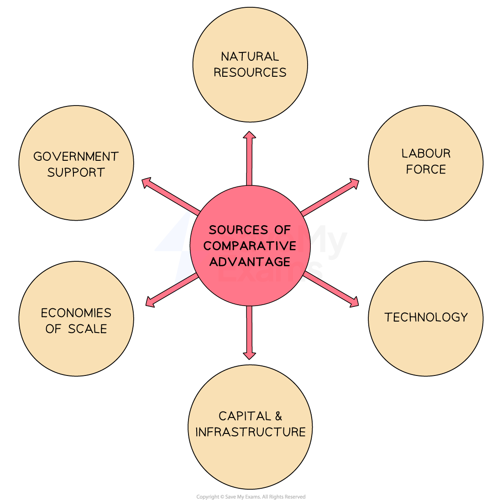

# Absolute & Comparative Advantage

## What is absolute and comparative advantage?

> **Spec point** — `spcpt_8kPwF4ZV2NV4SzYQ`

## What is absolute and comparative advantage?

- International trade occurs when countries exchange goods and services across national borders
- Countries trade because they differ in their ability to produce goods efficiently - these differences create the basis for *specialisation* and mutual gain

### Absolute advantage

- **A country has an absolute advantage in the production of a good if it can produce more of it than another country using the same quantity of resources**

  - Example: if Country X produces 100 units of wheat per worker and Country Y produces 60 units per worker, Country X has absolute advantage in wheat

### Comparative advantage

- **A country has a comparative advantage in the production of a good if it can produce it at a lower *****opportunity cost***** than another country**

  - Opportunity cost is the key concept — not the absolute quantity produced
  - A country can have comparative advantage in a good even if it has absolute advantage in nothing
  - Comparative advantage, not absolute advantage, determines the basis for beneficial trade

#### The distinction between absolute and comparative advantage

|   | Absolute advantage | Comparative advantage |
|---|---|---|
| Based on | - Quantity of output per unit of resource | - Opportunity cost of production |
| Determines | - Which country is more productive | - Which country should specialise in what |
| Basis for trade? | - Not sufficient alone | - The true basis for international trade |

## The sources of comparative advantage

> **Spec point** — `spcpt_FhKsxR9xCbQtZ56F`

## The sources of comparative advantage

- The sources of comparative advantage **can vary from country to country,** but some common factors include

*Common sources of comparative advantage *

### Natural resources

- Countries with abundant natural resources, such as **minerals, energy sources, fertile land or water bodies**, may have a comparative advantage in industries that utilise these resources

  - E.g. Ukraine has very fertile farmland and a climate conducive to growing grain

### Labor force

- The **quality, skills and cost of labor** can be a significant source of comparative advantage

  - Countries with a **skilled workforce** in specific industries, such as technology, **engineering** or manufacturing, may have a competitive edge in those sectors
  - Countries with **lower labour costs **may have a comparative advantage in *labour-intensive* industries

### Technology

- Access to **advanced technology, *****innovation ***and **research capabilities** can create a comparative advantage

### Capital and infrastructure

- The availability and quality of capital and infrastructure, such as **transportation networks, communication systems **and **reliable *****utilities***, can contribute to a comparative advantage

  - Well-developed infrastructure **facilitates efficient production, distribution and connectivity,** giving countries an edge in international trade

### Economies of scale

- Companies or countries that can achieve ***economies of scale*** in production have a comparative advantage

  - Spreading *fixed costs* over a larger output, **reduces *****unit costs ***and allows firms to offer competitive prices in the global market

### Government policies and support

- Government policies, such as ***trade agreements*****, *****subsidies*****, *****tax incentives*****, and *****intellectual property protections***, can influence a country's comparative advantage

  - Strategic government support **can help industries develop and compete** in the global market

## Calculating comparative advantage

> **Spec point** — `spcpt_6s29knKThC9YTnhF`

## Calculating comparative advantage

- Comparative advantage is identified by calculating and comparing the **opportunity cost** of producing each good in each country

  - The country with the **lower opportunity cost** in a good has the comparative advantage in that good and should specialise in its production
- Each worker can only produce one good at a time

  - The opportunity cost of producing one unit of a good is the quantity of the other good that same worker could have produced instead

The table shows the output per worker per week in two countries

|   | Wheat (tonnes) | Cars |
|---|---|---|
| Country X | 4 | 2 |
| Country Y | 8 | 6 |

**Country X opportunity costs:**

- 1 tonne of wheat - the worker could have made 2/4 = **0.5 cars**
- 1 car - the worker could have produced 4/2 = **2 tonnes of wheat**

**Country Y opportunity costs:**

- 1 tonne of wheat - the worker could have made 6/8 = **0.75 cars**
- 1 car - the worker could have produced 8/6 = **1.33 tonnes of wheat**

**Comparing opportunity costs:**

|   | Opportunity cost of 1 tonne of wheat | Opportunity cost of 1 car |
|---|---|---|
| Country X | 0.5 cars | 2 tonnes of wheat |
| Country Y | 0.75 cars | 1.33 tonnes of wheat |

- Country X has comparative advantage in **wheat** - it gives up only 0.5 cars per tonne vs 0.75 in Y
- Country Y has comparative advantage in **cars** - it gives up only 1.33 tonnes of wheat per car vs 2 in X
- Country X has **absolute advantage in both goods** - its workers produce more of both per week - yet both countries still gain from specialisation and trade because their **opportunity costs differ**

> **Worked Example**
> The table shows the factor inputs required to produce one tonne of wheat and one car in countries X and Y:
> 
> |   | Factor inputs per tonne of wheat | Factor inputs per car |
> |---|---|---|
> | Country X | 4 | 2 |
> | Country Y | 8 | 6 |
> 
> *What makes it possible for both countries to benefit from trade?*
> 
> A. Country X has an absolute advantage in wheat and car production
> 
> B. Country Y has an absolute advantage in wheat and car production
> 
> C. Country Y has a comparative advantage in wheat production
> 
> D. Opportunity cost of wheat and car production is the same between countries
> 
> **Final answer:** **Answer: C**
> 
> **Worked solution:**
> 
> - This question uses a factor inputs table rather than an output table - fewer inputs per unit means greater efficiency
> - The method is the same: calculate opportunity cost ratios and compare
> 
>   - Country X: opportunity cost of 1 tonne of wheat = 4/2 = **2 cars forgone**
>   - Country Y: opportunity cost of 1 tonne of wheat = 8/6 = **1.33 cars forgone**
>   - Country X: opportunity cost of 1 car = 2/4 = **0.5 tonnes of wheat forgone**
>   - Country Y: opportunity cost of 1 car = 6/8 = **0.75 tonnes of wheat forgone**
> 
> Now eliminate each option:
> 
> - Option A - X requires fewer inputs for both goods so does have absolute advantage in both. True, but absolute advantage alone does not create the basis for mutually beneficial trade. Eliminated
> - Option B - Y requires more inputs for both goods so has absolute advantage in neither. Factually incorrect. Eliminated
> - Option C - Y's opportunity cost of wheat is 1.33 cars; X's is 2 cars. Y gives up fewer cars to produce wheat, so **Y has comparative advantage in wheat**. Correct
> - Option D - Opportunity costs differ between countries (2 cars vs 1.33 cars for wheat). If they were identical, there would be no basis for trade at all. Eliminated
> 
> The trap is option A - students who identify that X has absolute advantage in both goods may assume this explains the gains from trade. It does not. Mutually beneficial trade requires only that opportunity costs **differ** between countries, not that one country is more productive overall.

> **Exam Hint**
> Always show your opportunity cost calculations explicitly - do not just state which country has comparative advantage.
> 
> In MCQs the calculation takes seconds and eliminates wrong answers with certainty; in data response questions the working must be shown to access marks.
> 
> The most common error is confusing absolute and comparative advantage. A country can have absolute advantage in every good and still benefit from specialising where its opportunity cost is lowest. The key test is always: which country gives up less of the other good to produce one unit of this good?
> 
> If opportunity costs are identical between countries there is no basis for trade.

## Limitations to the theory of comparative advantage

> **Spec point** — `spcpt_sTmHG8zjNXVNFtgT`

## Limitations to the theory of comparative advantage

- The theory assumes **complete specialisation**

  - In practice countries rarely specialise entirely in one good as this creates vulnerability to *demand shocks* and supply disruptions
- The theory assumes **constant opportunity costs**

  - In reality opportunity costs rise as resources are reallocated, meaning gains from specialisation diminish as production expands
- The theory assumes **no transport costs**

  - In practice trade costs can eliminate the price advantage gained from specialisation
- The theory assumes **perfect factor mobility**

  - In reality labour and capital cannot move freely between industries, meaning reallocation is slow, costly and politically difficult
- The theory is **static**

  - It describes comparative advantage at a point in time but ignores how productivity changes through investment and innovation over time
  
    - A country may have comparative advantage in a low-value *primary good* today but could develop advantage in higher-value industries over time
    - This is the basis for the *infant industry* argument covered in 6.2
- The theory ignores **economies of scale**

  - Countries may benefit from producing goods in which they do not currently have comparative advantage if large-scale production would eventually reduce unit costs sufficiently
- The theory assumes **free trade**

  - In practice *tariffs*, *quotas* and subsidies distort relative prices and prevent countries from trading at their comparative advantage
