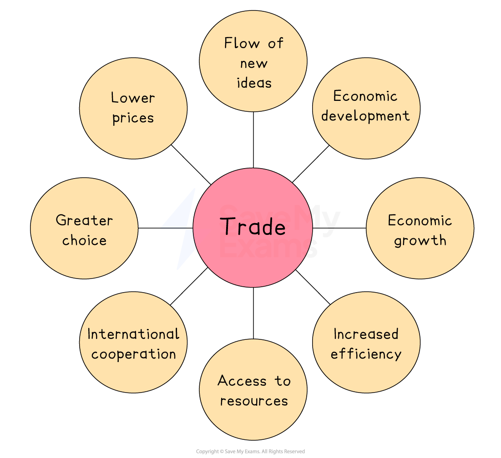
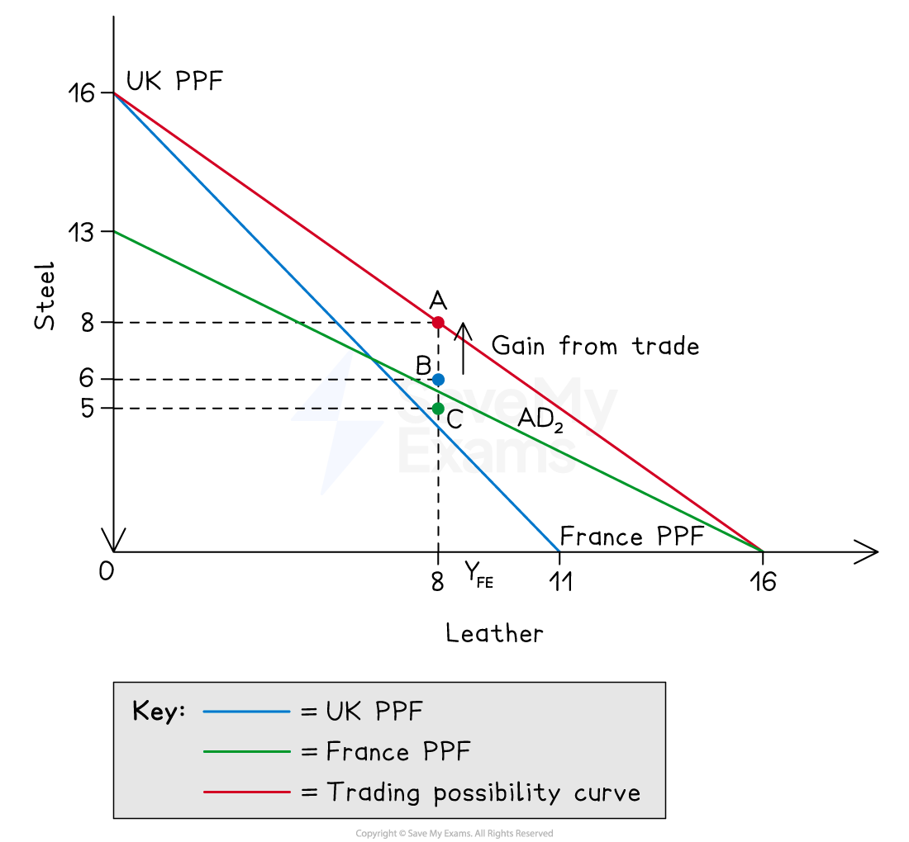

# Specialisation & Trade Liberalisation

## What is specialisation?

> **Spec point** — `spcpt_KCrJVTvrZ3tkrFMq`

## What is specialisation?

- **Specialisation is the process by which countries focus their productive resources on the goods and services in which they have a comparative advantage, trading surplus output with other nations **

  - When countries specialise in goods where they have a comparative advantage, total world output increases
  - Specialisation allows countries to exploit ***economies of scale*** - concentrating production lowers average costs as output rises
  - Specialisation drives **dynamic efficiency** - competition in world markets incentivises firms to *innovate* and improve productivity
  - Countries gain access to a wider variety of goods than they could produce domestically, increasing consumer choice and welfare

## Free trade (trade liberalisation)

> **Spec point** — `spcpt_vj5WGpZr9P2SNnfm`

## Free trade (trade liberalisation)

- **Trade liberalisation is the removal of barriers to international trade - such as *****tariffs*****, *****quotas ***and ***subsidies *****- allowing goods and services to flow freely between countries at world prices**

- International trade refers to the **exchange of goods and services** between countries

  - **Exports **are goods and services sold to overseas buyers - goods leave the country and money flows in
  - **Imports **occur when foreign goods and services are bought by domestic households and firms - money leaves the country and goods enter

- **International trade **is 'free' when there is no government intervention (quotas, taxes etc.) to reduce or limit trade

*The benefits of free trade*

- **Greater choice: **with access to a wider variety of goods and services, the *standard of living* improves
- **Lower prices:** with international competition prices fall, giving households the ability to buy more
- **International cooperation:** required for trade helps countries to build better relationships which leads to lower levels of hostility
- **Flow of new ideas: **innovative ideas and technology can be shared between countries
- **Access to resources:** output can increase and costs of production can fall with increased access to raw materials
- **Increased efficiency: **international competition allows the most efficient firms to emerge and this improves the use of global resources
- **Economic growth:** exports are a key component of the *gross domestic product* of many countries and an increase in exports can lead to economic growth
- **Economic development:** Increased output leads to lower levels of unemployment, which leads to higher incomes and a higher standard of living

## The trading possibility curve

> **Spec point** — `spcpt_8vFTn8YGTkK7CyrC`

## The trading possibility curve

- **The trading possibility curve shows the combinations of two goods a country can consume after specialising and trading - consumption possibilities that lie beyond its own PPF**

*The trading possibility curve*

### Diagram analysis

- Without trade, the UK produces and consumes **on its own PPF**

  - It could choose point C (5 steel, 8 leather)
- Without trade, France produces and consumes **on its own PPF**

  - It could choose point C (6 steel, 8 leather)
- The trading possibility curve (red line) runs from (0 steel, 16 leather) to (16 steel, 0 leather), lying beyond both national PPFs
- The UK has a **comparative advantage in steel **(steeper PPF); **France has a comparative advantage in leather** (flatter PPF)
- If both countries specialise completely, the UK produces 16 steel and zero leather; France produces 16 leather and zero steel

  - **Combined world output** rises to 16 units of steel and 16 units of leather, more than either country could produce alone

- Both countries can **now consume at point A** (8 steel, 8 leather)

  - A combination neither could reach independently
  - The UK produces 16 million units of steel and exports 8 million to France; employment shifts towards steel production
  - France produces 16 million units of leather and exports 8 million to the UK; employment shifts towards leather production
- The gain from trade is the movement from B and C up to point A

  - Higher consumption of both goods for both countries

> **Exam Hint**
> The trading possibility curve is distinct from a PPF - the PPF shows what a country can *produce* alone; the trading possibility curve shows what it can *consume* after trade. Always make this distinction explicit and label your diagram clearly with both curves.
> 
> When asked to explain the gains from trade using a diagram, identify three things: the pre-trade consumption points on each country's PPF, the trading possibility curve lying beyond both PPFs, and the post-trade consumption point that both countries can now reach. A common error is to draw only one PPF and miss the key comparison entirely.
> 
> The trading possibility curve assumes complete specialisation - in practice countries rarely specialise fully. If asked to evaluate the benefits of free trade, this is a strong limitation to develop: adjustment costs, structural unemployment as industries contract, and vulnerability to supply shocks all arise from over-specialisation.
