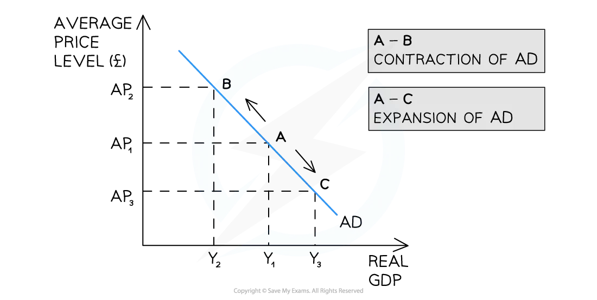
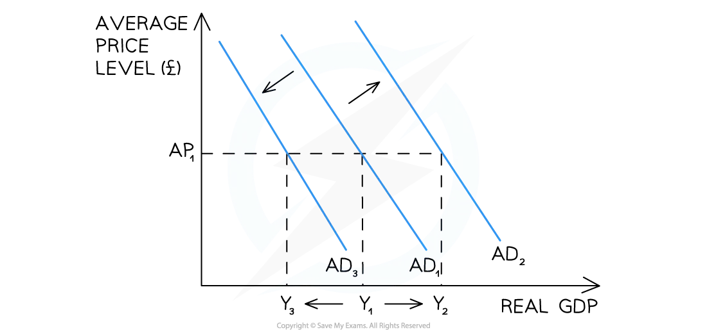
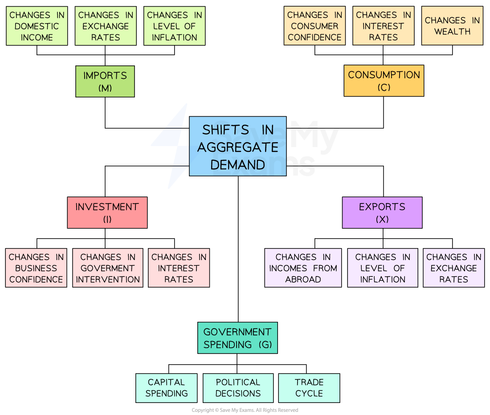

# Aggregate Demand

## An introduction to aggregate demand (AD)

> **Spec point** — `spcpt_tjmdRx2XygXfnvT2`

## An introduction to aggregate demand (AD)

- **Aggregate demand (AD) is the total demand for all goods and services in an economy at any given average price level**
- Its value is often calculated using the **expenditure approach**

  - AD = Consumption (C) + Investment (I) + Government spending (G) + (Exports-Imports) (X-M)
  - **AD = C + I + G + (X-M)**
- **Consumption** is the total spending on goods and services by consumers (households) in an economy
- **Investment** is the total spending on capital goods in an economy

  - This includes spending by firms on machinery, equipment and buildings
  - It also includes household spending on new housing
  - It includes changes in inventories (stocks of goods held by firms)
- **Government spending **is the total spending by the government in the economy

  - Includes *public sector* salaries, payments for provision of merit and public goods etc.
  - It does not include ***transfer payments***
- **Net exports** are the difference between the revenue gained from selling goods or services abroad and the expenditure on goods or services from abroad

  - Individuals, firms and governments export and import
- The relationship between the **average price level **and the **total output** in an economy is shown with an aggregate demand (AD) curve

### Aggregate demand (AD) curve for an economy

* Average Price Level on the Y axis and Real GDP or Real National Output on the X axis*

## Movements along the aggregate demand curve

> **Spec point** — `spcpt_GznnRt6p2PGzZXNm`

## Movements along the aggregate demand curve

- **Whenever there is a change in the average price level (AP) in an economy, there is a movement along the aggregate demand (AD) curve**

*A change in AP causes a movement along the aggregate demand (AD) curve, leading to a contraction or expansion of AD*

### Diagram analysis

- An **increase** in the AP (*ceteris paribus*) from AP1 → AP2 leads to a movement along the AD curve from A → B

  - There is a** contraction **of real GDP from Y1 → Y2
- A **decrease** in the AP (ceteris paribus) from AP1 → AP3 leads to a movement along the AD curve from A → C

  - There is an **expansion** of real GDP (output) from Y1 → Y3

> **Exam Hint**
> Always distinguish between a **movement along** the AD curve and a **shift** of the AD curve. A change in the average price level causes a movement along - a change in any determinant (*interest rates*, confidence, *exchange rates*, *fiscal policy*) causes the whole curve to shift. Mixing these up is one of the most common errors in AD/AS questions.

## Factors that cause the entire AD curve to shift

> **Spec point** — `spcpt_RXSwdNQQT9vw3bvJ`

## Factors that cause the entire AD curve to shift

- Whenever there is a change in any of the ***determinants of aggregate demand***    (AD) in an economy, there is a **shift **of the entire AD curve

*An increase in any of the determinants of AD will cause the AD curve to shift right - and vice versa*

### Diagram analysis

- An **increase** in any one of the determinants of aggregate demand (AD) results in a shift **right **of the entire curve from **AD****1**** → AD****2**

  - At every price level, real GDP has **increased **from Y1 → Y2
- A **decrease **in any one of the determinants of AD results in a shift **left **of the entire curve from **AD****1**** → AD****3**

  - At every price level, real GDP has **decreased** from Y1 → Y3

#### The determinants of aggregate demand

- **AD = *****Consumption*** **(C)** + ***investment*** **(I) **+ ***Government Spending*** **(G) **+ (Exports **(X)** - Imports **(M)**)
- Each of these components are influenced by a range of factors and any change to one of them has the potential to shift the aggregate demand curve
- If numerous factors change at the same time, the net effect will determine which way- and how far- the aggregate demand shifts

#### Factors that affect each determinant

*When multiple factors change at the same time, the net effect will determine which way the AD curve shifts—and how far. It is easier to analyse the impact of a single change*

### The key determinants and their transmission mechanisms

#### Interest rates

- A rise in interest rates increases the cost of borrowing and raises the return on saving, reducing consumption (C) and reducing firm investment (I); AD shifts left - falling interest rates have the reverse effect

#### Consumer confidence

- A fall in confidence leads households to reduce spending and increase *precautionary saving*, reducing consumption (C) and shifting AD left - rising confidence has the reverse effect

#### Business confidence

- A fall in confidence reduces firms' willingness to invest in new capital, reducing investment (I) and shifting AD left - rising confidence has the reverse effect

#### Exchange rates

- An appreciation of the exchange rate makes exports more expensive abroad and imports cheaper domestically, reducing exports (X) and increasing imports (M); net exports fall and AD shifts left - depreciation has the reverse effect

#### Government fiscal policy

- An increase in government spending (G) or a cut in taxation raises household *disposable income* and consumption (C), shifting AD right - a cut in spending or rise in taxation shifts AD left
