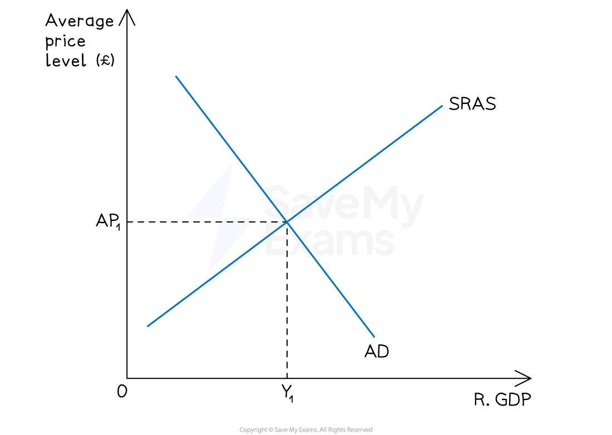
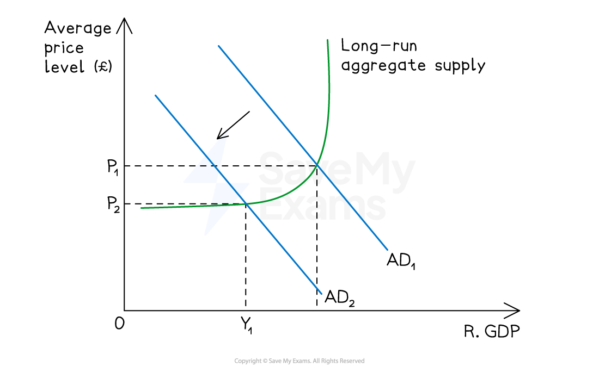
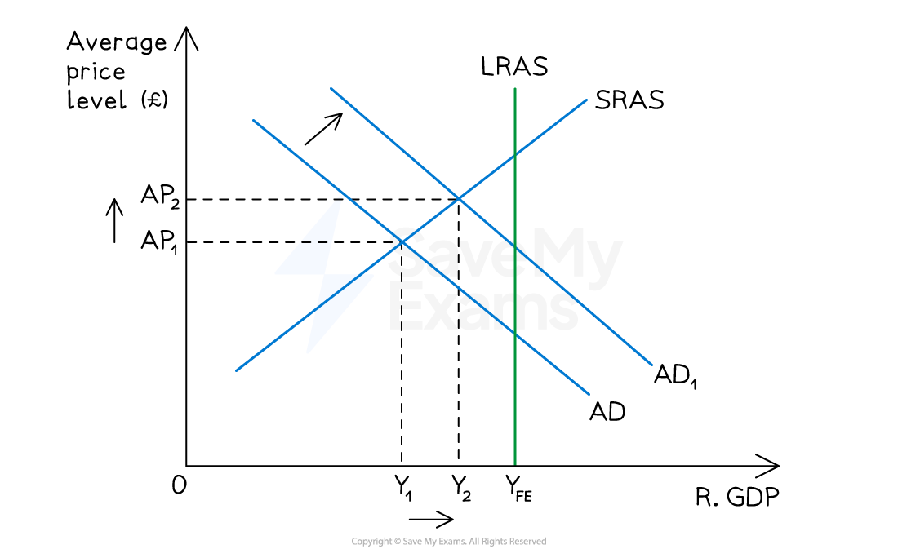
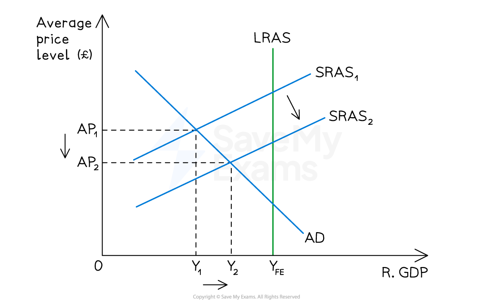

# Macroeconomic Equilibrium

## Short-run macroeconomic equilibrium

> **Spec point** — `spcpt_5QmHHCyDZTpkY4CF`

## Short-run macroeconomic equilibrium

- Real national output equilibrium occurs where **aggregate demand** (AD) intersects with **short-run aggregate supply **(SRAS)

*A diagram showing short-run equilibrium in an economy at an equilibrium price level of AP1 and real output of Y1*

### Diagram analysis

- This economy is in **short run equilibrium** at AP1Y1
- Any changes to the components of AD will cause the AD curve to shift left or right, creating a** new short-run equilibrium**
- Any changes to the determinants of SRAS will shift the SRAS curve left or right, creating a** new short-run equilibrium**
- The level of **employment** in the economy is determined by the equilibrium level of output - at Y1, firms require a corresponding level of workers to produce that output

  - If equilibrium output rises, employment rises; if equilibrium output falls, employment falls

## Long-run macroeconomic equilibrium

> **Spec point** — `spcpt_8qK7nrjNVRD39P4M`

## Long-run macroeconomic equilibrium

- **Free market economists** believe that the economy will **always return to its normal capacity level of output**

  - In the short-run, there will be fluctuations around this capacity level of output
  - In the long-run, the economy will return to this normal capacity level of output, but perhaps at a different **average price level**
- It is important to understand the long-run macroeconomic equilibrium as it is used to identify ***positive*** and ***negative*** output gaps in an economy (this is covered in more detail later on)

*A diagram that shows the free market view of long-run equilibrium which occurs at the intersection of long-run aggregate supply (LRAS), short-run aggregate supply (SRAS) & aggregate demand (AD)*

### Diagram analysis

- The **LRAS **curve demonstrates the **normal capacity level of output** of the economy using all of its **scarce resources**
- The **SRAS intersects with AD **at the LRAS curve
- This economy is producing at the **full employment level **of output (YFE)
- The **average price level **at YFE is AP1

## Keynesian long-run equilibrium

> **Spec point** — `spcpt_sNVMBDNqs5BcZbBB`

## Keynesian long-run equilibrium

- The Keynesian view challenges the classical assumption that the economy will always return to full employment output
- **In the Keynesian model, the economy can settle in long-run equilibrium below full employment** - where AD intersects the elastic section of the Keynesian LRAS

  - At this point, there is significant spare capacity and unemployment in the economy
  - The price level is stable because spare resources can be brought into production without bidding up *factor prices*
  - The economy will not automatically self-correct - without government intervention it may remain at this low output equilibrium indefinitely

### Diagram analysis

- The economy is initially in equilibrium at P1YFE - at the full employment level of output on the vertical section of the Keynesian LRAS

  - A fall in AD causes the AD curve to shift left from AD1 to AD2
  - The new equilibrium is at P2Y1 - below the full employment level of output YFE
  - There is now a **negative output gap** equal to Y1YFE - the economy is producing below its potential
- The price level has fallen from P1 to P2 - the economy is on the upward-sloping section of the Keynesian LRAS where both output and price level changes occur
- Unlike the classical model, **the economy will not automatically return to Y****FE** - wages and prices are sticky downwards and the self-correction mechanism breaks down at low levels of output
- This provides the Keynesian justification for **government intervention** - an increase in AD via *expansionary fiscal policy* can shift AD2 back rightward, raising output and employment back towards YFE

## Aggregate demand and supply analysis

> **Spec point** — `spcpt_CRh6MH45QRwzzbBk`

## Aggregate demand and supply analysis

### 1. An increase in aggregate demand (AD)

*An increase in aggregate demand*

#### Diagram analysis

- The **initial equilibrium** level of output was at **AP****1****Y****1**
- An** increase **in one of the components of ***AD*** (e.g. consumption) causes the AD to **increase AD****1****→AD****2**
- **Average prices** in the economy rise to **AP****2** and the real level of **output increases to Y****2**
- The new **short-run equilibrium** is at AP2Y2
- As output rises from Y1 to Y2, firms require more workers to meet higher demand - **employment rises**; conversely a fall in AD would reduce output and employment

### 2. An increase in short run aggregate supply (SRAS)

*An increase in the short-run aggregate supply (SRAS) causes higher outputs and lower prices*

#### Diagram analysis

- The **initial equilibrium** level of output was at **AP****1****Y****1**

  - This equilibrium represents a** **negative output gap equal to **Y****1****Y****FE**
- An** increase **in one of the determinants of ***SRAS*** (e.g. productivity) causes the SRAS to **increase SRAS****1****→SRAS****2**
- **Average prices** in the economy fall to **AP****2** and the real level of **output increases to Y****2**
- The new **short-run equilibrium** is at **AP****2****Y****2**
- There is still a **negative output gap** but it is smaller **(Y****2****Y****FE****)**
- As output rises from Y1 to Y2, more workers are needed in production - **employment rises** and the negative output gap narrows, meaning unemployment falls though it does not return to zero until YFE is reached

> **Worked Example**
> A government has increased output with no effect on the price level.
> 
> 
> 
> **What must have been the initial level of aggregate demand?**
> 
> A. AD1    B. AD2    C. AD3    D. AD4
> 
> **Final answer:** **Answer: A - AD1**
> 
> **Worked solution**
> 
> This question tests understanding of the Keynesian LRAS and which section of the curve the economy is operating on.
> 
> The key condition in the question is that output increased **with no effect on the price level**. This can only occur on the **highly elastic (flat) section** of the Keynesian LRAS - where there is significant spare capacity and unemployment, so firms can increase output by drawing on idle resources without bidding up factor prices.
> 
> - If AD shifts right from a position on the elastic section, real output rises, but the price level remains unchanged
> - If the economy were already on the upward-sloping or vertical section, any rightward shift in AD would raise the price level

> **Exam Hint**
> Always state the effect on **all three variables** when analysing an AD or AS shift - real output, the price level, and employment.
> 
> A common error is to identify the new equilibrium price and output but forget employment entirely. Remember that employment moves in the same direction as real output - rising output means firms need more workers; falling output means fewer workers are needed.
> 
> For the Keynesian model, always identify which section of the LRAS the economy is operating on before analysing the effect of an AD shift. A rightward shift in AD on the elastic section raises output without raising prices and increases employment - the same shift on the vertical section is purely inflationary with no output or employment effect.
