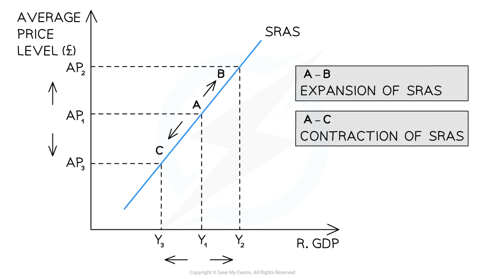

# Short Run Aggregate Supply (SRAS)

## An Introduction to short-run aggregate supply (SRAS)

> **Spec point** — `spcpt_GS2qphTnkK4w7cp6`

## An Introduction to short-run aggregate supply (SRAS)

- **Aggregate supply (AS) is the total volume of goods and services that firms in an economy are willing and able to produce at a given price level over a given time period**

  - It represents the relationship between the average price level and the real output that producers supply
  - In the short run, at least one factor of production is fixed - typically capital

### The short-run aggregate supply curve

*The SRAS is upward-sloping. As price levels rise, firms are incentivised to supply more *

### Diagram analysis

- The SRAS curve is **upward sloping** - as the average price level rises, firms are incentivised to increase output
- Two reasons explain the upward slope:

  - The SRAS is the **combined supply** of all individual firm supply curves in the economy, which are also upward sloping
  - As firms increase output towards full capacity, ***unit costs***** of production rise** - less efficient resources are brought into use and *factor prices* are bid up, so firms require higher prices to justify supplying more

## A movement along the SRAS curve

> **Spec point** — `spcpt_v9ZjRxfbSCy9jJNM`

## A movement along the SRAS curve

- Whenever there is a change in the average price level (AP) in an economy, there is a **movement along** the **short-run aggregate supply **(SRAS) curve

*An increase or decrease in the average price level (AP) causes a movement along the short-run aggregate supply (SRAS) curve, leading to a contraction or expansion of SRAS*

### Diagram analysis

- **Whenever there is a change in the average price level (AP), there is a movement along the SRAS curve**

  - An **increase** in the AP (*ceteris paribus*) from AP1 to AP2 leads to a movement along the SRAS curve from A to B
  
    - There is an **expansion** of real GDP from Y1 to Y2
  - A **decrease** in the AP (ceteris paribus) from AP1 to AP3 leads to a movement along the SRAS curve from A to C
  
    - There is a **contraction** of real GDP from Y1 to Y3

## Factors that cause the entire SRAS curve to shift

> **Spec point** — `spcpt_dvhCVfJHkTFzbgnw`

## Factors that cause the entire SRAS curve to shift

- Shifts in SRAS are caused by changes in conditions of supply in an economy; this usually means **changes in the costs of production**

  - Changes in the cost of raw materials and energy
  - Changes in *exchange rates* (E/R)
  - Changes in tax rates

*The shift of the entire short-run aggregate supply (SRAS) curve is due to a change in one of the determinants of aggregate supply*

### Diagram analysis

- Shifts in SRAS are caused by changes in the **conditions of supply** - this means changes in the **costs of production** or **productivity**

  - A **decrease in costs** or **increase in productivity** results in a **shift right** of the entire curve from SRAS1 → SRAS2
  
    - At every price level, output and real GDP have increased from Y1 → Y2
  - An **increase in costs** or **decrease in productivity** results in a **shift left **of the entire curve from SRAS1 → SRAS3
  
    - At every price level, output and real GDP have decreased from Y1 → Y3

> **Exam Hint**
> Always distinguish between a **movement along** the SRAS curve and a **shift** of the SRAS curve. A change in the average price level causes a movement along - a change in any determinant of supply (costs, wages, tax rates, exchange rates, *productivity*) causes the whole curve to shift.
> 
> For shift questions, always identify the effect on **costs of production** first, then state the direction of the shift and the impact on real output at every price level. The exchange rate determinant is frequently tested and often missed - a depreciation raises import costs, shifting SRAS left even if domestic conditions are unchanged.

## The determinants of short-run aggregate supply

> **Spec point** — `spcpt_Gsq43mRXpmk7Fh53`

## The determinants of short-run aggregate supply

- Whenever there is a change in the **conditions of supply** in an economy, there is a shift of the entire SRAS curve
- The key determinants are changes in costs of production and productivity

| Factor | Explanation | Impact on SRAS |
|---|---|---|
| **Cost of raw materials and energy** | - A rise in input costs means fewer goods and services can be produced with the same expenditure; a fall in input costs has the reverse effect | - Rise in costs - curve shifts left; fall in costs - curve shifts right |
| **Wage rates** | - Wages are the largest cost for most firms; a rise in wages increases costs of production and reduces output at every price level; a fall in wages has the reverse effect | - Rise in wages - curve shifts left; fall in wages - curve shifts right |
| **Tax rates on firms** | - Taxes represent an additional cost of production; a rise in tax rates increases costs and reduces output; a cut in tax rates has the reverse effect | - Rise in taxes - curve shifts left; cut in taxes - curve shifts right |
| **Exchange rates** | - A depreciation of the exchange rate raises the cost of imported raw materials and energy, increasing production costs; an appreciation has the reverse effect | - Depreciation - curve shifts left; appreciation - curve shifts right |
| **Productivity** | - A rise in productivity means more output can be produced from the same inputs, reducing unit costs; a fall in productivity has the reverse effect | - Rise in productivity - curve shifts right; fall in productivity - curve shifts left |

> **Case Study**
> ** The impact of sterling depreciation on UK SRAS - Brexit 2016**
> 
> **The context**
> 
> In June 2016, the UK voted to leave the European Union. The result triggered an immediate and sharp depreciation of sterling - the pound fell by approximately 10-15% against the US dollar and euro within days of the *referendum* result, reaching its lowest level against the dollar in over 30 years.
> 
> 
> 
> **The transmission to SRAS**
> 
> The UK economy is heavily dependent on imported raw materials, energy and intermediate goods. When sterling depreciated:
> 
> - The cost of importing raw materials and energy rose sharply in pound terms
> - Manufacturing and production costs increased across the economy as a result
> - Rising input costs shifted SRAS to the left - firms could supply less output at every price level
> 
> **The outcome**
> 
> - UK *inflation* rose from around 0.5% in mid-2016 to over 3% by late 2017, driven in part by higher import costs feeding through into production prices
> - The Office for National Statistics noted that import price inflation was a significant contributor to the rise in the *Consumer Prices Index* during this period
> - *Real wages* fell as price inflation outpaced wage growth - households faced a squeeze on *purchasing power*
> 
> **What this illustrates**
> 
> The Brexit depreciation is a clear real-world example of a ***negative supply shock*** - a currency movement that raised production costs and shifted SRAS left, generating *cost-push inflation* without any increase in productive capacity. It also illustrates that exchange rate changes affect both AD (via net exports) and SRAS (via import costs) simultaneously - making the overall macroeconomic effect difficult to predict with precision.
