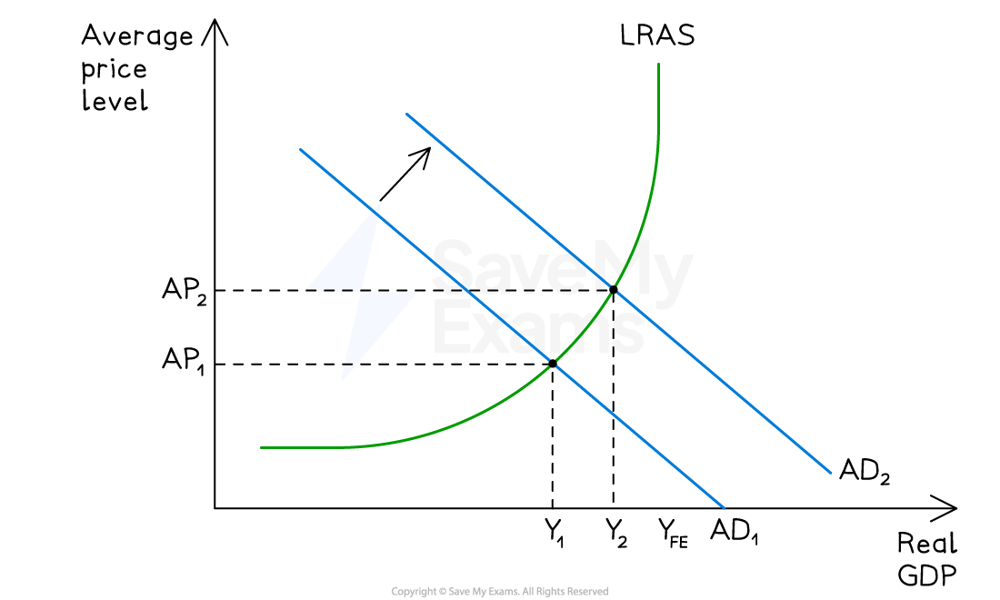
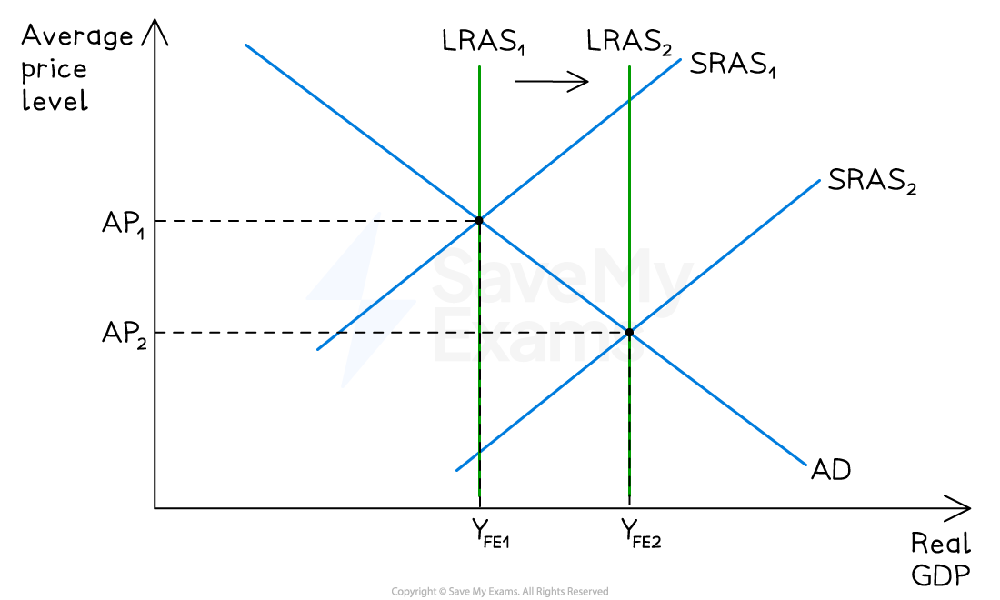

# Policies to Promote Economic Growth

## Introduction: two types of growth

> **Spec point** — `spcpt_fdVMystM8m3nYCZf`

## Introduction: two types of growth

- **Actual growth**  - is an increase in real GDP from using existing resources more fully (AD-driven, short-run)
- **Potential growth** - is an increase in productive capacity of the economy (LRAS-driven, long-run)
- Policies to promote growth fall into two categories:

  - **Demand-side policies** (fiscal and monetary)
  
    - These primarily boost actual growth by shifting AD right
  - **Supply-side policies** (market-based and interventionist)
  
    - These primarily boost potential growth by shifting LRAS right
- Effective long-run growth strategy usually requires a combination of both

## 1. Demand-side policies

> **Spec point** — `spcpt_ZtrmMbh4DssDfK3J`

## 1. Demand-side policies

### Expansionary fiscal policy

- Increase in government spending (G) or cuts in taxation (T) raise AD
- Higher disposable income raises consumption (C); lower *corporation tax* raises investment (I)
- *Multiplier effect* amplifies the initial injection

### Expansionary monetary policy

- Cut in interest rates reduces cost of borrowing and return on saving

  - Raises consumption (C) — households borrow more, save less
  - Raises investment (I) — firms face lower cost of capital
- *Quantitative easing* increases money supply and lowers long-term *yields*
- Currency may depreciate, raising net exports (X-M)

*Expansionary demand side policy*

#### Diagram analysis: demand-side policies

- Economy is initially in equilibrium at AP₁Y₁ with a negative output gap (Y₁YFE)
- Expansionary demand-side policy shifts AD right from AD₁ to AD₂

  - Real GDP rises from Y₁ to Y₂ and the average price level rises from AP₁ to AP₂
  - **Employment rises** as firms hire more workers to meet the higher output
- The negative output gap narrows and the economy moves closer to full employment

## 2. Supply-side policies

> **Spec point** — `spcpt_YKkK2yCcYMPMmqwj`

## 2. Supply-side policies

### Market-based supply-side policies

- Rely on market forces and incentives to improve efficiency
- Key tools:

  - Cuts in income tax and corporation tax to incentivise work and investment
  - *Deregulation *to reduce costs and encourage competition
  - *Privatisation *to improve efficiency through profit incentive
  - *Trade union* reform to improve labour market flexibility
  - Reducing unemployment benefits to incentivise job search

### Interventionist supply-side policies

- Rely on direct government action to expand productive capacity
- Key tools:

  - Government spending on education and training to raise human capital
  - Infrastructure investment (transport, energy, digital) to raise productivity
  - *Subsidies *for R&D to promote *innovation *and technological progress
  - Industrial policy to support strategic sectors

*Supply side policies*

#### Diagram analysis: supply-side policies

- The economy is initially at full employment equilibrium AP₁YFE1
- Successful supply-side policy shifts LRAS right from LRAS₁ to LRAS₂ (and SRAS right)
- Real GDP rises from YFE1 to YFE2 — an increase in potential output
- Average price level falls from AP₁ to AP₂ — non-inflationary growth
- **Employment rises** as productive capacity expands and new jobs are created

## The effectiveness of each policy

> **Spec point** — `spcpt_VbmfRm2s7jKz4jfF`

## The effectiveness of each policy

| Policy | Strengths | Weaknesses |
|---|---|---|
| **Fiscal (expansionary)** | - Powerful multiplier effect - Direct impact on AD - Targets specific regions/sectors | - Time lags (recognition, decision, implementation) - May cause budget deficit and rising national debt - Crowding out of private investment if interest rates rise; inflationary at full employment |
| **Monetary (expansionary)** | - Faster to implement than fiscal - *Central bank* independence reduces political interference | - Transmission lag of 12-18 months - Liquidity trap at very low rates (interest rates cannot fall below zero effectively) - May fuel *asset bubbles* - Depends on consumer and business confidence |
| **Market-based supply-side** | - Improves long-run productive capacity - Non-inflationary growth - Improves international competitiveness | - Long time lags (years/decades for education) - May increase inequality - Deregulation risks (e.g. 2008 financial crisis) - Effects uncertain and hard to measure |
| **Interventionist supply-side** | - Directly targets *market failures* (e.g. underinvestment in education) - Government can take long-term view | - Expensive — raises opportunity cost - Risk of *government failure* - Political interference - Outcomes depend on quality of implementation |

### Key evaluation points

- **Short-run vs long-run**: demand-side policies deliver faster results but may be inflationary; supply-side policies are slower but produce sustainable, non-inflationary growth
- **State of the economy matters**:

  - In recession (spare capacity) — demand-side policies most effective as AD is the constraint
  - At full employment — supply-side policies essential as LRAS is the constraint
- **Policy trade-offs**: expansionary policies may worsen inflation, *current account deficit*, or government debt
- **Keynesian vs Classical view**:

  - Keynesians favour demand-side intervention when economy is below full employment
  - Classicals argue only supply-side policies can raise long-run growth; demand-side policies are purely inflationary in the long run
- **Combined approach**: most economies use a mix -  monetary policy for short-run stabilisation, supply-side for long-run capacity

> **Worked Example**
> **South Korea's growth strategy (1960s - 2000s)**
> 
> **The context**
> 
> In the 1960s, South Korea was one of the poorest countries in the world, with GDP per capita below many sub-Saharan African economies. By 2020, it had become a high-income economy and member of the *OECD*, with GDP per capita exceeding US\$30,000.
> 
> **The policy mix**
> 
> South Korea's government pursued a long-term interventionist supply-side strategy:
> 
> - Heavy public investment in education — literacy rose from around 22% in 1945 to near-universal by the 1980s
> - State-directed investment in heavy industry (steel, shipbuilding, electronics) through subsidised credit to chaebol (conglomerates such as Samsung and Hyundai)
> - Infrastructure investment in transport, ports and telecommunications
> - *R&D* spending rose from under 0.5% of GDP in the 1970s to over 4% by 2020 — among the highest in the world
> 
> **The outcome**
> 
> 
> 
> - Real GDP grew at an average rate of around 7% per year between 1960 and 1997 — one of the fastest sustained growth rates in history
> - LRAS shifted dramatically rightward over decades as human and physical capital accumulated
> - Employment rose as the economy *industrialised *and moved workers from agriculture into manufacturing and services
> 
> **What this illustrates**
> 
> South Korea demonstrates that interventionist supply-side policies, sustained over decades, can transform an economy's productive capacity. Crucially, growth was driven by LRAS expansion rather than AD stimulus — producing non-inflationary, sustainable growth

> **Exam Hint**
> When a question asks about policies to promote growth, always distinguish between actual and potential growth from the outset. Demand-side policies primarily raise actual growth by closing a negative output gap - supply-side policies raise potential growth by expanding productive capacity. Confusing these loses analysis marks.
> 
> For 12-mark "assess" questions, always evaluate each policy's effectiveness using at least two criteria: time lags, the state of the economy (spare capacity vs full employment), and policy conflicts (inflation, debt, current account). A one-sided answer - e.g. "supply-side policies are best because they are non-inflationary" - caps your AO3 at Level 1.
> 
> Top-band answers compare policies directly and reach a supported judgment. For example: "In a recession with spare capacity, fiscal policy is likely more effective because the multiplier raises output without triggering inflation — but in an economy near full employment, supply-side policies are essential because further AD stimulus would simply cause inflation." Always link your judgment to the specific economic context given in the question.

###
