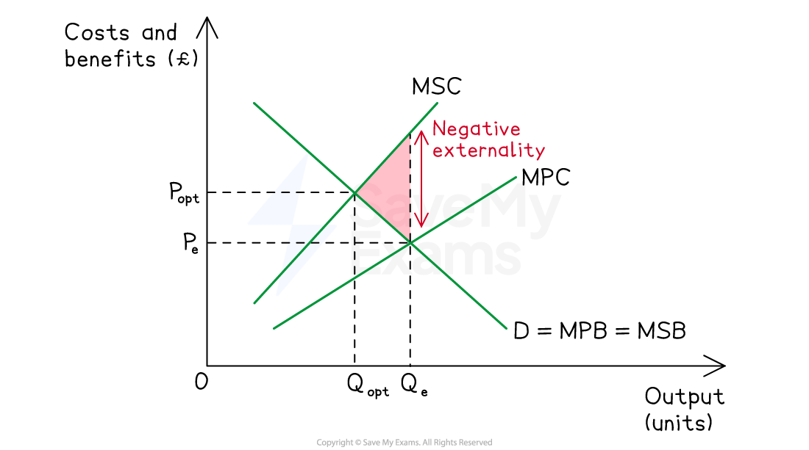

# Sustainable Economic Growth

## What is sustainable economic growth?

> **Spec point** — `spcpt_NsB2dtxbmDZs4ftP`

## What is sustainable economic growth?

- **Sustainable economic growth is growth that meets the needs of the present generation without compromising the ability of future generations to meet their own needs (Brundtland definition)**

  - It requires balancing current output with environmental protection and intergenerational equity

### Using and conserving resources

| Resource type | Characteristic | Condition for sustainable use |
|---|---|---|
| **Non-renewable** (oil, coal, minerals) | - Finite stock | - Develop substitutes - Reinvest revenues in alternatives |
| **Renewable** (forests, fish, solar) | - Regenerate naturally | - Use at rate ≤ regeneration rate |
| **Common access** (atmosphere, oceans) | - No ownership — prone to overuse | - Collective action to prevent *tragedy of the commons* |

### Impact of economic growth on environment and climate

- Growth typically uses more inputs and emits more waste
- These are **negative externalities** where producers and consumers do not bear the full social cost

| Impact | Mechanism |
|---|---|
| **Climate change** | - CO₂ from fossil fuels traps heat - Global temperatures rising |
| **Air and water pollution** | - Industrial emissions and agricultural runoff damage health and ecosystems |
| **Deforestation and biodiversity loss** | - Land cleared for farming, logging, *urbanisation* |
| **Resource depletion** | - Non-renewables consumed faster than substitutes developed |

## Policies to mitigate the environmental impact

> **Spec point** — `spcpt_yDzX9Bc8cCC7Svd3`

## Policies to mitigate the environmental impact

- **The polluter pays principle** sits at the core of most policies

  - Those who generate pollution should bear the cost of damage caused; underpins most environmental policy

#### The externality problem

*A negative externality of production*

- Without intervention, the market produces at Qe where private cost = private benefit
- Socially optimal output is Qopt where **marginal social cost = marginal social benefit**
- The gap between Qe and Qopt is the **welfare loss** — policy aims to close it

#### Market-based policies

| Policy | Mechanism | Real-world example | Limitation |
|---|---|---|---|
| **Carbon/pollution tax** | - Tax per unit of emissions raises private cost toward social cost → firms reduce output or switch to cleaner inputs | - Sweden's carbon tax (US\$130/tonne, 1991) | - Politically unpopular - *Regressive *on low-income households - Hurts competitiveness if unilateral |
| **Tradable pollution permits** (cap-and-trade) | - Government caps total emissions and issues permits; firms that cut emissions cheaply sell permits to firms that cannot → market price emerges on pollution | - **EU Emissions Trading System (EU ETS)** — world's largest carbon market, covers ~40% of EU emissions | - Requires accurate cap - Price volatility - Risk of over-allocation (EU ETS prices collapsed 2008–2017) |
| **Subsidies for clean technology** | - Lowers cost of renewables, EVs, energy efficiency → shifts production and consumption toward cleaner alternatives | - US Inflation Reduction Act (2022) - EU renewable subsidies | - Expensive - Opportunity cost on government budgets - Risk of picking wrong winners |

#### Command-and-control policies

| Policy | Mechanism | Real-world example | Limitation |
|---|---|---|---|
| **Regulation and emissions standards** | - Legal limits on pollution per unit of output - Bans on specific pollutants (e.g. CFCs) | - EU vehicle emissions standards - Montreal Protocol CFC ban | - Enforcement costs - No incentive to exceed standard - Can be inflexible |
| **Direct provision** | - Government supplies green infrastructure (public transport, renewable grid) | - China's high-speed rail - UK offshore wind expansion | - High capital cost - Long payback period |

#### International agreements

- **Paris Accord (2015)** — 196 parties committed to limit global warming to well below 2°C; each country set its own Nationally Determined Contributions
- **Kyoto Protocol (1997)** — earlier binding commitments for developed countries
- **Key challenge — free-rider problem:** countries benefit from others' emissions cuts without bearing their own costs; weak enforcement mechanisms

### Comparing market-based vs command-and-control

|   | Market-based (taxes, permits) | Command-and-control (regulation) |
|---|---|---|
| **Strength** | - Economically efficient — firms cut emissions where it is cheapest to do so - Ongoing incentive to *innovate* | - Certain outcomes — pollution cannot exceed the set limit |
| **Weakness** | - Uncertain quantity of emission cuts (taxes) or uncertain price (permits) | - Economically inefficient — same standard applied regardless of cost; no innovation incentive once standard is met |
| **Best used when** | - Marginal damage of pollution is gradual - Many small polluters | - Marginal damage is catastrophic at thresholds (e.g. ozone-depleting substances) - Few large polluters |

> **Case Study**
> **Costa Rica's green growth model**
> 
> Costa Rica has maintained economic growth while reversing severe environmental damage
> 
> **The policies**
> 
> - **Payment for Ecosystem Services** (Forestry Law 1996) — landowners paid to conserve forests, funded by a fossil fuel tax
> - **Renewable electricity** — over 90% from hydro, *geothermal *and wind
> - **Protected areas** cover ~26% of national territory
> 
> **Outcomes**
> 
> 
> 
> - Forest cover rose from 21% (1987) to 57% (2017) — reversing decades of deforestation
> - GDP per capita rose from ~US\$2,400 (1990) to ~US\$17,000 (2023)
> - GDP growth averaged ~4% annually 1990-2020
> 
> **Limitations**
> 
> - Transport emissions are rising as car ownership grows
> - Agriculture remains a *deforestation *pressure
> - The model relies on favourable geography (hydro potential) and small population
> 
> **Key lesson**
> 
> Sustainable growth is achievable with a policy mix combining pricing (carbon tax), incentives (PES) and protection (reserves) — but requires decades of political commitment.

> **Exam Hint**
> Always frame sustainable growth around intergenerational equity - meeting present needs without compromising future generations.
> 
> For 12-mark evaluation questions, the core trade-off is between short-run growth (often relying on cheap fossil fuels) and long-run sustainability (requiring costly clean alternatives).
> 
> For policy questions, distinguish market-based tools (taxes, *permits*) from command-and-control (regulation, bans) and evaluate which works best given the specific context.
